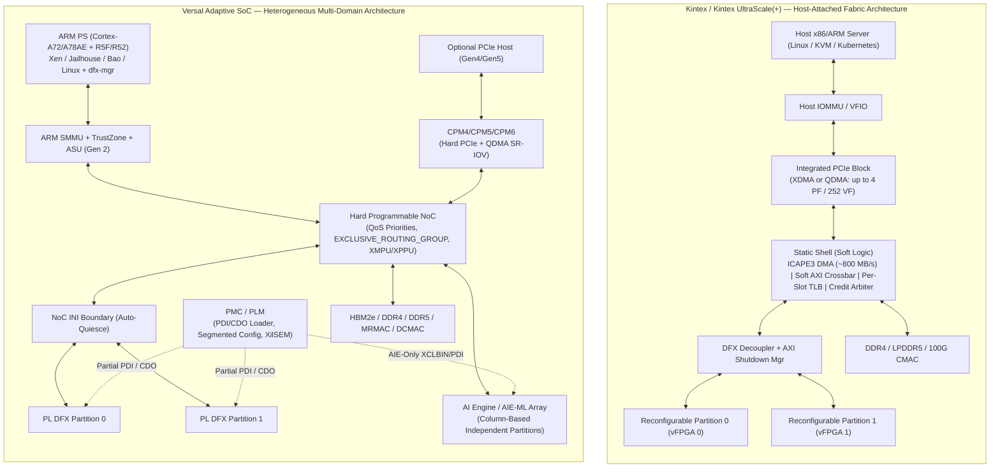
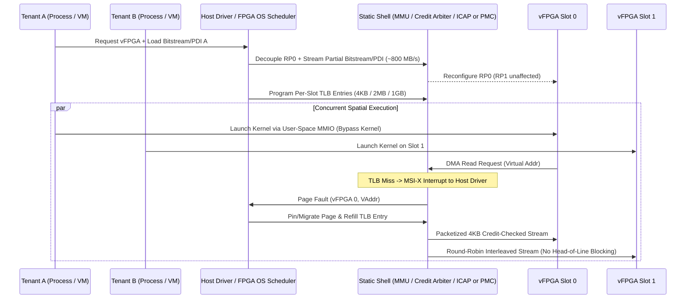
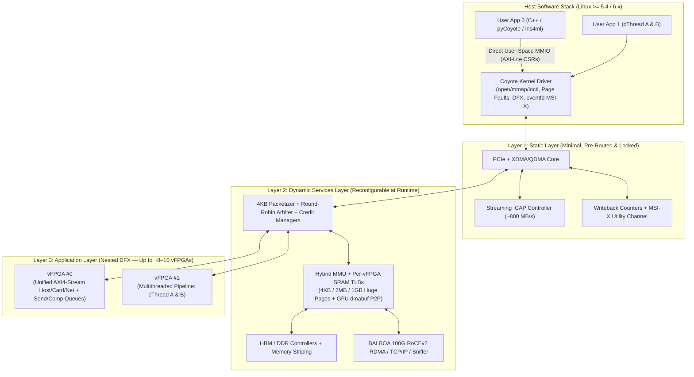
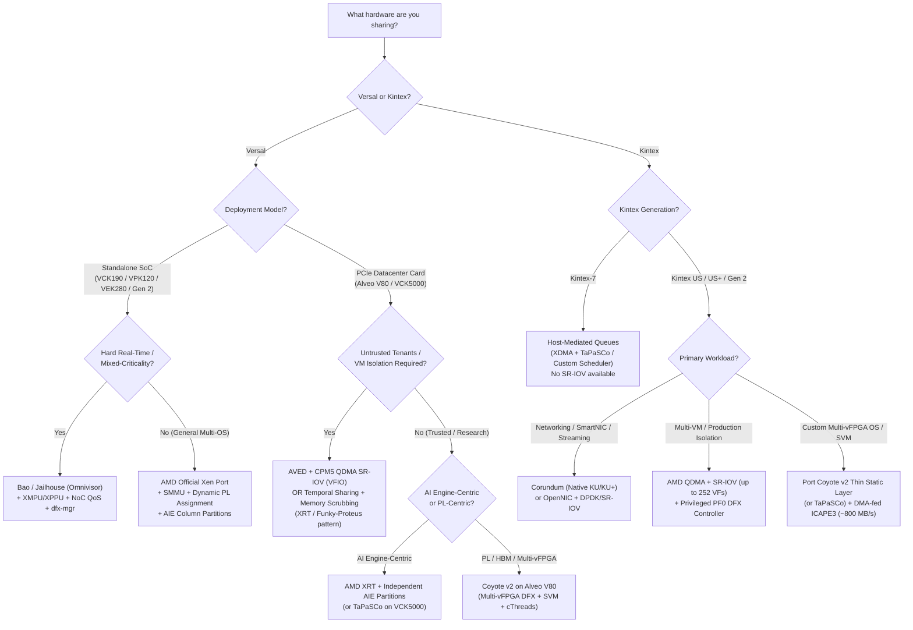

# FPGA Operating Systems & Virtualization for Sharing AMD/Xilinx Versal and Kintex Devices

## 1. Executive Summary

Sharing an FPGA across multiple users, processes, containers, or virtual machines requires an **FPGA Operating System (FPGA OS)**—a co-designed hardware/software layer typically composed of a **static hardware shell** (or hypervisor), **reconfigurable tenant regions**, **memory/I/O virtualization**, **arbitration and QoS hardware**, and **host or embedded kernel drivers and schedulers**.

In practice, designing or adopting an FPGA OS for **AMD/Xilinx Kintex** versus **AMD/Xilinx Versal** involves fundamentally different architectures:

* **Kintex (Kintex-7, Kintex UltraScale, Kintex UltraScale+, and Kintex UltraScale+ Gen 2)** is a **pure programmable-logic (PL) fabric** without a hardened ARM Processing System or hardened Network-on-Chip (NoC). Sharing is almost always **host-centric over PCIe** (or bump-in-the-wire over Ethernet), relying on PCIe DMA/SR-IOV hard blocks, soft AXI crossbars, ICAP/MCAP partial reconfiguration, and host OS drivers.
* **Versal (Prime, AI Core, HBM, Premium, AI Edge, and Gen 2 series)** is a **heterogeneous Adaptive SoC** combining an ARM Processing System (APU + RPU), a hardened Platform Management Controller (PMC/PLM), a hardened **Programmable NoC** with QoS, hardened **CPM4/CPM5/CPM6** PCIe+QDMA engines, and (on AI variants) a 2D **AI Engine (AIE / AIE-ML)** array. Versal can be shared as a **host-attached datacenter card** (e.g., Alveo V80 / VCK5000), as an **autonomous multi-OS embedded server** (running Xen, Jailhouse, or Bao on the ARM PS with hardware-enforced XMPU/XPPU/SMMU/NoC isolation), or via **column-partitioned AI Engine multi-tenancy**.

Across both families, every real-world FPGA OS design navigates a core trilemma between **utilization (spatial density)**, **isolation (security & deterministic performance)**, and **developer ergonomics (compile time, virtual memory, and portability)**:

1. **Trusted / Cooperative Multi-Tenancy** (internal teams, research clusters, microservices): Spatial sharing via **Coyote v2** (Versal V80 / UltraScale+), **AIE independent partitions**, or **TaPaSCo** delivers high utilization and rich OS abstractions (shared virtual memory, RDMA, multithreading).
2. **Untrusted / Production Multi-Tenancy** (cloud VMs, regulated environments): Physical side-channel and voltage-droop fault attacks still preclude untrusted spatial sharing of arbitrary RTL. Production deployments rely on **PCIe QDMA SR-IOV** (fixed/semi-static services mapped to VMs via VFIO), **temporal sharing with full memory scrubbing** (e.g., XRT or unikernel hypervisors like *Funky*/*Proteus*), or **hardware-partitioned SoC domains** (Xen/Bao + XMPU/XPPU on Versal).

---

## 2. Silicon Architecture & Hardware Virtualization Primitives

### 2.1 Generation-by-Generation Hardware Capability Matrix

| Capability | Kintex-7 | Kintex UltraScale | Kintex UltraScale+ | Kintex UltraScale+ Gen 2 *(2026)* | Versal Gen 1 (Prime / AI Core / HBM / Premium) | Versal Gen 2 (AI Edge / Prime / Premium Gen 2) |
| :--- | :--- | :--- | :--- | :--- | :--- | :--- |
| **Hard CPU Cores** | None | None | None | None | Dual Cortex-A72 + Dual Cortex-R5F | Cortex-A78AE + Cortex-R52 (up to 8+10 cores on AI Edge Gen 2) |
| **Hard Interconnect** | None (soft AXI) | None (soft AXI) | None (soft AXI / SmartConnect) | None (soft AXI + hard mem controllers) | Hard Programmable **NoC** + QoS | Enhanced Hard **NoC** + QoS + DDR5/LPDDR5X |
| **PCIe & SR-IOV** | Gen2 x8; **No SR-IOV** | Gen3 x8; up to **2 PF / 6 VF** | Gen3 x16 / Gen4 x8; QDMA up to **4 PF / 252 VF** | **PCIe Gen4**, 2× channel density, CNSA 2.0 security | **CPM4/CPM5** Gen4/Gen5; hard QDMA up to **4 PF / 252 VF** | **CPM5/CPM6** PCIe Gen5/Gen6 (Premium Gen 2), CXL support |
| **Memory Subsystem** | Soft MIG DDR3 | Soft MIG DDR4 | Soft MIG DDR4 + UltraRAM | Hard **LPDDR4X/5/5X** controllers (up to 5× BW) | Hard DDR4/LPDDR4 + **HBM2e** (up to 32 GB @ 810 GB/s on V80) | Hard **DDR5/LPDDR5X** + HBM (series-dependent) |
| **Hard Accelerators** | DSP48E1 | DSP48E2 | DSP48E2, 100G CMAC | 2× DSP density, 100G Ethernet | **AI Engines** (VLIW SIMD), 100G MRMAC, 600G DCMAC, Crypto | **AIE-ML v2** (512 KB mem tiles), **Mali-G78AE GPU**, ISP/VCU |
| **Reconfig Format & Engine** | Bitstream via ICAPE2 | Bitstream via ICAPE3 / MCAP | Bitstream via ICAPE3 / MCAP *(KU19P lacks MCAP PCIe sites)* | Bitstream + enhanced CNSA 2.0 authenticated boot | **PDI + CDO** via hardened **PMC / PLM** | **PDI + CDO** + **Segmented Configuration** (always enabled on AI Edge Gen 2) |
| **Hardware Isolation Units** | PL IDF only | PL IDF + VIV | PL IDF + VIV | PL IDF + authenticated config / anti-cloning | **XMPU, XPPU, SMMU**, TrustZone, NoC QoS, PL IDF | XMPU, XPPU, SMMU, **ASU (Application Security Unit)**, GPU HW Virt |

### 2.2 Reconfiguration Throughput & Latency Mechanics

Fast partial reconfiguration is critical for temporal multiplexing and on-demand accelerator swapping. A common engineering mistake is using default vendor single-word control-plane loaders instead of streaming DMA engines.

| Reconfiguration Mechanism | Target Family | Bus Interface | Peak Throughput | Typical Latency (for a ~10 MB PR Region) | Notes |
| :--- | :--- | :--- | :--- | :--- | :--- |
| **AXI HWICAP** (standard IP) | Kintex-7 / US / US+ | AXI-Lite | **~19 MB/s** | ~525 ms | Bottlenecked by single-word MMIO writes; unsuitable for dynamic multi-tenancy. |
| **PCAP** | Zynq / ZynqMP | AXI | **~128 MB/s** | ~78 ms | Software-driven from PS via Linux FPGA Manager (ZyPR achieves 2–5.4× speedup via non-blocking DMA pipelines). |
| **MCAP** (PCIe Config Space) | UltraScale / UltraScale+ | AXI / PCIe Ext Cap | **~145 MB/s** | ~69 ms | Convenient for Tandem PCIe boot, but slower than DMA-fed ICAP; unavailable on KU19P PCIe sites. |
| **DMA-Fed ICAPE3** (e.g., Coyote v2) | Kintex US+ / Virtex US+ | AXI-Stream (XDMA/QDMA) | **~800 MB/s** | **~12.5 ms** | Saturates ICAPE3 (32-bit @ 200 MHz); reduces reconfiguration latency by >10× vs. stock loaders. |
| **PMC / PLM PDI Loader** | Versal (Gen 1 & Gen 2) | SBI / NoC / CPM5 DMA | High-speed DMA into PMC SBI | Tens of ms (region-dependent) | Configured via partial **PDI** (`write_device_image -cell <rp>`); handles CRAM, NPI, NoC, and AIE CDOs atomically with optional RSA/ECDSA/AES verification. |

### 2.3 DFX Boundary, Decoupling, and Compilation Flows (UG909)

How an FPGA OS isolates a reconfiguring slot from live neighbors differs sharply between Kintex UltraScale+ and Versal:

* **Kintex / UltraScale+ DFX Boundary**:
  * Every AXI/control signal crossing between the static shell and a Reconfigurable Partition (RP) must pass through soft **DFX Decoupler** and/or **DFX AXI Shutdown Manager** IP. Without the Shutdown Manager, an in-flight AXI transaction targeting a slot being reconfigured will never return a response (`BVALID`/`RVALID`), permanently deadlocking the static AXI crossbar and host PCIe root complex.
  * **Abstract Shell + Nested DFX (`pr_subdivide`)**: Vivado supports combining **Abstract Shell** (which strips out unrelated static logic from the checkpoint so tenant builds are 15–20%+ faster and require far less RAM) *with* **Nested DFX** (subdividing a dynamic services layer into child application RPs) **on UltraScale+ devices only**. This is what enables Coyote v2's 3-layer flow (Static → Dynamic Services → Nested vFPGAs).
* **Versal DFX & NoC Boundary**:
  * **NoC Inter-NoC-Interconnect (INI) Auto-Quiescing**: On Versal, if you place the NoC Master/Slave Units (**NMU/NSU**) *inside* the RP so the static–RP boundary cuts across the hardened **NoC INI** rather than PL AXI wires, **NoC quiescing happens automatically** during partial PDI loading—eliminating soft PL `DFX Decoupler` / `DFX AXI Shutdown Manager` overhead. *(Software must still drain outstanding transactions to avoid NMU/NSU AXI handshake timeout interrupts.)*
  * **Multi-RP NoC Contention Warning**: Because the Versal NoC compiler can assign dynamically owned RP paths onto the same physical NoC channels used by static regions, a dynamic tenant can degrade static latency. For multi-RP shells on Versal, AMD (UG909) recommends **keeping boundary NoC path ownership in the static region** and enforcing **`EXCLUSIVE_ROUTING_GROUP`** constraints to isolate physical NoC channels between critical static domains and tenant slots.
  * **Debug Isolation**: In Versal DFX, each static and reconfigurable partition containing ILAs/VIOs requires its own **AXI Debug Hub** connected over a NoC INI interface (crossing a PL decoupler breaks standard debug connectivity).
  * **Segmented Configuration**: Standard on Versal AI Edge Gen 2 (and optional on Gen 1), this separates the boot PDI into a minimal PS/PMC/NoC boot image and a deferred PL image, allowing the OS/hypervisor on the ARM PS to boot rapidly and manage PL partitions dynamically from userspace (`dfx-mgr`).

---

## 3. Taxonomy of FPGA Sharing & Virtualization Models

Modern FPGA OSes combine five orthogonal sharing mechanisms:

1. **Temporal Multiplexing (Time-Sharing)**
   * **Mechanism**: Tenants take turns using the whole FPGA or a single RP. Between quanta, the OS drains queues, flushes off-chip DDR/HBM buffers, and swaps the partial bitstream/PDI.
   * **Context-Switch Challenge**: Unlike CPUs (where architectural state is a few kilobytes of registers), an active FPGA pipeline's state is scattered across hundreds of thousands of flip-flops and megabytes of BRAM/URAM. Hence, most practical systems use **non-preemptive run-to-completion** or **cooperative quiescence** (waiting for a batch/packet boundary) rather than arbitrary mid-cycle preemption.
   * **Best for**: Untrusted cloud tenants, large monolithic accelerators, workloads tolerating 15–100 ms switching latency.

2. **Spatial Multiplexing (Multi-vFPGA / Multi-RP Partitioning)**
   * **Mechanism**: Floorplanning the fabric into $N$ isolated Reconfigurable Partitions (practically $N \le 8\text{–}10$ on large UltraScale+/Versal dies before routing congestion and clock-region boundaries erode $F_{\max}$).
   * **Best for**: Trusted/cooperative workloads that individually underutilize massive dies (e.g., an Alveo V80 has >2.5M LUTs and 810 GB/s HBM2e).

3. **Hardware Pipeline Multithreading (`cThreads`)**
   * **Mechanism**: Pioneered in Coyote v2—multiple software threads interleave independent requests through the *same* deeply pipelined vFPGA hardware instance (analogous to CPU SMT/Hyper-Threading). Crucial for workloads with sequential per-stream data dependencies (e.g., AES-CBC encryption, autoregressive LLM token generation) where a single thread leaves pipeline stages idle; Coyote v2 demonstrated up to **7× idle-time reduction** on AES-CBC.
   * **Best for**: Sharing a single high-throughput hardware pipeline across many concurrent clients without paying DFX area overhead.

4. **Queue & Compute-Unit Virtualization (PCIe SR-IOV / XRT Contexts / AIE Columns)**
   * **Mechanism**: Hardware exposes isolated virtual interfaces—up to 252 PCIe Virtual Functions (QDMA SR-IOV), multi-process XRT hardware contexts, or column-isolated Versal AI Engine partitions—mapped directly into VMs, containers, or processes.
   * **Best for**: Production multi-VM/container sharing of stable or operator-managed accelerators (SmartNICs, crypto, storage, DSP, AI inference).

5. **Cluster-Level & Disaggregated Virtualization**
   * **Mechanism**: Treating a rack of heterogeneous FPGAs (mixing Kintex, Alveo UltraScale+, and Versal) as a unified virtual resource pool via network-attached shells (RDMA/RoCEv2), virtual bitstreams (*Proteus*), or Kubernetes/unikernel orchestrators (*Funky*, *ViTAL*, *SVFF+*).

---

## 4. Open-Source FPGA Operating Systems & Virtualization Shells

### 4.1 Coyote & Coyote v2 (ETH Zurich Systems Group)

* **Repository**: [github.com/fpgasystems/Coyote](https://github.com/fpgasystems/Coyote) (MIT license for hardware/runtime; GPLv2 for Linux driver).
* **Papers**: OSDI '20 (*"Do OS abstractions make sense on FPGAs?"*); LATTE '25 / arXiv:2504.21538 (*"Coyote v2: Raising the Level of Abstraction for Data Center FPGAs"*).

Coyote v2 is the most complete, actively maintained open-source **FPGA Operating System** available in 2026.

#### Key Technical Features
* **Three-Layer Reconfigurable Hierarchy**: Unlike Coyote v1, Catapult, AWS F1/F2, or Harmonia—where networking and memory controllers are frozen in the static layer—Coyote v2 pushes services into a **Dynamic Services Layer**. Switching from TCP/IP to RDMA or changing HBM striping takes milliseconds via partial reconfiguration rather than taking the card offline. Linking new user apps against a pre-routed shell reduces Vivado build times by **15–20%**.
* **Hybrid Shared Virtual Memory (SVM) & GPU P2P**: On-chip SRAM TLBs (parametrizable sets, associativity, and page sizes up to **1 GiB huge pages**) translate virtual addresses for host DDR, card HBM/DDR, and remote RDMA buffers. TLB misses trigger MSI-X interrupts to the host driver, which handles page pinning/migration (similar to GPU Unified Memory). External contributions (and 2026 *RoPeerTo* work) extend the TLB via Linux `dmabuf` for **zero-copy FPGA↔GPU peer-to-peer DMA**.
* **Deadlock Prevention & Fair Sharing**: Untrusted/buggy user logic that stops consuming AXI streams can backpressure and freeze an entire shared FPGA. Coyote v2 prevents this with **independent per-vFPGA, per-stream credit managers** (separate crediters for host, card memory, and network) plus **4 KB packetization and round-robin interleaving** across PCIe and network links.
* **FPGA-Initiated DMA & User Interrupts**: User logic exposes hardware send/completion queues so pointer-chasing workloads (graphs, databases, QEC decoders) can initiate DMA transfers without CPU round-trips, plus generic user-defined interrupts delivered via Linux `eventfd`.
* **Platform Status**:
  * **Versal**: Officially supports **AMD Alveo V80** (Versal HBM, 32 GB HBM2e, PCIe Gen5 x8, 250 MHz shell clock) on Vivado 2024.2 and 2025.1. Currently ships without integrated 200G networking on V80; however, 2026 research (*SCENIC*, arXiv:2604.15128) demonstrates extending Coyote v2 on V80 with **200G AMD DCMAC**, Linux `netdev`/`ibv_device` integration, and direct GPU/SSD streaming.
  * **Kintex**: Officially ships pre-routed static checkpoints for UltraScale+ Alveo boards (U55C, U200, U250, U280). Porting to a **Kintex UltraScale+ PCIe card** requires replacing the thin Static Layer (PCIe/XDMA IP, board pinout, clock/DDR constraints, and pblock floorplan) while reusing the entire Dynamic Services Layer, Application Layer, and Linux driver unmodified.

### 4.2 TaPaSCo (TU Darmstadt)

* **Repository**: [github.com/esa-tu-darmstadt/tapasco](https://github.com/esa-tu-darmstadt/tapasco) (actively maintained; 2025.12 releases support Vivado 2024.1–2025.1).
* **Architecture**: Focuses on **automated heterogeneous composition** rather than dynamic multi-tenant hot-swapping. Given a declarative specification (e.g., `tapasco compose [kernelA x 4, kernelB x 2] @ 250 MHz -p vck5000`), it automatically builds the AXI/NoC interconnect, PCIe DMA, interrupts, memory controllers, and a **Rust-based host runtime** (`C`, `C++`, `Rust`, and `Python` APIs).
* **Sharing Capabilities**:
  * Multiple host processes/threads share a composed pool of Processing Elements (PEs — HLS, RTL, Bluespec, or **RISC-V soft cores** via `tapasco-riscv` including CVA6, VexRiscv, SweRV, Flute).
  * **Shared Virtual Memory (SVM)**: Uses Linux **HMM (`CONFIG_DEVICE_PRIVATE`)** with an on-FPGA IOMMU/TLB supporting both On-Demand Page Migrations (ODPM via device/CPU page faults) and User-Managed Page Migrations (UMPM).
  * **Direct P2P NVMe** (added in 2025) and SFP+ streaming arbitration (multiple PEs sharing a transceiver).
* **Versal & Kintex Support**:
  * **Versal**: Native support for **VCK5000** (Versal AI Core) including QDMA streaming, AI Engines, and 100G MRMAC.
  * **Kintex**: Supports Zynq/ZynqMP and Virtex/Alveo PCIe cards (VC709, NetFPGA-SUME, VCU108/118/1525, Alveo U50/U250/U280, BittWare XUP-VVH). Adding a Kintex-7 or Kintex UltraScale+ PCIe board requires defining a board TCL platform description on top of its existing PCIe XDMA/QDMA architecture.

### 4.3 Networking & SmartNIC Shells (Strongest Turnkey Kintex Support)

If your primary workload is networking, packet processing, fintech, or streaming telemetry, SmartNIC shells provide superior **queue-level multi-tenancy** with much smaller area overhead than general-purpose DFX shells:

| Shell | Maintained By | Kintex Support | Versal Support | Multi-Tenancy & Sharing Features |
| :--- | :--- | :--- | :--- | :--- |
| **Corundum** ([docs.corundum.io](https://docs.corundum.io/)) | UCSD / Open Source | **Native**: Kintex UltraScale (KU035 on ExaNIC X10, <25% LUTs) & Kintex UltraScale+ (Silicom fb2CG@KU15P) | Community / partial | Modular Verilog PCIe DMA, **10,000+ hardware queues**, extensible hardware TDMA/fair schedulers, Linux `netdev` driver, Python full-stack cosimulation. |
| **AMD OpenNIC Shell** ([Xilinx/open-nic-shell](https://github.com/Xilinx/open-nic-shell)) | AMD / Xilinx | Porting straightforward on KU+ (uses standard QDMA + 100G CMAC) | V80 HACC AVED+OpenNIC extensions (2025–2026) | QDMA (1–4 PFs, up to 2,048 queues) + 100G CMAC + two user RTL plugin boxes (250 MHz / 322 MHz); Linux & DPDK drivers. |
| **RecoNIC** ([Xilinx/RecoNIC](https://github.com/Xilinx/RecoNIC)) | AMD Research | Built atop OpenNIC (Alveo U250 base; adaptable to KU+/U45N) | Research ports | Adds **RDMA compute-on-NIC** (RoCEv2) allowing network-attached processing and remote memory access. |
| **DYNANIC / NDK** | CESNET / Partners | UltraScale+ / Kintex cards | **Versal Premium** (e.g., 400G/800G SmartNICs like iWave VP1502) | High-throughput line-rate Network Development Kit (NDK) with SR-IOV, VirtIO, and Open vSwitch offload. |

---

## 5. AMD Official Virtualization, Runtimes & Reference Stacks

### 5.1 AMD XRT (Xilinx Runtime) & Versal AI Engine Independent Partitioning

XRT is AMD's official runtime stack for Vitis-accelerated platforms (Alveo UltraScale+, Versal VCK5000, Alveo V70, Versal AI Edge / VEK385, and embedded Versal Linux).

* **Multi-Process Hardware Contexts (`xrt::hw_context`)**: Modern XRT (UG1076 / UG1642 / UG1701, 2026.x) provides thread- and process-safe APIs allowing multiple host processes to concurrently open and share kernels or AI Engine graphs on the same device.
* **Versal AI Engine Column-Based Partitioning**: A major Versal-exclusive advantage for multi-tenancy. The 2D AI Engine array can be **spatially partitioned into non-overlapping column ranges**, each running an independently compiled graph:
  * Each partition can be controlled, monitored (`xrt-smi`), error-recovered, and **reloaded at runtime without disturbing neighboring AIE columns** using separate AIE-only and PL-only XCLBINs.
  * Ideal for multi-model AI inference, multi-channel 5G/6G baseband DSP, or radar/SDR pipelines sharing one Versal die.
* **The Single-RP PL Bottleneck**: Per AMD UG1701 (2026.2), Vitis/XRT DFX hardware platforms **support only a single Reconfigurable Partition (RP)** on the PL (and require the AIE array, if present, to reside inside that RP). Consequently, stock XRT *cannot* dynamically hot-swap multiple independent PL tenant bitstreams concurrently; for multi-slot PL DFX, you must move to Vivado DFX + Coyote v2 or a custom PLM/QDMA shell.

### 5.2 AMD AVED (Alveo Versal Example Design)

* **Repository**: [github.com/Xilinx/AVED](https://github.com/Xilinx/AVED)
* For the Versal HBM **Alveo V80**, AMD shifted away from closed Vitis XRT shells to **AVED**—an open Vivado-flow base design comprising:
  1. Pre-configured **CIPS** + **CPM5** (PCIe Gen5 x8 + hardened QDMA) + **Programmable NoC** + HBM2e/DDR4.
  2. **AMC (AVED Management Control)**: Satellite management firmware running on the Versal **Cortex-R5F RPU** handling telemetry, power/thermal limits, SMBus, and PDI flashing.
  3. **AMI (AVED Management Interface)**: Host Linux kernel driver, C API, and CLI (`ami_tool`).
* **Implication for Sharing**: AVED gives you a production-validated hardware bring-up foundation on V80 (and similar Versal PCIe cards), but **no multi-tenant virtualization out of the box**. You either adopt **Coyote v2** (which replaces/wraps the V80 shell) or layer **CPM5 SR-IOV + Vivado DFX** directly onto AVED.

### 5.3 AMD QDMA + PCIe SR-IOV (PG302 for Kintex US+ / PG344 for Versal)

For sharing either a **Kintex UltraScale+** or a **Versal** PCIe card across multiple **KVM/QEMU virtual machines or Kubernetes pods** with strict DMA isolation, **QDMA with SR-IOV** is the most production-ready hardware primitive:

* **Hardware Scale**: Up to **4 Physical Functions (PFs)** and **252 Virtual Functions (VFs)** sharing up to **2,048 hardware DMA queues** (configurable as AXI4-MM or AXI4-Stream), with per-VF BARs, MSI-X interrupts, and hardware PF↔VF mailbox registers.
* **Host Isolation**: Binding VFs to `vfio-pci` allows the host CPU's **IOMMU (Intel VT-d / AMD-Vi)** to translate and confine every VF's DMA accesses strictly to its assigned VM's guest physical memory.
* **Driver Flexibility**: AMD maintains both a standard **Linux kernel driver (`kmod`)** for interrupt-driven workloads and a **DPDK Poll-Mode Driver (PMD)** for kernel-bypass ultra-low-latency dataplanes.
* **Combining SR-IOV with DFX**: Assign **PF0** exclusively to a privileged host management daemon (controlling ICAPE3/PMC reconfiguration, DFX decouplers, and queue-to-slot routing tables) while handing **VF0..VFn** to guest VMs. Each VF's tag (`vf_id` / queue ID) routes traffic cleanly to its dedicated accelerator slot or time-sliced compute engine.

### 5.4 AMD Embedded Development Framework (EDF) / Yocto + `dfx-mgr`

On standalone Versal SoCs running embedded Linux (Yocto Scarthgap+ with System Device Tree / Lopper):
* **`dfx-mgr`** automates runtime loading, unloading, and tracking of partial PL payloads (`.pdi` / `.dtbo`) along with Linux **Device Tree Overlays**, automatically probing and removing Linux kernel drivers for dynamically loaded PL peripherals.
* Integrates cleanly with **Segmented Configuration** so the Linux PS boots independently and loads tenant PL overlays on demand.

---

## 6. On-Chip Embedded Hypervisors & Hardware Isolation (Versal SoC Domain)

Unlike Kintex, a standalone Versal Adaptive SoC can host **multiple isolated operating systems simultaneously** on its ARM Cortex-A72/A78AE and Cortex-R5F/R52 cores while partitioning PL and AIE resources among them.

### 6.1 Type-1 Hypervisors on Versal

1. **Xen Hypervisor (Official AMD Port — UG1304 / UG1784)**
   * Shipped directly in AMD's Yocto/PetaLinux layers with hardware-assisted virtualization (Dom0 control domain + multiple DomU Linux/RTOS guests).
   * **Recent Enhancements (2024.2–2026)**: Added **dynamic PL assignment** for newly spawned VMs and **hardware virtualization of the Mali-G78AE GPU** on Versal AI Edge / Prime Series Gen 2.
   * **PL Isolation Rule**: Each PL master IP assigned to a DomU guest must use a guest-dedicated AXI/NoC port backed by the ARM **SMMU** so the guest's PL accelerator cannot DMA into another guest's RAM.

2. **Jailhouse & Omnivisor (Static Partitioning)**
   * Linux-booted static partitioning hypervisor that slices CPUs, memory, and peripherals into deterministic "cells" with near-zero jitter.
   * **Omnivisor (ECRTS '24)** extends Jailhouse to heterogeneous MPSoCs—unifying isolation across ARM APU cores, Cortex-R5 real-time cores (via *RPU-Guard*), and **RISC-V soft cores in the PL**, enabling mixed-criticality workloads (e.g., hard real-time control loops alongside Linux analytics) on one chip.

3. **Bao Hypervisor**
   * Minimalist, bare-metal static partitioning hypervisor with no Dom0 dependency (<1% overhead, millisecond boot times). Supports ARMv8-A (MMU) and ARMv8-R dual-stage MPU architectures, with optional VirtIO backend VMs for controlled peripheral sharing.

4. **Commercial Certified Hypervisors**
   * **Wind River VxWorks**, **QNX Hypervisor**, **Green Hills INTEGRITY**, and **SYSGO PikeOS** all maintain AMD Versal partnerships for DO-178C (avionics), ISO 26262 (automotive), and IEC 61508 (industrial) mixed-criticality partitioning.

### 6.2 Versal Hardware Isolation Primitives (AM011 / AM026)

A Versal hypervisor relies on five silicon protection blocks configured via Vivado CIPS Isolation Configuration and locked by the PLM at boot:

* **XMPU (Xilinx Memory Protection Unit)**: Region-based firewall sitting in front of OCM, DDRMC, and HBM controllers, checking every AXI Master ID (SMID) against read/write/trustzone permissions.
* **XPPU (Xilinx Peripheral Protection Unit)**: Aperture-based firewall protecting configuration registers (SLCR, PMC, LPD/FPD peripherals) so a compromised guest or PL master cannot reset clocks, alter routing, or tamper with another tenant.
* **ARM SMMU (System MMU)**: Provides Stage-1 and Stage-2 virtual-to-physical address translation for PL masters and PCIe/CPM DMAs targeting PS memory.
* **NoC QoS & Traffic Classes**: Assigns Isochronous, Low-Latency, and Best-Effort classes plus bandwidth/burst shaping on each NMU so a noisy PL/AIE tenant cannot starve real-time RPU/APU traffic.
* **ASU (Application Security Unit — Versal Gen 2)**: Dedicated hardware security subsystem offloading tenant cryptographic operations and secure key isolation from the PMC.

> [!NOTE]
> **What about running a hypervisor on Kintex?** Because Kintex lacks hard ARM cores, running an on-chip hypervisor requires instantiating a soft CPU such as a **RISC-V core with the H-Extension** (e.g., RocketChip + **seL4** microkernel hypervisor, actively researched through 2026) or MicroBlaze V. While useful for low-rate control planes or security research, soft-core hypervisors cannot match the throughput or area efficiency of a host CPU or Versal's hard ARM PS.

---

## 7. Academic, Preemptive & Cloud-Native FPGA OS Landscape

Beyond the actively deployable open-source shells and vendor stacks, academic and hyperscaler research has solved specific hard problems—**preemption, bitstream portability, I/O virtualization, and Kubernetes/unikernel integration**—that increasingly guide next-generation production designs:

### 7.1 Foundational & Classic FPGA OSes
* **BORPH (UC Berkeley)** & **LEAP (MIT/Intel)**: Established the foundational abstractions—BORPH extended Linux so hardware designs appeared as standard UNIX processes communicating via filesystem pipes (`ioreg`); LEAP introduced latency-insensitive channels and virtualized scratchpad memories to decouple user logic from board-specific DRAM/I/O.
* **ReconOS (Paderborn Univ., `github.com/epics/reconos`)**: Unified hardware accelerators and software threads under standard POSIX primitives (`semaphores`, `mutexes`, `mboxes`) using lightweight Linux "delegate threads" and an on-FPGA MMU. Influential for Zynq/7-series SoCs, though largely superseded by Coyote/TaPaSCo for modern UltraScale+/Versal cards.

### 7.2 Shared-Memory & I/O Virtualization
* **Optimus (ASPLOS '20, UW/Microsoft)**: Shared-memory FPGA hypervisor (prototyped on coherent CPU-FPGA HARP, generalizable to PCIe/CXL) combining spatial partitioning with temporal oversubscription of fixed accelerators. Introduced **page-table slicing** and shadow paging to isolate up to 8 concurrent accelerators with 1.98×–7× aggregate throughput gains.
* **FSRF (OSDI '23)**: Virtualizes FPGA I/O by directly mapping host files into FPGA virtual address space with per-application MMU optimizations.
* **vFPIO (USENIX ATC '24)**: Built atop **Coyote**, introduces POSIX-like virtual I/O ports allowing user logic to dynamically switch between host DRAM, HBM, PCIe, and RDMA without reconfiguring the FPGA, paired with a priority-based I/O transaction scheduler that protects high-priority tenant throughput under contention (~1% average overhead).

### 7.3 Preemption, Fine-Grained Scheduling & Bitstream Relocation
* **AmorphOS (OSDI '18, UT Austin)**: Introduced "Morphlets" wrapped in a protective "Hull" for spatial/temporal multiplexing and on-chip memory virtualization, relying on developer-implemented quiescence hooks for context switching.
* **SYNERGY (ASPLOS '21)**: Eliminated manual state-capture code by applying compiler transformations (extending the *Cascade* Verilog JIT) so arbitrary Verilog modules can transparently yield at sub-clock-tick granularity for suspend/resume and live migration across heterogeneous FPGAs (incurring a ~3–4× performance penalty).
* **Nimblock & Nimblock 2.0 (ISCA '23, UIUC)**: Uses an overlay/slot architecture to split dataflow pipelines into preemptively schedulable tasks for multi-tenant and serverless computing (evaluated on Zynq UltraScale+ and Versal research testbeds; up to **5.7× lower average response time** vs. non-sharing and only 13% serverless overhead vs. bare-metal).
* **FOS + `byteman` (Univ. of Manchester, `FPGA-Research-Manchester/fos`)**: Automates slot-based partial reconfiguration on Zynq/UltraScale+ with **bitstream relocation** (`byteman`), eliminating the need to compile a separate partial bitstream for every physical slot. *Limitation*: Relies on frame-level bitstream manipulation incompatible with Versal's CDO/PDI format.
* **ZyPR (2023–2026)**: End-to-end build tool and Linux userspace PR runtime manager for Zynq/UltraScale+ SoCs achieving **2× to 5.4× higher reconfiguration throughput** than stock Xilinx Linux FPGA Manager.
* **Tetris**: Employs nested dynamic reconfigurable regions managed as a resource tree with a fat-tree inter-region interconnect (1.16× higher utilization, 1.3× throughput on HLS dataflow workloads).

### 7.4 Production Hyperscaler & Cloud-Native Unikernel Stacks (2025–2026)
* **Harmonia (ASPLOS '25, ByteDance/Douyin)**: Production-deployed unified shell-role framework across heterogeneous datacenter FPGAs. Decouples a minimal hardware-dependent static layer from reusable building blocks, cutting shell engineering effort by **69–93%**.
* **Funky (SoCC '25)**: Cloud-native FPGA virtualization pairing **unikernel sandboxes** (IncludeOS/Solo5) with a dedicated per-app hypervisor and Kubernetes CRI/scheduler extensions. Provides hypervisor-grade isolation (avoiding shared-kernel container risks), **28.7× smaller images** than AMD Docker containers, transparent **task preemption, checkpointing, and node migration**, and only **7.4% overhead** over native execution on Alveo cards.
* **Proteus (EuroSys '26, TU Munich)**: Extends the unikernel-hypervisor model to **heterogeneous multi-FPGA clusters**. Introduces a device-agnostic **virtual bitstream (`vBitstream`)**, signed bitstream registry, automated memory-layout mapper (up to **1.95× speedup** via automatic data placement), temporal isolation with full off-chip buffer scrubbing, and a performance-aware cluster scheduler (4.9–6.8% virtualization overhead across diverse AMD FPGA setups).

---

## 8. Cluster-Level Orchestration (Kubernetes, Slurm & OpenStack)

Scaling FPGA sharing across a multi-node cluster requires bridging node-level FPGA OSes with cluster schedulers:

* **AMD/Xilinx Kubernetes Device Plugin & FPGA Operator** ([Xilinx/FPGA_as_a_Service](https://github.com/Xilinx/FPGA_as_a_Service), [Xilinx/fpga-operator](https://github.com/Xilinx/fpga-operator)): Discovers Alveo devices and exposes them as extended K8s resources. By default allocates **whole cards**; pairing with **QDMA SR-IOV** lets you expose individual VFs as allocatable pod resources.
* **Generic Device Plugin for AVED / AMI**: Used on Versal Alveo V80 clusters (such as SKAO's 2026 Kubernetes deployments) to map `/dev/ami*` devices into pods without XRT.
* **Kubernetes Dynamic Resource Allocation (DRA) + Kueue**: Emerging 2025–2026 standard replacing rigid extended resources (`limits: xilinx.com/fpga: 1`) with structured `ResourceClaim`s that can express accelerator attributes (shell version, memory capacity, AIE column count, bitstream compatibility) and fair-sharing quotas.
* **SVFF+ (2025) & Funky (2025)**: Research Kubernetes integrations that manage **partial-reconfiguration vFPGA slots** directly through CRI annotations and custom schedulers.
* **OpenStack Cyborg**: Provides lifecycle management (discovery, bitstream programming, attach/detach) for PCIe FPGAs in VM-based private clouds, primarily at whole-card or SR-IOV VF granularity.

---

## 9. Multi-Tenant Security Threat Model & Defenses

> [!CAUTION]
> **Physical Side-Channel & Fault Attacks Remain an Open Threat for Untrusted Spatial Multi-Tenancy**
> Unlike CPUs—where microarchitectural isolation is mostly bounded by caches and privilege rings—co-resident FPGA tenants share **the physical silicon Power Distribution Network (PDN), clock distribution, routing switchboxes, and off-chip memory controllers**. Even with perfect AXI firewalls and IOMMUs, an attacker allowed to load arbitrary RTL into a spatial RP slot can attack neighbors.

### 9.1 Multi-Tenant Threat & Mitigation Matrix

| Attack Vector | Mechanism | Applies To | Practical Defenses & Status |
| :--- | :--- | :--- | :--- |
| **Unauthorized DMA / Memory Escape** | Malicious RP issues rogue PCIe/AXI/NoC reads or writes to host RAM or neighbor DDR/HBM. | Kintex & Versal | **Solved in practice**: Host IOMMU/VFIO (with SR-IOV), per-vFPGA TLBs (Coyote v2), Versal **XMPU/XPPU/SMMU**, and AXI firewalls. |
| **Backpressure / Bus Lockup DoS** | Buggy/malicious RP stalls `TREADY`/`RREADY` or drops AXI responses, hanging the static shell or PCIe root. | Kintex & Versal | **Solved in practice**: Per-vFPGA credit managers (Coyote v2), `DFX AXI Shutdown Manager` (US+), NoC timeout monitors & INI quiescing (Versal). |
| **PDN Voltage-Droop Fault Injection** | Attacker instantiates thousands of ring oscillators (ROs) or high-fanout toggling trees ("power viruses") to droop $V_{\text{CCINT}}$, inducing timing faults or board resets. | Kintex & Versal *(spatial only)* | **Bitsteam/Netlist Scanning** (**FPGADefender**, AWS-style DRC forbidding combinational loops), runtime on-chip **TDC voltage sensors** + automated slot shutdown, or disallow untrusted spatial sharing. |
| **Remote Power & Crosstalk Side Channels** | Attacker uses TDC/RO delay sensors or adjacent long wires (*"Leaky Wires"*) to extract AES keys or steal neural-network architectures from a neighbor RP. | Kintex & Versal *(spatial only)* | **Vivado Isolation Design Flow (IDF) + Vivado Isolation Verifier (VIV)** (enforces physical fence regions of unused routing/CLBs), **Active Fences** (noise-injection power-balancing circuits), or switch to **temporal sharing**. |
| **Shared DRAM / NoC Contention & Rowhammer** | Aggressive memory bursts starve neighbor bandwidth or flip adjacent DRAM rows. | Kintex & Versal | Dedicated HBM pseudo-channels per tenant, Versal **NoC `EXCLUSIVE_ROUTING_GROUP`** & QoS shaping, full DDR/HBM scrubbing between temporal tenants (*Proteus*). |
| **Bitstream Tampering & IP Theft** | Untrusted host/CSP inspects or alters tenant partial bitstreams/PDIs during deployment. | Kintex & Versal | Versal authenticated/encrypted PDIs (RSA/ECDSA/AES-GCM via PMC/ASU), Kintex US+ Gen 2 CNSA 2.0 crypto, or TEE-backed multi-key loaders (**SecTEND**, IEEE 2026). |

---

## 10. Master Comparison Matrix

| Stack / System | Category | Sharing Granularity | Versal Support | Kintex Support | Memory / I/O Virt | Preemption / Dynamic Reconfig | Isolation Strength | Maintenance / Maturity (2026) |
| :--- | :--- | :--- | :--- | :--- | :--- | :--- | :--- | :--- |
| **Coyote v2** | Open-Source FPGA OS | Spatial (up to ~10 vFPGAs) + Temporal + `cThreads` | **Native (Alveo V80)** *(200G net via SCENIC ext.)* | **Porting feasible** (KU+ US+ arch) | Per-vFPGA TLB (4K/2M/1G), GPU P2P, 100G RDMA | Fast ICAP (~800 MB/s) for both services & apps | High logical + credit QoS *(trusted spatial)* | **High** (active ETHZ + community) |
| **TaPaSCo** | Composer + Runtime | Multi-PE task pool (multi-process) | **Native (VCK5000)** (QDMA, AIE, 100G) | **Board plugin needed** | Optional SVM (Linux HMM + IOMMU), P2P NVMe | Full bitstream reload | Process-level | **High** (active TU Darmstadt) |
| **AMD XRT + AIE Partitions** | Vendor Runtime | Multi-process + AIE column spatial + 1 PL RP | **Native** (VCK5000, V70, VEK385, embedded) | **No turnkey shell** | XRT BO / DMA | AIE partition reload; 1 PL RP only | Process + AIE hardware column isolation | **Production** (AMD official) |
| **AMD QDMA + SR-IOV** | Hardware PCIe Virt | Up to **4 PF / 252 VF** (2,048 queues) | **Native (CPM5 hard block)** | **Native (Kintex US+)** *(US: 2PF/6VF)* | VFIO / Host IOMMU / DPDK PMD | Pair with privileged PF DFX controller | **Very Strong** (VM/IOMMU hardware VF) | **Production** (AMD official) |
| **AMD AVED** | Reference Base Shell | Single-tenant base (foundation for custom OS) | **Native (Alveo V80)** | No | CPM5 QDMA + RPU AMC / Host AMI | Base PDI flashing via AMI | Base hardware | **Production** (AMD official) |
| **Corundum** | Open-Source NIC Shell | 10,000+ hardware queues | Community / partial | **Native (KU035, KU15P)** | Scatter-gather DMA + TDMA schedulers | Static (can add DFX boxes) | Queue-level | **High** (widely deployed) |
| **AMD OpenNIC / RecoNIC** | Open-Source NIC Shell | 1–4 PF, up to 2,048 queues + RDMA (RecoNIC) | V80 HACC extensions | Adaptable on KU+ | QDMA + 100G CMAC + DPDK | Static user plugin boxes | PF/queue-level | **Medium-High** (AMD Research) |
| **Xen (AMD Port)** | Embedded Type-1 Hypervisor | Multi-OS VMs (Dom0 + DomU) on PS + PL + GPU | **Official AMD port** (Gen 1 & Gen 2) | **N/A** (no hard ARM PS) | ARM SMMU + XMPU/XPPU + NoC QoS | Dynamic PL VM assignment (2024.2+) + `dfx-mgr` | **Very Strong** (hardware SoC domains) | **Production** (AMD Yocto/EDF) |
| **Jailhouse / Bao / Omnivisor** | Static Partitioning Hypervisor | Deterministic mixed-criticality cells | Supported / active (ARMv8-A/R) | **N/A** *(soft-core RISC-V only)* | SMMU + XMPU/XPPU + RPU-Guard | Static partition (hard real-time) | **Very Strong** (minimal TCB) | **High** (embedded / RT) |
| **Funky / Proteus** | Cloud-Native Unikernel Hypervisor | Temporal + heterogeneous cluster pooling | Via XRT/OpenCL PAL | Via XRT/OpenCL PAL | Unikernel virtual I/O + auto memory mapper | **K8s preemption, checkpointing, migration** | **Very Strong** (unikernel + mem flush) | **Research** (SoCC '25 / EuroSys '26) |
| **Nimblock 2.0** | Serverless Overlay Scheduler | Fine-grained spatial + preemptive tasks | Research target | Zynq US+ / US+ fabric | Overlay bus | Preemptive pipeline scheduling | Logical slot | **Research** (ISCA '23) |
| **vFPIO** | Virtual I/O Extension | Multi-vFPGA I/O sharing | Extends Coyote | Extends Coyote | Virtual POSIX I/O ports (HBM/DDR/PCIe/RDMA) | Dynamic I/O switching without PR | Priority QoS isolation | **Research** (ATC '24) |
| **FOS + `byteman`** | Relocatable Slot OS | Spatial + temporal relocatable slots | **Incompatible** (PDI/CDO format) | 7-series / UltraScale(+) PR | AXI / DMA | Relocatable partial bitstreams | Slot-level | **Research / Legacy** |
| **Harmonia** | Hyperscaler Shell Framework | Unified shell-role multi-FPGA | Multi-vendor design | Multi-vendor design | Reusable host/mem/net blocks | Role DFX | Shell-role boundary | **Proprietary** (ByteDance, ASPLOS '25) |

---

## 11. Concrete Reference Blueprints & Selection Guide

### Quick Selection Flowchart

### Blueprint 1: Multi-Tenant Versal Alveo V80 Compute Node (Trusted Workloads)
* **Stack**: **Coyote v2** on Vivado 2024.2/2025.1 + Linux 6.8 host (+ optional *SCENIC* 200G DCMAC extension if high-speed networking is needed).
* **Architecture**:
  * Allocate 4–8 vFPGA slots with **HBM2e channel striping** (dedicated HBM pseudo-channels per slot to avoid memory contention).
  * Enable **1 GiB huge-page TLBs** for ML/analytics datasets and Linux `dmabuf` if co-located with GPUs.
  * Use **`cThreads`** inside individual vFPGAs for workloads with sequential dependencies to maximize pipeline occupancy without inflating DFX slot count.
  * For Kubernetes integration, expose each vFPGA device node (`/dev/fpga_*`) via a custom device plugin or DRA driver.

### Blueprint 2: Mixed-Criticality Standalone Versal SoC (e.g., VPK120 / VCK190 / AI Edge Gen 2)
* **Stack**: **AMD EDF (Yocto Scarthgap+)** + **Xen** (or **Bao** for hard real-time) + **Vivado CIPS Isolation** + **`dfx-mgr`**.
* **Architecture**:
  * **PS Partitioning**: Pin critical control tasks to **Cortex-R5F/R52** (lockstep if safety-critical) or a static Bao/Jailhouse cell; run tenant Linux VMs on Cortex-A72/A78AE under Xen.
  * **NoC & Memory Isolation**: Lock **XMPU/XPPU** rules at boot via PLM; route tenant PL slots through **NoC INI boundaries** (for automatic NoC quiescing during DFX) with **`EXCLUSIVE_ROUTING_GROUP`** separating static/real-time NoC channels from dynamic tenant slots.
  * **AI Engines (if present)**: Partition into independent column ranges managed via XRT hardware contexts so one tenant can reload or recover its AIE graph without halting other columns.

### Blueprint 3: Production Multi-VM Kintex UltraScale+ PCIe Card
* **Stack**: **AMD QDMA IP (PG302) with SR-IOV** + **Vivado Abstract Shell DFX** + **KVM/QEMU VFIO** (or Kubernetes SR-IOV device plugin).
* **Architecture**:
  * Configure QDMA with **1 privileged Physical Function (PF0)** owned by the host hypervisor daemon and **$N$ Virtual Functions (VF0..VF$N$)** passed into guest VMs via `vfio-pci` and host IOMMU.
  * Keep PF0 as the sole owner of **DMA-fed ICAPE3** (avoiding slow AXI HWICAP/MCAP) and **DFX AXI Shutdown Managers** wrapping 2–4 coarsely floorplanned RP slots (aligned to clock-region/SLR boundaries to preserve timing).
  * Route QDMA queue IDs (`qid`) strictly to their authorized RP slot or fixed-function accelerator engine inside the static shell so a compromised VM cannot forge descriptors targeting another tenant's slot.
  * Enforce **Vivado Isolation Design Flow (IDF) + VIV** and DRC bitstream scanning (blocking combinational loops/ROs) if tenants supply custom kernels, or restrict VFs to signed operator-vetted bitstreams.

### Blueprint 4: Multi-Tenant 100G Network / Streaming Kintex UltraScale+
* **Stack**: **Corundum** (or **OpenNIC**) + **DPDK Poll-Mode Driver** + optional **SR-IOV**.
* **Architecture**:
  * Leverage Corundum's native KU/KU+ board definitions (<25% logic on KU035; ample headroom on KU15P/KU19P) and hardware queue/TDMA schedulers to isolate per-tenant packet flows at line rate.
  * Map dedicated TX/RX queue rings to separate containers/VMs via DPDK VFIO, placing shared or DFX-swappable bump-in-the-wire parsers/filters inside the user logic box.
