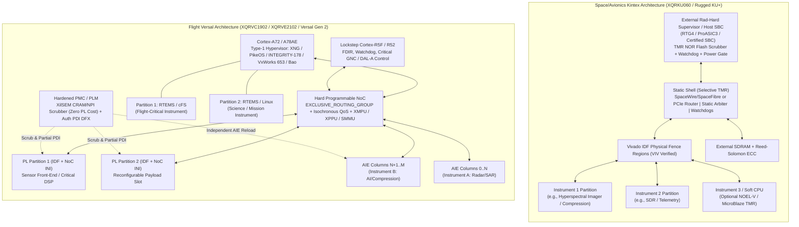

# FPGA Operating Systems & Partitioning Architectures for Sharing Versal and Kintex Across Flight Instruments

Sharing an FPGA across multiple **flight instruments**—whether **spacecraft science/navigation payloads** (imagers, spectrometers, SAR/STAP radar, SDRs, star trackers, GNC) or **airborne avionics flight instruments** (flight displays, air-data/inertial fusion, radar altimeters, flight control)—imposes radically different requirements from datacenter FPGA OSes like Coyote v2 or Kubernetes device plugins.

In flight systems, **determinism, fault containment, radiation/SEU survivability, certification evidence (DO-254 / DO-178C / ECSS), and SWaP-C** supersede peak dynamic multiplexing flexibility.

---

## 1. Why Flight-Instrument Sharing Differs from Datacenter FPGA OSes

| Requirement | Datacenter FPGA OS (e.g., Coyote v2, XRT) | Flight-Instrument FPGA Sharing (Space & Avionics) |
| :--- | :--- | :--- |
| **Determinism & Timing** | Best-effort throughput; page faults, TLB misses, and Linux jitter are acceptable. | **Strict bounded WCET** (Worst-Case Execution Time); zero unbounded interference between critical and non-critical instruments (**CAST-32A / AMC 20-193**). |
| **Fault Containment (FFI)** | Process crash or slot deadlock handled by host driver reset. | **Freedom From Interference (FFI)**: A fault, SEU/SEFI, or sensor flood in Instrument B *must never* corrupt state, starve bus bandwidth, or miss deadlines in Instrument A. |
| **Dynamic Reconfiguration (DFX)** | Frequent runtime swapping of untrusted/dynamic slots (~12 ms). | **Avionics (DO-254)**: Almost always **static spatial partitioning** (runtime DFX is rarely certifiable). **Spaceflight**: Used selectively for **mission-phase mode switching** and **background SEU/SEFI slot repair**, strictly coordinated with configuration scrubbing. |
| **Radiation & Scrubbing** | Not applicable. | **Mandatory for spaceflight**: Continuous CRAM scrubbing (**SEM IP / external rad-hard scrubber** on Kintex; **PMC XilSEM** on Versal), hardware BRAM/URAM ECC, and selective **TMR**. |
| **I/O & Form Factor** | PCIe Gen4/5, 100G–800G Ethernet, host x86 server. | **Space**: SpaceWire, SpaceFibre (100+ Gbps), CCSDS, Camera Link, JESD204B/C, SpaceVPX / cPCI Serial Space / CS2 CubeSat. **Avionics**: ARINC 429, MIL-STD-1553, AFDX / TSN, ARINC 818 video, 3U/6U OpenVPX / SOSA. |

---

## 2. Flight-Qualified Silicon: Kintex vs. Versal for Shared Instruments

### Flight-Relevant Device Comparison

| Device Family | Key Flight Parts | Hard CPUs & Lockstep | Radiation / Safety Heritage | Configuration Scrubbing | Best Flight-Instrument Role |
| :--- | :--- | :--- | :--- | :--- | :--- |
| **Space-Grade Kintex UltraScale** | **XQRKU060** (20 nm, Class B) | None *(soft MicroBlaze / NOEL-V / LEON optional)* | Flight heritage (NASA **SpaceCube v3.0 Mini**, ESA **HPDPU**, Lagrange PMI studies). | Soft **SEM IP** (uses ICAPE3) or **external rad-hard scrubber** (TMR NOR Flash). | Shared payload DSP/compression/SDR fabric paired with a rad-hard OBC or external supervisor. |
| **Ruggedized Kintex UltraScale+ / Gen 2** | **XQKU15P / KU19P**, **Kintex US+ Gen 2** *(2026, CNSA 2.0, LPDDR5X)* | None | Widely used on 3U OpenVPX / SOSA / DO-254 avionics I/O & sensor boards. | SEM IP (if high-altitude atmospheric SEU mitigation needed). | Shared avionics I/O concentrator (ARINC 429/818, 1553, radar/EO-IR) attached to a certified host SBC. |
| **Space-Grade Versal AI Core / Edge** | **XQRVC1902** (7 nm, Class B), **XQRVE2102** (AI Edge) | Dual **Cortex-A72** + Dual **Cortex-R5F** (lockstep capable) | Proton & heavy-ion tested: **zero SEL** up to 80 MeV·cm²/mg & 400 MeV protons; **~10× SEU improvement** vs. 16 nm US+; passed 50 krad(Si) TID. | **XilSEM runs in hardened PMC firmware** (0 PL LUTs; supports auto-reinit after deferred DFX). | Consolidated multi-instrument spacecraft computer (C&DH + multiple science/AI/SDR/radar instruments on one SoC). |
| **Versal Prime / AI Edge Series Gen 2** | **XC2VE35xx / XC2VE38xx / XC2VM38xx** | **Cortex-A78AE** + **Cortex-R52** (lockstep) + **Mali-G78AE** GPU | Targeted for next-gen DAL-A/B airborne mission computers & cockpit displays; **ASU** security unit; **Segmented Configuration** default. | PMC XilSEM + hardware EDAC on DDR5/LPDDR5X/BRAM/URAM. | Consolidated **IMA cockpit displays** (OpenGL SC / Vulkan SC) + mixed-criticality sensor fusion & flight control. |

---

## 3. Operating Systems & Partitioning Hypervisors for Flight Instruments

Because "flight instruments" spans both **spacecraft payloads** and **airborne avionics**, the right OS stack depends on which assurance regime applies.

### 3.1 Track A: Spacecraft Flight Instruments (NASA / ESA / SmallSat / Orbital Payloads)

1. **XtratuM Next Generation (XNG — fentISS)**
   * **What it is**: ESA's premier bare-metal **Time and Space Partitioning (TSP)** Type-1 hypervisor designed for spaceflight (**ECSS-E-ST-40C Level B** qualification path).
   * **How it shares instruments**: Enforces strict ARINC 653-style static cyclic time windows and spatial memory/MMU isolation. Runs **RTEMS**, **Linux**, or bare-metal flight software inside separate partitions on the same chip.
   * **Hardware fit**: Supports ARM multicore SoCs (Zynq/Versal architectures) as well as **NOEL-V RISC-V soft-core clusters** on Kintex/Virtex FPGAs (proven in ESA's *De-RISC* qualification effort).

2. **RTEMS (Real-Time Executive for Multiprocessor Systems)**
   * **What it is**: Open-source, flight-proven POSIX RTOS with massive NASA and ESA heritage (including SMP support and ECSS qualification kits).
   * **How it shares instruments**: Runs natively on Versal ARM cores (or inside XNG partitions, or on soft LEON/NOEL-V/MicroBlaze cores on Kintex). Commonly paired with **NASA cFS** or **JPL F'**.

3. **NASA cFS (Core Flight System) & JPL F' (F Prime)**
   * **Role**: Flight software middleware layered *above* RTEMS, VxWorks, FreeRTOS, or Linux to cleanly isolate multiple instruments on a shared processor/FPGA.
   * **cFS**: Uses a deterministic **Software Bus (SB)** publish/subscribe architecture plus **OSAL** (OS Abstraction Layer) and **PSP** (Platform Support Package), allowing independent science instruments to be developed, tested, and uplinked as separate apps without touching core C&DH. Used heavily on NASA **SpaceCube** (Kintex UltraScale) missions.
   * **F' (F Prime)**: Component-based architecture with statically verified ports and autocoded telemetry/command interfaces—ideal for deterministic, resource-constrained instrument pipelines.

4. **OpenAMP (Asymmetric Multiprocessing on Versal)**
   * **What it is**: Officially supported in AMD Vitis / Yocto / Lopper for Versal (UG1304).
   * **How it shares instruments**: Splits Versal cleanly across heterogeneous cores—e.g., running **FreeRTOS / Zephyr / Bare-Metal** on the **lockstep Cortex-R5F/R52** for critical instrument timing, FDIR, and scrubbing supervision, while running **RTEMS or Linux** on the **Cortex-A72/A78AE** for high-rate science processing, communicating over shared-memory `RPMsg` rings protected by XMPU rules.

5. **Emerging Orbital Cloud-Native Stacks (Non-Critical Multi-Tenant Science Payloads)**
   * **EU ORCHIDE (Horizon Europe #101135595, demonstrated KubeCon EU 2026)**: Deploys **K3s + Argo Workflows + `urunc` unikernels + `vAccel`** on orbital compute nodes explicitly targeting **AMD Versal FPGAs** alongside ARM64/Orin nodes for multi-instrument payload sharing.
   * **DLR Real-Time Containers**: Demonstrated rootless Podman containers with real-time scheduling guarantees on Xilinx MPSoCs for space science applications (best restricted to lower-criticality payload partitions isolated behind a hypervisor).

---

### 3.2 Track B: Airborne Avionics Flight Instruments (IMA — DO-254 / DO-178C / ARINC 653)

For certified aircraft/UAV flight instruments (primary flight displays, navigation, radar altimetry, engine/air-data instrumentation), **ARINC 653 Time and Space Partitioning** is the industry standard. Every major certified avionics RTOS/hypervisor vendor partners with AMD for Versal and Zynq UltraScale+:

| RTOS / Hypervisor | Certification Pedigree | Key Multi-Core & FPGA Sharing Features | AMD Target Fit |
| :--- | :--- | :--- | :--- |
| **SYSGO PikeOS** | **DO-178C DAL A**, MILS, Common Criteria EAL 5/6, EN 50128 SIL 4 | Type-1 separation kernel + ARINC 653 hypervisor; **cache coloring** for AMC 20-193 / CAST-32A determinism; hosts mixed DAL-A RTOS + Linux/POSIX partitions side by side. | **Versal** (APU & PikeOS for MPU on RPU), ZynqMP, or host SBC paired with Kintex US+. |
| **Green Hills INTEGRITY-178 tuMP** | **DO-178C DAL A** multicore | Official AMD Versal partner; time-and-space partitioned multicore RTOS/hypervisor with deterministic affinity groups and ARINC 653 support. | **Versal**, ZynqMP, host SBC + Kintex US+. |
| **Wind River VxWorks 653 / Cert** | **DO-178C DAL A**, ARINC 653 | Official VCK190/Versal BSP lineage; supports ARINC 653 partitioning, COTS DO-254/DO-178C evidence bundles (e.g., with Abaco/Mercury VPX boards). | **Versal**, ZynqMP, host SBC + Kintex US+. |
| **DDC-I Deos** | **DO-178C DAL A**, ARINC 653 | Deterministic time/space partitioning + patented slack scheduling; integrated with **Rapita RVS** for AMC 20-193 multicore interference & WCET certification evidence. | **Versal**, ZynqMP, host SBC + Kintex US+. |
| **Lynx Software LynxOS-178 / LynxSecure** | **DO-178C DAL A**, ARINC 653 | Separation kernel hypervisor isolating certified flight instrument partitions from uncertified mission/AI Linux VMs. | **Versal**, ZynqMP, host SBC + Kintex US+. |
| **Bao / Jailhouse (Omnivisor)** | *Open-source* (certifiable architecture; minimal TCB) | Static partitioning (<1% overhead on Bao; Omnivisor adds **RPU-Guard** and heterogeneous RISC-V PL core isolation). Ideal for experimental UAVs, CubeSats, or pre-cert prototyping. | **Versal** (ARMv8-A/R + PL soft cores). |
| **AMD Official Xen Port** | *Non-DAL* (industrial / tactical / prototyping) | Official Yocto/EDF support; **dynamic PL assignment** (2024.2+) and **Mali-G78AE hardware GPU virtualization** on Versal Gen 2 (useful for multi-display avionics prototyping with OpenGL SC / Vulkan SC). | **Versal Gen 1 & Gen 2**. |

---

## 4. Hardware Partitioning, Determinism & Radiation Co-Design

Software partitioning alone is insufficient when multiple flight instruments share one FPGA die. You must enforce isolation and fault containment in the **PL fabric, interconnect, memory, and configuration controller**.

### 4.1 Physical PL Isolation: Vivado Isolation Design Flow (IDF) + VIV

When two flight instruments of different Design Assurance Levels (e.g., a DAL-A flight-critical sensor interface and a DAL-C/D mission instrument) share a Kintex or Versal PL:
* Use **AMD Vivado Isolation Design Flow (IDF)** to assign each instrument to disjoint physical pblocks separated by **Isolation Fence Regions** (unused tile columns/rows preventing shared routing switchboxes or accidental signal bridging).
* Verify the implemented netlist with **Vivado Isolation Verifier (VIV)**, which runs automated DRCs confirming zero illegal cross-partition routing and strict single-point trusted interfaces.
* Place **hardware bus firewalls / protocol checkers** (AXI timeout monitors, transaction-length limiters, master-ID filters) at every instrument boundary so a hung instrument state machine cannot deadlock the shared bus.

### 4.2 Deterministic Interconnect & Memory (Satisfying CAST-32A / AMC 20-193)

The hardest obstacle to certifying or flight-qualifying a shared Versal or Kintex is **shared-resource interference** (one instrument's DMA bursts inflating another instrument's worst-case latency):

* **On Versal (Hard NoC Advantage)**:
  * Assign **Isochronous** or **Low-Latency** NoC traffic classes to critical flight instruments and **Best-Effort** with explicit bandwidth/burst throttling to non-critical science payloads.
  * Apply **`EXCLUSIVE_ROUTING_GROUP`** constraints in Vivado so critical instrument NoC paths **never share physical NoC channels** with non-critical or dynamically reconfigurable partitions (UG909).
  * Lock **XMPU** (memory regions per AXI SMID) and **XPPU** (peripheral register apertures) at boot via the PLM, and enforce **cache coloring** in the hypervisor (e.g., PikeOS) on shared ARM L2/L3 caches.
* **On Kintex (Soft Interconnect Discipline)**:
  * Avoid a single flat round-robin AXI crossbar shared across mixed-criticality instruments. Instead, use **TDMA (Time-Division Multiple Access)** or **strict-priority credit-limited arbiters** with hardware watchdogs that auto-isolate any instrument exceeding its burst or latency envelope.
  * Prefer **physically separate memory banks** (dedicated BRAM/URAM blocks with hardware ECC per instrument, or separate DDR channels) over a single shared memory controller wherever SWaP allows.

### 4.3 Radiation Scrubbing, Selective TMR & In-Orbit DFX Co-Design

For **spaceflight instruments**, SRAM-based FPGAs (XQRKU060 and XQRVC1902) experience Single-Event Upsets (SEUs) in configuration memory (CRAM) and user state:

1. **Avoid Blind Full-Chip TMR**: Triplicating an entire multi-instrument FPGA destroys your logic/power budget (3×+ area). Instead, classify every instrument module by fault behavior:
   * **Self-healing datapaths** (streaming DSP, FEC, image filters): Leave single-threaded; a transient upset affects one sample/frame and flushes out.
   * **Self-recovering loops** (tracking loops, PLLs, NCOs): Protect with lightweight **watchdogs**, not TMR.
   * **Persistent-critical control & shared infrastructure** (AXI/NoC arbiters, bus routers, SpaceWire/SpaceFibre link FSMs, instrument config registers, DFX decouplers): Apply **selective TMR** (~few percent of fabric) + **hardware ECC/EDAC** on all BRAM/URAM and **Reed-Solomon ECC** (e.g., RS(12,8)) on external SDRAM.

2. **Scrubbing vs. Partial Reconfiguration (DFX) Arbitration**:
   * **Kintex (`XQRKU060`)**: The internal **SEM IP** owns the `ICAPE3` port. If you share the FPGA across instruments via in-orbit DFX, your supervisor *must* cleanly pause SEM scrubbing, decouple the target instrument slot (`DFX AXI Shutdown Manager`), stream the partial bitstream, verify CRC, and resume scrubbing—or offload scrubbing entirely to an **external rad-hard supervisor FPGA** (e.g., Microchip RTG4/ProASIC3 reading TMR NOR Flash, as done on SpaceCube and ESA HPDPU).
   * **Versal (`XQRVC1902`)**: **XilSEM runs in hardened PMC firmware** (consuming zero PL LUTs—only PMC RAM, power, and scrub latency). Starting in AMD 2024.2+, **XilSEM supports automatic re-initialization after deferred partial reconfiguration**. Combined with **NoC INI automatic quiescing**, Versal enables **background active fault recovery** (a core NASA SpaceCube / NavCube / EPSCoR focus area): when an instrument slot experiences a localized SEFI, the RPU/PMC isolates that slot via NoC INI and reloads its partial PDI without disturbing other active flight instruments!

3. **Versal AI Engine Column Sharing for Space DSP**:
   * For multi-instrument signal processing (e.g., STAP radar + hyperspectral CNN + SDR modem on one **XQRVC1902**), assign **disjoint AIE columns** per instrument via AMD's Independent AIE Partitioning. Each instrument's AIE partition can be independently reset, reloaded, or power-gated during idle orbital phases to meet tight SmallSat power budgets.

---

## 5. Concrete Flight-Instrument Reference Architectures

### Architecture 1: Multi-Instrument Spacecraft DPU on Space-Grade Versal (`XQRVC1902`)
* **Target Mission**: Earth observation, planetary science, or multi-payload SmallSat/MediumSat sharing 1 Versal across C&DH + 2–4 science/nav instruments (e.g., imager + spectrometer + SDR + optical nav).
* **OS / Partitioning Stack**:
  * **Lockstep Cortex-R5F**: Bare-metal or FreeRTOS/Zephyr **FDIR Supervisor** (health monitoring, XilSEM upset telemetry, power/thermal throttling, deterministic instrument trigger timing).
  * **Cortex-A72**: **XtratuM (XNG)** (for ECSS Level B isolation) or **RTEMS + NASA cFS / JPL F'** (for lower-cost NASA Class C/D missions), bridging to the R5F via **OpenAMP**.
* **Hardware Sharing Architecture**:
  * Static **SpaceFibre / SpaceWire** & CCSDS router in selective-TMR PL.
  * Instruments isolated via **Vivado IDF** fences + **NoC INI** boundaries + **`EXCLUSIVE_ROUTING_GROUP`** + locked **XMPU/XPPU** apertures.
  * Science instruments split across **independent AIE column partitions** and/or **mission-phase DFX slots** coordinated with **PMC XilSEM** auto-reinit.
  * External **rad-hard power/watchdog supervisor IC** providing hard power-cycle recovery against unrecoverable SEFIs.

### Architecture 2: Shared Spaceflight Payload Processor on Kintex UltraScale (`XQRKU060`)
* **Target Mission**: High-heritage radiation-tolerant instrument processor (SpaceCube v3.0 / ESA HPDPU class) sharing one Kintex across multiple sensor front-ends or mission modes.
* **OS / Control Stack**:
  * **External Rad-Hard OBC / System Controller** (e.g., RAD750 / LEON3 / RTG4 / ProASIC3) runs **RTEMS + cFS** (or VxWorks) and owns configuration Flash, scrubbing, and mode scheduling.
  * *(Optional on-chip)* TMR **NOEL-V (RISC-V)** or **MicroBlaze** soft core running **RTEMS** or **XtratuM (XNG)** for local housekeeping.
* **Hardware Sharing Architecture**:
  * **Static Infrastructure (Selective TMR)**: SpaceWire/SpaceFibre links, deterministic TDMA memory arbiter, DDR controller with Reed-Solomon ECC, and `DFX AXI Shutdown Managers`.
  * **Instrument Partitions**: 2–3 statically floorplanned **Vivado IDF** partitions (aligned to clock regions) for concurrent instruments, or **temporal DFX slots** swapped by the external rad-hard scrubber between orbital phases (e.g., capture mode → compress/ML mode → downlink mode).

### Architecture 3: DO-254 / DO-178C Mixed-Criticality Avionics Flight Instruments (IMA)
* **Target Platform**: **AMD Versal Prime / AI Edge Gen 2** (standalone SoC) *or* **3U OpenVPX / SOSA Certified SBC + Ruggedized Kintex UltraScale+ / Gen 2**.
* **OS / Hypervisor Stack**:
  * **SYSGO PikeOS**, **Green Hills INTEGRITY-178 tuMP**, **Wind River VxWorks 653**, or **DDC-I Deos** providing **ARINC 653 Time & Space Partitioning** (DO-178C DAL A) + **cache coloring** + **Rapita RVS / LDRA** multicore interference verification (**AMC 20-193**).
* **Hardware Sharing Architecture**:
  * **Zero runtime DFX** (static DO-254 certified bitstream/PDI verified at boot via hardware root of trust and Startup BIT).
  * **DAL-A Instruments** (flight control / primary air-data / cockpit primary display): Dedicated lockstep **Cortex-R52** or ARINC 653 partition, dedicated **Isochronous NoC routing group**, locked **XMPU/XPPU**, and **Vivado IDF + VIV** physical fences in PL.
  * **DAL-C/D / Mission Instruments** (synthetic vision, moving map, health monitoring, AI perception): Separate ARINC 653 partition (or isolated Linux guest under separation kernel), Best-Effort bandwidth-throttled NoC channels, and **Mali-G78AE** (OpenGL SC / Vulkan SC) on Versal Gen 2.
  * If using **Kintex US+ on OpenVPX**: Attach via **PCIe QDMA SR-IOV** (or static BAR partitioning with hardware master-ID checks) so each ARINC 653 partition on the host SBC owns isolated hardware queues and register apertures.

---

## 6. Key Decision Checklist Before Freezing Your Architecture

1. **Aviation vs. Spaceflight**: Do you need **DO-254 / DO-178C / AMC 20-193** airworthiness certification (favoring **PikeOS / INTEGRITY-178 / VxWorks 653 / Deos** + static IDF partitioning), or **spaceflight radiation tolerance & ECSS / NASA Class A–D** (favoring **XQRVC1902 / XQRKU060** + **XNG / RTEMS / cFS / F'** + XilSEM / external scrubber)?
2. **Mixed-Criticality Spread**: Are all shared instruments the same criticality (e.g., all science payloads), or are you co-locating a flight-critical instrument (GNC / primary display / C&DH) with lower-criticality payloads (requiring **lockstep R5F/R52**, **IDF/VIV fences**, and **`EXCLUSIVE_ROUTING_GROUP`**)?
3. **Concurrent vs. Mission-Phase Sharing**: Must all instruments run **simultaneously** (static spatial partitions + AIE columns), or do they alternate by flight phase (enabling **DFX time-sharing** to shrink SWaP-C on space payloads)?
4. **Target Form Factor & Host Topology**: Standalone **Versal SoC** (no external CPU needed) vs. **Kintex** attached to a flight OBC / OpenVPX SBC over **SpaceWire, SpaceFibre, or PCIe**?
