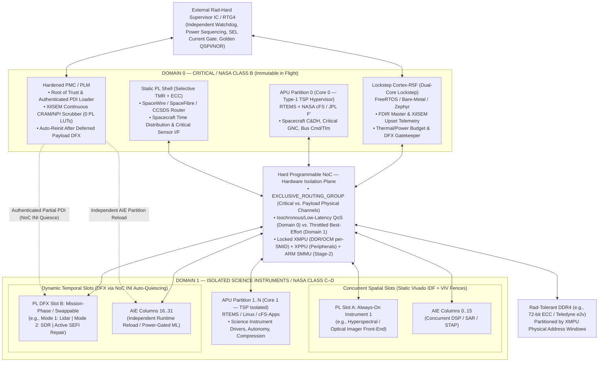
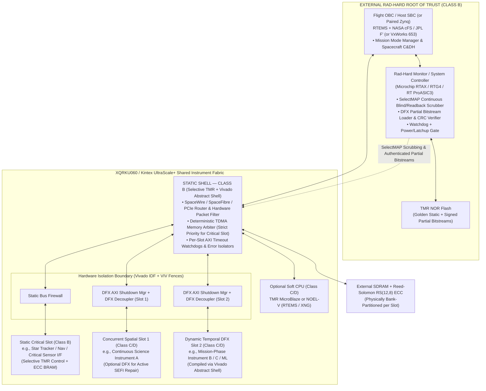
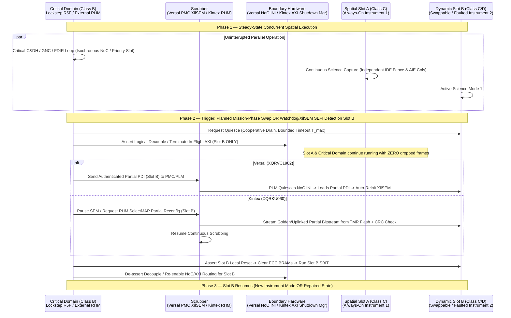

# NASA Class B–D Architecture Blueprint: Sharing Versal or Kintex FPGAs Across Mixed-Criticality Flight Instruments

This blueprint translates FPGA operating system and virtualization research into a concrete, flight-qualifiable architecture tailored to three program constraints:

1. **Assurance Regime**: **NASA Class B through Class D** spaceflight missions (**NPR 8705.4** risk classification, **NPR 7150.2D** software engineering, **NASA-STD-8739.8** software assurance).
2. **Mixed-Criticality Isolation**: Strict **Freedom From Interference (FFI)** isolating **critical flight functions** (C&DH, FDIR, GNC/Nav, spacecraft bus commanding/telemetry, scrubbing/reconfiguration control) from **lower-criticality science instruments**.
3. **Dual-Mode Sharing**: Native support for **both concurrent spatial sharing** (multiple instruments operating simultaneously) **and dynamic temporal sharing** (mission-phase DFX swapping and autonomous background SEU/SEFI slot repair).

---

## 1. NASA Class B–D Assurance & Cost-Containment Strategy

Under **NPR 7150.2D**, if lower-criticality science instrument software or firmware shares an unprotected processor, memory space, or interconnect with a **Class B** flight-critical function, assurance authorities require **elevating the entire shared codebase to Class B**—dramatically increasing V&V cost and preventing agile in-orbit payload updates.

**The Architectural Goal**: Build a small, immutable, formally verified **Class B Trusted Computing Base (TCB)** in hardware and software that enforces provable **spatial and temporal partitioning**. Everything outside the TCB (individual science instruments, onboard ML inference, experimental DSP/SDR modes) can then be developed, verified, and even reconfigured in orbit at **Class C or Class D** rigor.

### Scaling Across NASA Mission Classes

| Dimension | NASA Class B (High-Value Robotic / Discovery / Lunar-Mars) | NASA Class C (Medium-Risk / Explorer / Orbital Instruments) | NASA Class D (SmallSat / CubeSat / ISS / Tech Demo) |
| :--- | :--- | :--- | :--- |
| **Target Silicon** | **Space-Grade Class B**: `XQRVC1902` (Versal AI Core) or `XQRKU060` (Kintex UltraScale) | `XQRVC1902` / `XQRVE2102` or `XQRKU060` (or upscreened KU+/Versal with rad-hard supervisor) | Upscreened/COTS Versal or Kintex UltraScale+ (e.g., SpaceCube v3.0 Mini `KU060`) + rad-hard monitor |
| **External Supervisor** | **Mandatory** rad-hard supervisor FPGA/MCU (Microchip RTG4/RTAX) + TMR NOR Flash + power latchup/watchdog | **Strongly recommended** rad-hard monitor (e.g., RT ProASIC3 / PolarFire) + external watchdog | Lightweight rad-tolerant watchdog + current-limiting power switch |
| **Hypervisor / Partitioning OS** | **XtratuM (XNG)**, **VxWorks 653**, **SYSGO PikeOS**, or **INTEGRITY-178 tuMP** (formal TSP evidence) | **XtratuM (XNG)**, **Bao** (static partitioning), or **OpenAMP** (Lockstep R5F + APU RTEMS) | **OpenAMP** (R5F FreeRTOS/Zephyr + APU RTEMS/Linux) or **Bao** |
| **Flight Software Framework** | **NASA cFS** (Class A/B heritage) or **JPL F'** over **RTEMS** / VxWorks | **NASA cFS** or **JPL F'** over **RTEMS** / FreeRTOS | **cFS**, **F'**, or Linux/containers (e.g., ORCHIDE/Podman) in isolated Class D payload partitions |
| **Hardware Isolation** | **Vivado IDF + VIV** physical fences + locked **XMPU/XPPU/SMMU** + **`EXCLUSIVE_ROUTING_GROUP`** + Selective TMR | **Vivado IDF + VIV** + XMPU/XPPU + NoC QoS + Selective TMR on static shell | Logical AXI firewalls + XMPU/NoC QoS + Selective TMR on bus/FDIR FSMs |
| **Dynamic DFX Policy** | Allowed **only in Class C/D payload slots** (strictly isolated behind NoC INI / AXI Shutdown Mgr); Class B static shell is locked & immutable in flight | Supported for mission-phase payload swaps & autonomous SEFI repair | Full flexibility for on-orbit payload updates & ML model/bitstream uplinks |

---

## 2. Primary Architecture: Space-Grade Versal (`XQRVC1902` / `XQRVE2102`)

**Recommendation**: If your SWaP-C and procurement budget permit, **Versal is significantly cleaner than Kintex** for mixed-criticality dual-mode sharing. Its hardened **lockstep Cortex-R5F**, **PMC XilSEM** (zero PL LUTs), **hard Programmable NoC with QoS**, **NoC INI automatic quiescing**, **XMPU/XPPU/SMMU**, and **independent AI Engine column partitions** eliminate most of the soft-logic routing and timing-closure penalties that plague multi-tenant Kintex designs.

### 2.1 How Each Layer Enforces Mixed-Criticality Isolation on Versal

1. **Physical Processor Separation (APU vs. Lockstep RPU)**:
   * Put the lowest-level, highest-criticality **FDIR Supervisor, hardware watchdog feeder, power/thermal safety monitor, and DFX/XilSEM coordinator** on the **Cortex-R5F in dual-core lockstep mode** (256 KB combined TCM with ECC). Even if the entire Cortex-A72 APU crashes or hangs, the lockstep R5F detects the missed heartbeat, isolates faulty payload partitions, and maintains safe-mode commanding.
   * Communicate between RPU and APU strictly over bounded **OpenAMP (`RPMsg`)** shared-memory rings locked down by **XMPU** permissions.

2. **APU Time & Space Partitioning (Type-1 Hypervisor)**:
   * Run a **static Type-1 TSP hypervisor** on the dual Cortex-A72 APU:
     * **Class B**: **XtratuM (XNG)**, **SYSGO PikeOS** (with L2 cache coloring), **VxWorks 653**, or **INTEGRITY-178 tuMP**.
     * **Class C/D**: **Bao** (<1% overhead, static partitioning, no Dom0) or **XNG**.
   * Pin **Partition 0 (Class B — RTEMS + cFS/F')** to Core 0 (or dedicated cyclic time windows) with dedicated physical DDR windows and cache colors.
   * Assign **Partitions 1..N (Class C/D — RTEMS or Linux)** to Core 1 for science instrument software, onboard autonomy, or ML orchestration. Inter-partition messaging crosses strictly typed, rate-limited queuing/sampling ports (or a cFS Software Bus Network/Gateway bridge) so a runaway science app cannot flood Class B command queues.

3. **Hard NoC & Memory Firewalling**:
   * **XMPU**: Carve external ECC DDR4 into non-overlapping physical regions keyed by AXI Master ID (**SMID**). Partition 0's RAM and the RPU's TCM/OCM are hardware-unwritable by any payload PL slot, AIE column, or Partition 1+ software.
   * **XPPU**: Lock down PMC, CIPS SLCR, clock/reset registers, and spacecraft bus peripherals so only the PLM and Lockstep RPU can alter clocks, resets, or configuration paths.
   * **NoC QoS & `EXCLUSIVE_ROUTING_GROUP`**: Assign Domain 0 (RPU, APU0, SpaceFibre/SpaceWire router) to **Isochronous / Low-Latency** traffic classes on an **exclusive physical NoC routing group**, completely separated from Domain 1's Best-Effort throttled NoC channels. Keep boundary NoC path ownership in the static region (per AMD UG909 multi-RP guidance).

4. **Dual-Mode PL + AIE Sharing**:
   * **Concurrent Spatial Mode**: Always-on instruments occupy disjoint **Vivado IDF** physical pblocks (verified by **VIV**) and disjoint **AI Engine column ranges** (`--aie.pl-freq` / independent graph compilation).
   * **Dynamic Temporal Mode**: Swappable payload slots cross the static–RP boundary exclusively through **NoC INI (Inter-NoC-Interconnect)** interfaces (placing the NMU/NSU *inside* the RP), giving **automatic hardware NoC quiescing** during partial PDI reconfiguration without soft PL decouplers. Meanwhile, **AI Engine column partitions** can be independently reloaded or reset at runtime using separate AIE-only XCLBINs/PDIs without halting neighboring AIE columns.

---

## 3. Secondary / High-Heritage Architecture: Kintex (`XQRKU060` / Kintex US+)

**When to choose Kintex**: When your mission already has flight-qualified **SpaceCube v3.0 / v3.0 Mini** or **ESA HPDPU** heritage boards, strict power/BOM limits favoring 20 nm `XQRKU060` (Class B–C) or 16 nm Kintex UltraScale+ (Class C–D), or an existing rad-hard spacecraft OBC (e.g., RAD750, LEON3/GR740, NOEL-V).

Because Kintex has **no hard ARM PS, no hard PMC, and no hard NoC**, you must provide the Class B root of trust and scrubbing **externally** (the NASA SpaceCube pattern).

### 3.1 Key Kintex Design Rules for Mixed-Criticality Dual-Mode Sharing

1. **External Rad-Hard Monitor (RHM) Owns Scrubbing & DFX**:
   * Never let a Class C/D payload touch `ICAPE3`.
   * For Class B/C, follow the **SpaceCube v3.0** model: an external rad-hard FPGA (RTAX / RTG4 / RT ProASIC3) performs continuous **SelectMAP scrubbing** from TMR NOR Flash and serves as the sole gatekeeper for **DFX partial bitstream loading**.
   * If you *must* use internal **SEM IP** on `ICAPE3` (Class D budget), build a Class B **Configuration Arbiter FSM** (selective-TMR) that strictly sequences: *Pause SEM → Assert DFX AXI Shutdown Manager → Stream Partial Bitstream → Verify CRC → Release Decoupler → Resume SEM*.

2. **Vivado Abstract Shell + IDF for Independent Instrument Teams**:
   * Lock and qualify the Class B static shell once. Export a **Vivado Abstract Shell** checkpoint for each DFX slot so external university/instrument teams can synthesize, place, and route their Class C/D instrument bitstreams independently (15–20% faster builds, zero access to Class B static internals).
   * Enforce **Vivado IDF + VIV** physical fences between the Critical Slot and the Science Slots so routing switchboxes never overlap.

3. **Deterministic Bus & Memory Arbitration (No Flat AXI Crossbars)**:
   * Replace default round-robin AXI interconnects with a **TDMA or strict-priority credit-limited arbiter** giving the Class B Critical Slot guaranteed bandwidth slots and hard latency bounds.
   * Wrap every dynamic slot with an AMD **DFX AXI Shutdown Manager** + **hardware transaction watchdog**: if an SEU hangs an instrument's AXI handshake, the Shutdown Manager cleanly terminates in-flight transactions with `SLVERR`, triggers an FDIR interrupt to the OBC/RHM, and initiates autonomous slot reload—preventing a bus lockup from propagating to the Critical Slot.

4. **Soft-Core OS Option (When No External OBC Runs Instrument FSW)**:
   * Instantiate a **NOEL-V (RISC-V)** or **MicroBlaze / MicroBlaze V** cluster inside a dedicated partition running **RTEMS + cFS** (proven on SpaceCube v3.0 Mini) or **XtratuM (XNG)** (ESA *De-RISC* ECSS Level B path). Use selective TMR on the soft core's control pipeline and hardware ECC on all instruction/data BRAMs.

---

## 4. Flight Operating System & Hypervisor Selection Matrix (NASA Class B–D)

| OS / Hypervisor Stack | Best Mission Class | Versal Fit | Kintex Fit | Mixed-Criticality Partitioning | Licensing & Ecosystem Notes |
| :--- | :--- | :--- | :--- | :--- | :--- |
| **XtratuM (XNG) + RTEMS + cFS/F'** | **Class B – C** | High (ARMv8-A) | High on **NOEL-V** soft cores (ESA De-RISC) | **Hard TSP** (cyclic time slots + MMU/MPU space isolation); ECSS Level B pedigree | Commercial/ESA-backed (fentISS); strong spaceflight heritage. |
| **Wind River VxWorks 653 + cFS** | **Class B** | High (VCK190 / Versal BSP lineage) | Via external SBC/OBC | **ARINC 653 TSP**; DO-178C DAL A / NASA Class A–B heritage | High commercial license cost; gold-standard formal V&V artifacts. |
| **SYSGO PikeOS / Green Hills INTEGRITY-178 tuMP** | **Class B** | **High** (official AMD Versal partners) | Via external SBC/OBC | **ARINC 653 TSP + L2 Cache Coloring** (strongest multicore interference evidence) | Commercial; ideal if program wants turnkey multicore interference proof. |
| **OpenAMP (Lockstep R5F FreeRTOS/Zephyr + APU RTEMS/cFS)** | **Class B (R5F) + Class C/D (APU)** | **Native (Best SWaP/Cost on Versal)** | N/A (no hard R5F/A72) | **Hardware core-level isolation** (R5F lockstep vs. A72) + XMPU/XPPU | **Open-source** (AMD official Yocto/Vitis/Lopper support); lowest licensing cost while keeping strong physical separation. |
| **Bao Static Hypervisor + RTEMS / Linux** | **Class C – D** *(path to B)* | **High** (ARMv8-A & ARMv8-R, <1% overhead) | Soft RISC-V only | Static hardware partitioning; minimal TCB (~few kSLOC), no Dom0 | **Open-source (Apache 2.0)**; strong emerging choice for lightweight space TSP. |
| **RTEMS (Native SMP) + NASA cFS / JPL F'** | **Class C – D** *(or inside TSP partition for Class B)* | High | High (on OBC or MicroBlaze/NOEL-V) | Logical app separation (cFS Software Bus / F' ports) — *pair with hypervisor or R5F split for true Class B/D isolation* | **Open-source**; highest NASA flight heritage (`cFS` core verified up to Class A). |
| **Linux (Yocto / EDF + `dfx-mgr`) / ORCHIDE Containers** | **Class C/D Payload Partition ONLY** | High (APU Partition 1+) | MicroBlaze Linux (SpaceCube Mini) | **Never use as Class B TCB**; always confine inside an isolated hypervisor guest or secondary core | Enables Vitis AI, XRT AIE partitioning, Python/ML tooling, and `dfx-mgr` safely away from Class B flight software. |

> [!TIP]
> **Best-Value NASA Class B–D Hybrid Stack on Versal (`XQRVC1902`)**:
> Run **Bare-Metal or FreeRTOS FDIR/Supervisor on the Lockstep Cortex-R5F**, run **XtratuM (XNG) or Bao** on the **Cortex-A72** hosting **Partition 0 (Class B: RTEMS + cFS/F')** and **Partition 1 (Class C/D: RTEMS or Yocto Linux + XRT/AIE + `dfx-mgr`)**, and isolate PL/AIE slots via **XMPU/XPPU + NoC `EXCLUSIVE_ROUTING_GROUP` + Vivado IDF**. This achieves strict Class B isolation with minimal licensing overhead while unlocking full modern Versal AIE/DFX tooling inside the Class C/D partition.

---

## 5. Dual-Mode Operation: Safe Spatial + Dynamic DFX & SEFI-Repair Protocol

To support **both** concurrent spatial operation and dynamic temporal DFX (for mission-phase switching *or* active background SEU/SEFI repair) without ever disturbing the Class B Critical Domain or neighboring spatial instruments, enforce this strict state-machine protocol:

### Critical Implementation Details for This Protocol
1. **Bounded Quiesce Timeout ($T_{\max}$)**: If Slot B is being swapped due to an SEFI, it may be hung and unable to acknowledge a cooperative drain. After $T_{\max}$ (e.g., 1–5 ms), the **Class B supervisor forcibly engages decoupling** (`DFX AXI Shutdown Manager` on Kintex; NoC INI quiescing + NMU/NSU ISR clear on Versal).
2. **Configuration Image Authentication**: Every partial PDI (Versal) or partial bitstream (Kintex) stored in onboard Flash or uplinked from ground must be cryptographically authenticated (RSA/ECDSA/SHA via Versal PMC `XilSecure` or RHM verification) before loading, preventing a corrupted uplink from bricking static routing or causing power-rail faults.
3. **Scrubbing Continuity**:
   * On **Versal**, verify **XilSEM auto-initialization after deferred partial reconfiguration** (AMD 2024.2+ PLM/XilSEM) in hardware-in-the-loop fault-injection testing so CRAM/NPI scrubbing resumes immediately over the newly loaded slot.
   * On **Kintex**, external **SelectMAP blind/readback scrubbing** must be frame-aware (masking or updating the golden frame table for the reconfigured RP region) so the scrubber does not "correct" the newly loaded Instrument B back into Instrument A!

---

## 6. Radiation & Selective-TMR Design Rules (Flight-Proven)

Applying uniform 3× TMR across a shared multi-instrument FPGA wastes ~70% of fabric and power. Instead, follow the **state-classification methodology** proven across NASA/spaceflight Versal and Kintex programs:

| Logic / State Category | Examples in Shared Flight FPGA | Required Mitigation | Fabric Cost |
| :--- | :--- | :--- | :--- |
| **1. Persistent-Critical Infrastructure & Control** | Static shell AXI/NoC arbiters, SpaceWire/SpaceFibre link FSMs, DFX decoupler controllers, config/mode registers, Class B timing sequencers | **Selective TMR** (triplicated flip-flops + voters) + **Configuration Scrubbing** (XilSEM / RHM) | Low (~3–8% of total fabric) |
| **2. On-Chip & Off-Chip Memories** | Frame buffers, cFS Software Bus pools, filter coefficients, DMA descriptors, soft-CPU caches/TCM | **Hardware ECC / EDAC** on all BRAM/URAM + **72-bit ECC DDR4** or **Reed-Solomon RS(12,8)** on external SDRAM + memory scrubbing | Minimal (uses hardened ECC blocks) |
| **3. Self-Recovering Control Loops** | Tracking loops, PLLs, NCOs, AGC accumulators, frame-sync detectors | **Watchdogs + Saturation Clamps** (auto re-acquire) — do *not* triplicate | Minimal |
| **4. Self-Healing Streaming Datapaths** | High-rate DSP filters, FFTs, image compression, CNN/AI inference layers, FEC pipelines | **None** (single-string; transient upsets flush out in milliseconds; packet CRC/FEC catches bad frames) | **0%** |

---

## 7. Phased Engineering & V&V Roadmap (Class B–D)

1. **Phase 1 — Prototyping & Isolation Bring-Up (Ground Dev Hardware)**
   * **Versal**: Start on **AMD VCK190** (pin/architecture twin to `XQRVC1902`) or **VEK280** (`XQRVE2102` class) using Vivado 2024.2/2025.1+, AMD EDF/Yocto, and Vitis.
   * **Kintex**: Start on **KCU105** or **NASA SpaceCube v3.0 Mini EVK** (`KU060`).
   * Build the **Class B Static Shell** first with locked **XMPU/XPPU**, **`EXCLUSIVE_ROUTING_GROUP`**, and **Vivado IDF** pblocks; run **Vivado Isolation Verifier (VIV)** cleanly before adding any instrument logic.

2. **Phase 2 — OS / Hypervisor & cFS/F' Integration**
   * Stand up **Lockstep R5F FDIR** + **XNG / Bao / VxWorks 653** on the APU (or external OBC + RHM on Kintex) with **RTEMS + NASA cFS / JPL F'**.
   * Run **interference stress benchmarks** (hammering DDR, NoC, and AIE from the Class C/D partition while measuring worst-case latency and jitter in the Class B partition) to generate NPR 7150.2D / safety-case partitioning evidence.

3. **Phase 3 — Dual-Mode Sharing & Fault-Injection Campaign**
   * Validate **concurrent spatial operation** (Static Slot A + AIE Cols 0..15) simultaneously with **500+ automated DFX partial reconfiguration cycles** on Slot B and AIE Cols 16..31.
   * Perform **simulated SEU/SEFI fault injection** (via XilSEM error injection on Versal or SEM/SelectMAP bit-flips on Kintex) targeting both Slot B logic and boundary interfaces to prove that: (a) Slot B faults never corrupt or delay Class B tasks or Slot A, and (b) autonomous FDIR decouple-and-reload recovers Slot B within mission availability budgets.

4. **Phase 4 — Flight Hardware & Radiation Qualification**
   * Transition to `XQRVC1902` / `XQRKU060` engineering model with the external rad-hard supervisor IC/FPGA and conduct proton/heavy-ion beam testing (or leverage existing AMD DS946 / NASA radiation characterization data tailored to your Class B–D RHA plan).
