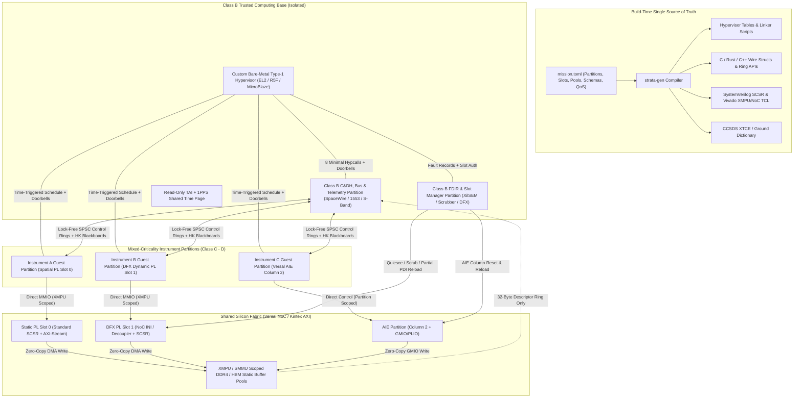
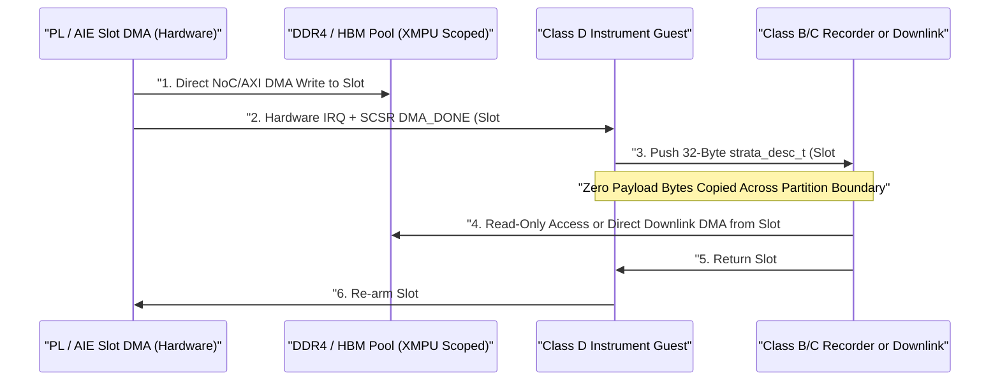
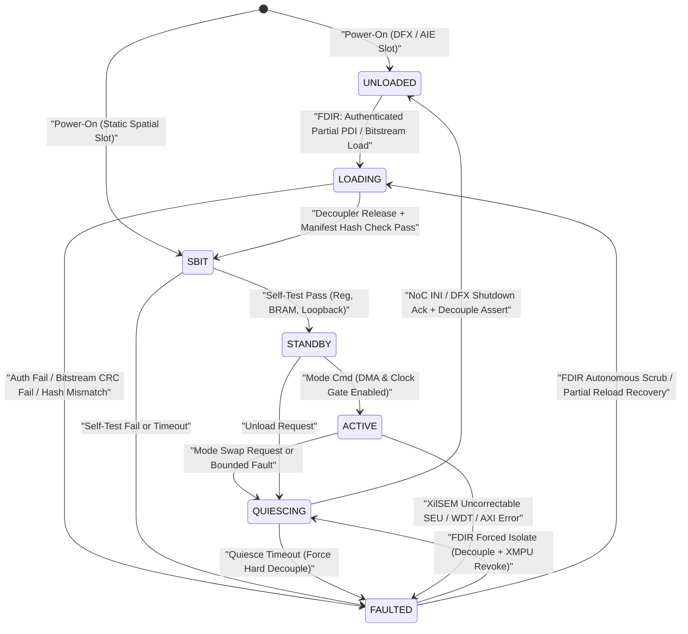

# Flight Instrument Middleware Teardown & Clean-Sheet Framework Specification (STRATA)

> [!IMPORTANT]
> **Architectural Premise**: You are implementing your own **bare-metal Type-1 hypervisor** on AMD/Xilinx **Versal** (`XQRVC1902` / `XQRVE2102`) and/or **Kintex** (`XQRKU060` / KU+) to host mixed-criticality **NASA Class B–D** flight instruments using **both** concurrent spatial partitioning and dynamic temporal sharing (DFX / AIE reload).
>
> This report dissects why existing flight software and FPGA middlewares fail under that premise—including a candid breakdown of what **JPL F' (F Prime)** gets right and where it breaks down—and specifies a clean-sheet, minimal-TCB instrument framework (**STRATA**: *Shared-FPGA Time-partitioned Real-time Avionics & Telemetry Architecture*) designed directly for a custom bare-metal hypervisor.

> [!NOTE]
> **Note on "United" Middleware**: In public spaceflight and AMD/Xilinx literature, there is no standalone flight middleware named "United." This teardown explicitly evaluates **AMD Vitis Unified / XRT** (the most common FPGA-side culprit) alongside all major flight stacks. If you were referring to a specific internal, commercial, or defense middleware literally named *United* (or *Unity* / *FUHSI*), flag it and we can add a dedicated teardown and migration bridge.

---

## Executive Diagnosis: Why Existing Middlewares Break on a Shared-FPGA Bare-Metal Hypervisor

Almost every existing spaceflight framework was designed for one of two legacy worlds:
1. **Single-processor, flat-memory RTOS flight computers** (RAD750, LEON3/4, Cortex-R5 running VxWorks or RTEMS) where "middleware" means an in-process message bus (`cFS`, `F'`, `Outpost`, `FSFW`), and FPGAs are treated as dumb external SPI/SpaceWire/AXI peripherals bolted on via custom board-support drivers.
2. **Linux-hosted COTS accelerator cards** (`Vitis Unified / XRT`, `OpenAMP`, `OpenCPI`, `Space ROS / DDS`) that assume POSIX processes, virtual memory, dynamic allocators, kernel drivers, and a trusted host OS.

When you place a **custom bare-metal hypervisor** underneath multiple Class B–D instruments sharing a single Versal or Kintex silicon die, **five structural mismatches** emerge across existing middlewares:

| Architectural Requirement | Legacy Flight Middleware (cFS, F', TASTE) | Linux/Heterogeneous Middleware (OpenAMP, XRT, OpenCPI, Space ROS) | What Your Custom Bare-Metal Hypervisor Actually Needs |
| :--- | :--- | :--- | :--- |
| **Address-Space Boundary** | Assumes single flat address space; cross-partition bridges degenerate into copy/serialize hubs | Assumes Linux kernel + user-space drivers (`remoteproc`, `/dev/xclmgmt`, POSIX shm) | Native EL2/MPU partition awareness; lock-free shared-memory rings + hardware doorbells |
| **High-Rate Instrument Data** | Copy-centric software bus or in-process raw pointers (`Fw::Buffer`) that cannot cross MMU/XMPU boundaries | Multi-copy VirtIO rings (up to 3 copies) or Linux DMA-BUF / XRT BO managers | **Zero-copy descriptor rings** over static XMPU/SMMU-scoped DDR4/HBM pools written directly by PL/NoC DMA |
| **Dynamic Hardware (DFX / AIE)** | Static compile-time component graph; zero concept of a PL slot disappearing, quiescing, or reloading | Linux `dfx-mgr` / XRT (limited to 1 PL RP in stock Vitis flows, uncertifiable at Class B) | **First-class PL/AIE Slot Contract** (`UNLOADED` → `SBIT` → `ACTIVE` → `QUIESCING` → `FAULTED`) unified across static spatial & DFX slots |
| **Mixed-Criticality FDIR** | Shared heap/bus/thread pools; a runaway Class D app can starve queues or corrupt shared memory | Central broker/daemon single points of failure; unbounded discovery/retry storms | Hardware-enforced memory/NoC/time budgets + **generation-numbered** fault isolation & autonomous slot restart |
| **Class B V&V Cost (NPR 7150.2D)** | Large legacy C/C++ frameworks or heavy autocode toolchains inflate Class B TCB | Uncertifiable Linux + C++ runtime dependencies | Tiny auditable Class B core (<5–10 KSLOC hypervisor + framework core) with Class C–D instruments strictly isolated |

---

## Section 1: Deep-Dive Teardown of Existing Middlewares

### 1.1 JPL F' (F Prime + FPP) — *"OK, But Not Great"*

F' is currently the cleanest open-source flight software framework in the NASA ecosystem, which is why engineers naturally evaluate it first. Understanding **exactly what it gets right** and **exactly where it fights a shared-FPGA hypervisor** is the best starting point for designing something better.

#### What F' Gets Right (Keep These Ideas)
* **Strongly Typed Component Interfaces (FPP)**: Replacing untyped `void*` message IDs with typed ports, serializable structs, and compile-time connection checking eliminates whole classes of integration bugs.
* **No Dynamic Allocation After Init**: Static sizing of queues, buffers, and pools aligns well with NPR 7150.2D Class B/C guidelines.
* **Built-In Telemetry, Events, Parameters & Ground Dictionary Generation**: Generating commands/telemetry dictionaries directly from interface models prevents flight/ground ICD drift.
* **Rate Group Execution Model**: Explicit cyclic execution (`ActiveRateGroup`, `PassiveRateGroup`, `ActivePhaser`) gives deterministic periodic scheduling.

#### Why F' Falls Short for a Custom Bare-Metal Hypervisor + Shared FPGA
1. **Cross-Partition Zero-Copy Breaks at `Svc::GenericHub`**:
   Inside a *single* F' deployment, `Fw::Buffer` passes a `U8*` pointer (`m_bufferData`) + offset/capacity between components without copying. However, the official F' `Svc::GenericHub` SDD explicitly enforces that **pointers can never cross deployments**: on `bufferIn`, `GenericHub` allocates a transport buffer, **copies the entire payload**, returns the original buffer, pushes bytes through a buffer driver, and re-wraps on the far side. On a multi-partition bare-metal hypervisor moving 2–20 Gbps of SAR, lidar, or hyperspectral frames from PL/AIE into DDR4 and onward to storage/downlink partitions, `GenericHub` turns your zero-copy FPGA NoC into a CPU memory-copy bottleneck.
2. **Fragile Manual Buffer Provenance (`Fw::Buffer` & `BufferContextTable`)**:
   Because `Fw::Buffer` is a raw C++ struct wrapping `U8* m_bufferData` and an untyped `U32 m_context`, ownership return is purely by convention. Components like `Svc::FprimeRouter` must maintain a mutex-guarded `BufferContextTable` keyed on raw data pointers just to remember which uplink/DMA pool a buffer came from—and if a downstream consumer accidentally offsets or mis-returns a buffer, lookup degrades or leaks. There is no hardware memory-protection enforcement or automatic lease revocation when a Class D science component crashes.
3. **Heavy Class-Hierarchy Ceremony & OSAL Virtual Dispatch**:
   Every component drags in FPP-generated base classes, port wrapper objects, and (by default) link-time virtual dispatch in the OSAL (`Interface::getDelegate()` via placement-new vtables). While F' has added bare-metal escape hatches (`FW_DIRECT_PORT_CALLS`, compile-time `OsSelection.hpp`), you are constantly fighting the framework's default abstractions to get predictable bare-metal codegen.
4. **Thread-Per-Active-Component Overhead**:
   F' encourages making every stateful subsystem an `Active` component with its own OS thread and message queue. Inside a bare-metal hypervisor partition, creating 15–30 RTOS threads + stacks + queues inside each guest partition wastes cache, SRAM, and context-switch cycles when a partition is already an isolated execution unit that could run a clean state machine or cooperative cyclic schedule.
5. **Compile-Time-Fixed Topology vs. Dynamic DFX / AIE Reconfiguration**:
   F' topologies are wired statically at compile time. There is no native concept of a hardware PL slot or AIE column being **unloaded, decoupled, scrubbed, swapped to a different instrument personality mid-mission, self-tested (SBIT), and re-bound** without rebooting the entire deployment.
6. **Zero FPGA / NoC / Scrubbing Awareness**:
   F' has no standard abstraction for PL CSR maps, AXI/NoC DMA descriptor rings, XMPU/SMMU aperture ownership, Versal XilSEM / Kintex SEM upset correlation, or hardware 1PPS/TAI synchronization. Every FPGA instrument team ends up writing ad-hoc glue drivers outside FPP.

---

### 1.2 NASA cFS (cFE / OSAL / Software Bus / SBN)

* **Strengths**: Unmatched flight heritage (verified up to NASA Class A), modular app loading (`cFE ES`), broad mission-ops familiarity, and existing CCSDS Space Packet conventions.
* **Root Failure Modes on Your Architecture**:
  * **Flat Address-Space C89 Architecture**: cFS was built around single-address-space RTOS tasks sharing a common cFE kernel. Memory protection between Class B and Class D apps is weak or bolted on via heavy ARINC-653/VxWorks port layers that duplicate what your bare-metal hypervisor already does cleanly.
  * **Copy-Centric Software Bus (`CFE_SB_TransmitMsg`) & Latency Blow-Up**: Every message publish traverses the Software Bus routing table, copies into subscriber pipes, and uses weak C structs + macro-heavy boilerplate (`CFE_MSG_*`) with no static interface schema verification. Recent 2026 embedded/safety-MCU benchmarks of cFS measured **~82.5 µs constant task-cycle overhead** and **1.85×–7.67× Software Bus latency degradation** when message pools spill from on-chip SRAM to external SDRAM.
  * **Software Bus Network (SBN) Misfit**: SBN bridges cFS instances over sockets/SpaceWire by serializing and copying packets—useless for multi-Gbps shared-memory FPGA data planes.
  * **Static Footprint & Legacy Bloat**: >100 KB base static RAM before mission apps, heavy C preprocessor configuration matrices, and zero native support for Versal NoC/DFX/AIE or bare-metal hypercalls.

---

### 1.3 OpenAMP / RPMsg / VirtIO / `libmetal`

* **Strengths**: Widely shipped in AMD/Xilinx Vitis BSPs for asymmetric multiprocessing (AMP) between Versal APU (Cortex-A72) and RPU (Cortex-R5F); standard VirtIO vring wire layout.
* **Root Failure Modes on Your Architecture**:
  * **Linux `remoteproc` Gravity Well**: OpenAMP's ecosystem assumes Linux owns lifecycle (`remoteproc`), resource tables, and memory allocation. Stripping it down to pure bare-metal-to-bare-metal under a custom hypervisor requires ripping out half of `libmetal` and fighting upstream assumptions.
  * **Triple-Copy Bottleneck & Fixed 512 B Vring Slots**: Standard RPMsg copies data **up to three times** (sender buffer → VirtIO vring buffer → receiver app buffer, plus kernel/user copies if Linux is involved) with default 512-byte payload slots and dynamic buffer descriptor fetches. Academic hardening efforts (e.g., `TZ-VirtIO`) had to strip out dynamic allocation and blocking fetches just to bound worst-case latency.
  * **Untyped Byte Streams, No Flight Semantics**: RPMsg gives you raw untyped endpoints (or TTY character streams that destroy message framing). You still have to build schemas, FDIR, rate-limiting, zero-copy DMA pools, time sync, and DFX lifecycle from scratch.

---

### 1.4 AMD Vitis Unified / XRT / `dfx-mgr`

* **Strengths**: Rapid commercial prototyping on Alveo and VCK190; integrated AIE graph tooling (`aiecompiler`) and XRT runtime APIs for Linux hosts.
* **Root Failure Modes on Your Architecture**:
  * **100% Incompatible with Bare-Metal Hypervisors & Class B Assurance**: XRT is a massive C++ user-space + Linux kernel driver (`zocl` / `xocl`) stack with dynamic memory allocation, multi-threaded schedulers, and hundreds of thousands of lines of uncertifiable COTS code.
  * **Artificial DFX Limitations**: Stock Vitis Unified / XRT DFX flows historically constrain designs to a **single PL Reconfigurable Partition** (`1 RP`), whereas Vivado DFX / Abstract Shell + PMC PLM natively supports multiple concurrent spatial + dynamic RPs.
  * **What to Keep**: Use AMD's offline build tools (`Vivado` DFX/IDF, `aiecompiler` for AIE ELF/PDI generation, `Bootgen` for authenticated partial PDIs), and **completely discard** XRT, `dfx-mgr`, and PetaLinux from the flight runtime.

---

### 1.5 ESA TASTE, CORDET-C2 & CCSDS SOIS / SEDS

* **ESA TASTE**:
  * *Good*: Model-driven AADL + ASN.1/ACN bit-exact wire encoding and formal schedulability analysis.
  * *Bad*: Brutal toolchain lock-in (heavy VM/Docker build environments, rigid generated C/Ada glue), painful debugging when generated code mismatches hardware DMA/CSR timing, and poor fit for agile mixed-language bare-metal hypervisor + RTL co-design.
* **CORDET-C2 (ESA)**:
  * *Good*: Clean component-based architecture with explicit PUS (Packet Utilization Standard) services.
  * *Bad*: Explicitly delegates inter-node/inter-partition transport to external middleware and targets single-MCU RTOS deployments rather than shared-FPGA hypervisors.
* **CCSDS SOIS / SEDS (Electronic Data Sheets, CCSDS 870.0-G-1 / 850.0-G-2)**:
  * *Good*: The **schema concept** (machine-readable XML/YAML descriptions of device registers, telemetry packets, calibration curves, and state machines) is genuinely valuable for instrument ICDs.
  * *Bad*: Full SOIS runtime stacks have weak lightweight flight adoption and over-abstract hardware buses into slow generic subnetwork layers. **Verdict**: Export/import SEDS or XTCE dictionaries at *build time*, never run a heavy SOIS runtime on-orbit.

---

### 1.6 OpenCPI, DLR Outpost / ScOSA, FSFW / `sat-rs`, LASP Adamant & Space ROS / DDS

| Stack | Origin / Language | What It Does Well | Why Not Adopt As-Is |
| :--- | :--- | :--- | :--- |
| **OpenCPI** | Open-source / C++ + VHDL/SV | Only mainstream middleware explicitly unifying CPU + FPGA worker pipelines (used in hyperspectral FPGA payload demos) | Heavy XML/runtime/build machinery; Linux-hosted container assumptions; too large and complex for a NASA Class B bare-metal TCB |
| **DLR Outpost / ScOSA** | DLR / Embedded C++ | Clean, modern, heap-free embedded C++ abstractions designed for hybrid rad-hard + COTS multi-node spacecraft | Still assumes RTOS task-level messaging over SpaceWire/Ethernet; lacks native hypervisor EL2 ABI and FPGA DFX/AIE slot orchestration |
| **FSFW / `sat-rs`** | Univ. Stuttgart / C++ & Rust | Clean CCSDS/ECSS PUS packet primitives (`sat-rs` is excellent `no_std` Rust) | Packet/service library rather than a hypervisor + shared-FPGA data-plane/DFX framework (worth borrowing `sat-rs` CCSDS codecs if using Rust) |
| **LASP Adamant** | CU Boulder / SPARK Ada | Formal proof capability + clean F'-like static component topology | Ada/SPARK ecosystem friction for mixed FPGA/C/C++/Rust instrument teams; same static-topology/no-DFX limits as F' |
| **Space ROS / DDS** | NASA / Open Robotics / C++ | Rich autonomy/robotics tooling | Unsuitable for bare-metal Class B partitions: dynamic DDS discovery, large memory/CPU footprint, serialization overhead, RTOS/Linux dependencies |

---

### 1.7 Modern Bare-Metal & Microkernel Patterns Worth Stealing

Instead of forcing a legacy flight framework onto a bare-metal hypervisor, **four modern systems** already solved the hardest sub-problems cleanly:

1. **seL4 Microkit** — *Extreme Primitives Minimalism*:
   * Reduces the entire system abstraction to **three static concepts**: **Protection Domains (PDs)**, **Memory Regions (MRs)**, and **Channels** (async notifications / doorbells), declared in one static system description file. No dynamic IPC object creation, no broker daemon.
2. **Oxide Hubris** — *Compile-Time Topology, Generation-Numbered Restart & Leases*:
   * Declares every task, memory region, peripheral, and priority in a single `app.toml`.
   * **Generation counters** on every partition/slot: when a faulted partition restarts, its generation increments and any peer holding a stale handle immediately gets a clean `DEAD_GENERATION` error—zero hung transactions.
   * **Supervisor outside the kernel**: the hypervisor only enforces isolation and delivers fault records; an unprivileged Class B FDIR supervisor implements recovery policy.
   * **Memory Leases**: temporary, bounded lending of memory buffers that automatically revoke if either side faults.
3. **Eclipse `iceoryx2`** — *Decentralized Lock-Free Zero-Copy Data Plane & Blackboard*:
   * No central broker daemon (no single point of failure).
   * Pairs zero-copy shared-memory slot pools (index/descriptor rings) with a **Blackboard** pattern—ideal for flight Housekeeping (HK) telemetry where instruments overwrite their latest fixed-size HK struct atomically and the Class B telemetry collector samples it on cadence without queues or IPC storms.
4. **Coyote v2 (ETH Zurich)** — *Standardized Hardware vFPGA Shell Contract*:
   * Proves that every FPGA tenant (spatial or DFX) can be bound behind a uniform hardware contract: one standardized CSR control interface + standardized AXI-Stream / DMA data channels + hardware credit-based rate/bandwidth enforcement.

---

## Section 2: Clean-Sheet Framework Specification — **STRATA**

**STRATA** (*Shared-FPGA Time-partitioned Real-time Avionics & Telemetry Architecture*) is a purpose-built, zero-heap, bare-metal flight instrument framework engineered to sit directly on top of your custom hypervisor across **Versal** (`XQRVC1902`/`XQRVE2102`) and **Kintex** (`XQRKU060`/KU+).

### 2.1 Core Architectural Axioms

1. **Zero Heap, Zero Dynamic Discovery, Zero Central Broker**: Every partition, memory region, DMA pool, ring buffer, interrupt route, and PL/AIE slot is statically allocated and verified at build time.
2. **Strict Control Plane vs. Data Plane Separation**:
   * *Control Plane*: Small, bounded, fixed-schema messages over lock-free SPSC rings + hardware doorbells.
   * *Data Plane*: **True zero-copy**—CPU cores *never* copy science frames. PL/AIE DMA writes directly into XMPU/SMMU-isolated DDR4/HBM slots; only 32-byte descriptors cross partitions.
3. **Single-Source-of-Truth Static Manifest**: One declarative manifest (`mission.toml`) generates **both** software artifacts (hypervisor tables, linker scripts, C/Rust/C++ packed wire headers, CCSDS XTCE ground dictionaries) **and** hardware artifacts (XMPU/XPPU/NoC QoS configs, SystemVerilog CSR packages).
4. **Hardware/PL/AIE Slots Are First-Class Citizens**: Software partitions, static spatial PL slots, dynamic DFX PL slots, and Versal AIE columns all share one uniform lifecycle state machine, manifest hash verification, and FDIR fault model.
5. **Class B TCB Containment**: The hypervisor + STRATA core + FDIR/DFX Manager live in a tiny, statically verified **Class B** footprint. Science instruments (Class C–D) link only a thin, header-only/zero-dependency `strata-guest` SDK and cannot violate timing, memory, NoC bandwidth, or bus integrity of any other partition.

### 2.2 End-to-End System Architecture



---

### 2.3 Layer 0: Single-Source-of-Truth Static System Manifest

F' splits configuration across FPP files, CMake `default/config/*.hpp` headers, and hand-maintained board/FPGA headers; cFS scatters it across C header tables and build scripts. **STRATA collapses all static architecture decisions into one declarative manifest** validated at build time before a single line of flight code compiles.

#### What `mission.toml` Declares
* **Partitions**: `id`, `criticality` (`CLASS_B` | `CLASS_C` | `CLASS_D`), `cpu_affinity` (e.g., `APU_CORE0`, `RPU_LOCKSTEP`, `MB_TMR`), `time_budget_us`, `period_ms`, `memory_regions`, `allowed_hypcalls`.
* **Hardware Slots (`pl_slots` & `aie_slots`)**: `slot_id`, `mode` (`STATIC_SPATIAL` | `DFX_DYNAMIC` | `AIE_COLUMN`), `scsr_phys_addr`, `noc_routing_group` (e.g., `CRITICAL_EXCL` vs. `SCIENCE_BEST_EFFORT`), `xmpu_region_id`, `allowed_bitstreams` (with SHA-384 / RSA-4096 digest table), `quiesce_timeout_us`.
* **Control Channels**: Directed SPSC links (`src_partition -> dst_partition`, `depth`, `msg_schema`, `max_doorbells_per_frame`).
* **Housekeeping Blackboards**: Fixed-size `#[repr(C)]` telemetry structs per partition written lock-free via seqlock.
* **Zero-Copy Data Pools**: Physical DDR4/HBM base address, `slot_count`, `slot_bytes` (aligned to 4 KB / cache line), `writer_entity` (PL/AIE DMA SMID or partition ID), `reader_partition` (e.g., Mass Memory / Downlink).

#### Compile-Time Safety Checks Performed by `strata-gen`
* **Zero Memory Overlap Proof**: Mathematically verifies no two non-shared physical memory regions or XMPU apertures overlap.
* **NoC / Bus Criticality Isolation Check**: Fails the build if any `CLASS_C`/`CLASS_D` slot references a `CRITICAL_EXCL` Versal NoC routing group or shares an AXI interconnect slave with Class B C&DH without an isolating bridge.
* **Schedulability & Queue Bound Check**: Verifies sum of partition minor-frame budgets fits within major frame with margin; verifies every SPSC ring depth is a power of two and fits in statically reserved shared RAM.
* **ABI / RTL Hash Lock**: Computes a 64-bit `MANIFEST_HASH` baked into both the hypervisor image, guest SDK headers, and SystemVerilog SCSR `RO` register—preventing mismatched bitstream/software loads on-orbit.

---

### 2.4 Layer 1: Minimal Bare-Metal Hypervisor ABI (`hypcall` Surface)

Inspired by **seL4 Microkit** and **Oxide Hubris**, the custom bare-metal hypervisor exposes **no POSIX syscalls, no file systems, no sockets, and no dynamic allocation**. The entire EL1→EL2 (Versal A72) or trap interface (R5F / MicroBlaze) is **8 auditable hypercalls**—small enough to achieve 100% MC/DC structural coverage for NASA Class B:

| Call ID | Hypercall | Arguments | Semantics & Fault Containment |
| :---: | :--- | :--- | :--- |
| `0` | `hyp_yield()` | `flags` | Voluntarily yield remaining minor-frame CPU slice to hypervisor idle/background scrubber. |
| `1` | `hyp_wait_event()` | `event_mask, timeout_ns` | Block partition until a doorbell channel, hardware IRQ routed to this partition, or TAI deadline fires. |
| `2` | `hyp_notify()` | `channel_id` | Ring hardware IPI/doorbell to peer partition on a statically authorized channel. **Rate-limited by hypervisor token bucket** to prevent interrupt storms from a runaway Class D guest. |
| `3` | `hyp_time_read()` | *(none)* → `tai_ns, epoch` | Fast deterministic read of hardware-synchronized TAI time (or zero-trap read directly from the Read-Only Shared Time Page). |
| `4` | `hyp_fault_report()` | `fault_code, detail` | Explicit self-reported software fault (e.g., assertion/SBIT failure) delivered to the Class B FDIR Supervisor. |
| `5` | `hyp_slot_op()` | `slot_id, op, image_id` | **Privileged (Class B FDIR / Authorized Manager only)**: Request authenticated DFX bitstream/PDI load, AIE column reset, or hardware decouple. Unprivileged Class C/D guests receive `EPERM` (they request mode swaps via a Control Ring message to FDIR). |
| `6` | `hyp_part_ctl()` | `part_id, op` | **Privileged (Class B FDIR Supervisor only)**: Quiesce, reset, scrub stack/BSS, and restart a faulted Class C–D partition, incrementing its **generation counter**. |
| `7` | `hyp_diag_trace()` | `tag, val0, val1` | Optional bounded write to a hardware-protected flight recorder / ring log (compile-time disableable or rate-capped). |

> [!TIP]
> **Why Only 8 Hypercalls?**
> Notice what is *absent*: there is **no `hyp_send_msg()`** copying payloads through EL2! Data transfer happens entirely in statically mapped shared memory (SPSC rings, blackboards, and DMA descriptor rings). The hypervisor never parses instrument packets, never allocates queues, and never touches payload memory—drastically shrinking the Class B verification surface.

---

### 2.5 Layer 2: Three Purpose-Built Communication Primitives

Instead of forcing commands, 1 Hz housekeeping, and 10 Gbps instrument imagery through one compromised "software bus," STRATA provides **three minimal, hardware-sympathetic primitives**:

#### Primitive A — Control Plane: Lock-Free SPSC Rings + Doorbells
* **Used for**: Commands, command acknowledgments, mode requests, event reports, small parameter updates (≤ 256 B fixed slots).
* **Mechanism**: One cache-line-aligned Single-Producer Single-Consumer (SPSC) ring per directed channel in shared non-cacheable or hardware-coherent memory (e.g., Versal CCI-500 / OCM / uncached DDR).
  * Producer writes payload, issues `DMB ISHST` (write memory barrier), increments `head`, and calls `hyp_notify(channel_id)` *only* if consumer's `armed` flag is set (interrupt coalescing!).
  * Consumer reads `head`, processes up to `N` messages per cycle, issues `DMB ISHLD`, and increments `tail`.
* **Why it beats cFS SB / OpenAMP / F'**: Zero locks, zero heap, zero kernel copies, zero mutex priority inversion, and **exact compile-time memory bounds**. Every message header carries `(src_gen, dst_gen, seq_num, schema_id)` so stale messages from a restarted partition are deterministically rejected.

#### Primitive B — Housekeeping Plane: Lock-Free Seqlock Blackboards (Borrowed from `iceoryx2`)
* **Used for**: Periodic health, status, temperatures, counters, SBIT status, and engineering telemetry (1–10 Hz).
* **Mechanism**: Each instrument partition owns one write-only (to itself) / read-only (to Class B C&DH) shared memory page containing a fixed `#[repr(C)]` HK struct prefixed by an atomic `uint32_t seq` counter.
  * Writer increments `seq` (odd = write in progress), writes fixed struct, `DMB`, increments `seq` (even = stable).
  * Class B Telemetry Collector reads `seq1`, copies struct, reads `seq2`; if `seq1 != seq2` or odd, retries (bounded max 2 retries, else flags `HK_TORN_READ` without blocking!).
* **Why it beats F' / cFS telemetry**: Eliminates telemetry queue overflows completely. Even if a Class D science app crashes mid-write or runs wild, it **cannot flood** the Class B telemetry collector with packets or exhaust shared buffers.

#### Primitive C — High-Rate Data Plane: Zero-Copy Descriptor Rings + Static Buffer Pools
* **Used for**: Hyperspectral cubes, SAR frames, lidar point clouds, focal-plane imagery, SDR IQ bursts, AIE tensor outputs (100 Mbps – 100+ Gbps).
* **Mechanism**:
  1. A static pool of `K` fixed-size buffers (e.g., 64 × 4 MB frames in DDR4/HBM) is mapped **Read-Write** to the producing PL/AIE DMA engine (via Versal XMPU/SMMU `SMID` or Kintex AXI address filter) and **Read-Only** to the consuming partition (e.g., Class B/C Mass Memory Recorder or CCSDS AOS/USLP Downlink Framer).
  2. When PL/AIE finishes writing Frame `i` into DDR, its hardware DMA/SCSR pushes a **32-byte `strata_desc_t`** onto the producer's completion ring (or the instrument's lightweight guest partition validates metadata and forwards the 32-byte descriptor over an SPSC descriptor ring to the recorder/downlink partition).
  3. The consumer reads the frame **in place** (or feeds the physical address directly to the SpaceWire/Optical/PCIe downlink DMA engine!) and returns the `pool_slot_idx` on the free-return ring.
  4. **Lease / Timeout Protection**: If a Class D consumer stalls or crashes while holding a frame slot, the producer/FDIR detects the expired `lease_deadline_ns` or incremented `consumer_gen`, reclaims the slot safely after hardware DMA flush, and never leaks buffer capacity.



---

### 2.6 Layer 3: First-Class Hardware / PL / AIE Instrument Slot Contract

This is the single biggest differentiator from every existing FSW middleware. In STRATA, **every hardware instrument slot**—whether it is a permanent **spatial** Vivado IDF partition, a **dynamic DFX** Reconfigurable Partition, or a **Versal AIE column**—must implement one tiny, uniform hardware-software contract.

#### Standard 4 KB Slot Control & Status Register (`SCSR`) Block
Every PL slot maps a standard 4 KB AXI4-Lite slave at `offset 0x0000` (generated directly as a SystemVerilog package by `strata-gen`). Instrument-specific registers start at `offset 0x1000`.

| Offset | Register | Access | Purpose |
| :--- | :--- | :---: | :--- |
| `0x000` | `MAGIC_VER` | RO | Fixed `0x53545241` (`"STRA"`) + SCSR ABI version (`major.minor`) |
| `0x004` | `MANIFEST_HASH_LO` | RO | Lower 32 bits of compile-time `mission.toml` hash (verified at `SBIT`) |
| `0x008` | `MANIFEST_HASH_HI` | RO | Upper 32 bits of manifest hash |
| `0x00C` | `SLOT_CAP` | RO | `[7:0] slot_id`, `[15:8] personality_id`, `[16] is_dfx`, `[17] has_aie`, `[18] has_dma` |
| `0x010` | `STATE` | RO | Current hardware FSM state (`RESET`, `SBIT`, `STANDBY`, `ACTIVE`, `QUIESCING`, `FAULTED`) |
| `0x014` | `CMD` | WO | Uniform commands: `RUN_SBIT`, `ENTER_STANDBY`, `START_ACTIVE`, `QUIESCE`, `SOFT_RESET` |
| `0x018` | `FAULT_STATUS` | RW1C | Latched hardware faults: `AXI_ERR`, `FIFO_OVF`, `ECC_UE`, `WDT_EXP`, `CRC_FAIL`, `PLL_UNLOCK` |
| `0x01C` | `IRQ_MASK / STAT` | RW / RW1C | Standardized interrupt mask & pending bits (bounded by hypervisor IRQ throttle) |
| `0x020` | `WDT_RELOAD` | RW | Hardware slot watchdog (if guest partition hangs, PL autonomously enters safe `STANDBY`!) |
| `0x024` | `TAI_SEC / NSEC` | RO | Latched hardware TAI timestamp synchronized to global 1PPS/NoC time pulse |
| `0x040` | `DMA_TX_DESC_BASE` | RW | Base physical/IPA address + depth of hardware-accessible free-slot & completion descriptor rings |

#### Unified Spatial + Dynamic DFX / AIE Slot Lifecycle



> [!IMPORTANT]
> **Why This Solves Both Spatial and Temporal Sharing Cleanly**:
> * A **static spatial instrument** boots straight into `SBIT → STANDBY → ACTIVE` and never transitions to `UNLOADED`, yet still supports `QUIESCING → STANDBY` for clean fault reset or power gating without touching sibling spatial slots.
> * A **dynamic DFX or AIE instrument** traverses the exact same software API (`UNLOADED → LOADING → SBIT → STANDBY → ACTIVE`), while the Class B FDIR/Slot Manager handles Versal PMC `XilPLMI`/NoC INI quiescing (or Kintex `DFX AXI Shutdown Manager` + DMA-fed `ICAPE3` reload) transparently underneath.

---

### 2.7 Layer 4: Time-Triggered Execution & Hardware Time Synchronization

* **Hypervisor Major/Minor Frame Schedule**:
  * Class B partitions (C&DH, FDIR, bus comms) receive strict, non-preemptible time slots in every minor frame (e.g., 10 ms minor frame, 100 ms / 1 s major frame—ARINC 653-style temporal partitioning without ARINC 653 APEX bloat).
  * Class C–D science partitions execute in bounded budget windows or dedicated APU cores (`A72 Core 1` for science, `R5F Lockstep` + `A72 Core 0` for Class B on Versal).
* **Zero-Thread-Explosion Intra-Partition Model**:
  * Inside a guest partition, STRATA does **not** require an RTOS or thread-per-component. Most bare-metal instrument partitions run a **single deterministic event/rate-group loop**:
    1. Wake on `hyp_wait_event(DOORBELL | DMA_IRQ | TICK)`.
    2. Drain bounded `N` control-ring commands.
    3. Reap completed PL/AIE DMA descriptors and forward 32-byte descriptors to storage/downlink.
    4. Run periodic instrument state machine / calibration step.
    5. Refresh Seqlock HK Blackboard.
    6. Kick PL `SCSR.WDT_RELOAD` and `hyp_yield()`.
  * If a complex Class D science payload (e.g., an autonomous CV/ML app) genuinely wants FreeRTOS or RTEMS *inside* its own guest partition, it can run it without affecting any other partition—because the hypervisor ABI and shared-memory wire formats are OS-agnostic.
* **Hardware Time Sync (Zero-Jitter)**:
  * A single hardware 1PPS + TAI counter in the static shell distributes a hardware strobe pulse directly to every PL slot (`SCSR.TAI_*`) and updates a **Read-Only Shared Time Page** mapped into every guest partition. Instrument frames are hardware-timestamped at sensor capture with nanosecond accuracy—never skewed by software scheduling jitter.

---

### 2.8 Layer 5: Native FDIR, Scrubbing & Generation-Aware Recovery

Because your hypervisor and framework co-design hardware and software fault containment, radiation-induced upsets (SEUs/SEFIs) become routine, bounded state transitions rather than spacecraft-wide safing events:

1. **Spatial Upset Attribution (Versal & Kintex)**:
   * On **Versal**, PMC **XilSEM** (CRAM + NPI scan, 0 PL LUTs) reports uncorrectable frame addresses to the Class B FDIR Supervisor on Lockstep R5F. FDIR looks up the frame address in the build-time `slot_frame_map` generated from Vivado pblocks.
   * On **Kintex**, the external rad-hard supervisor/scrubber (SpaceCube v3.0 pattern) reports uncorrectable frame coordinates over its dedicated link to Class B FDIR.
2. **Surgical Single-Slot Recovery (Zero Collateral Damage)**:
   * **Step 1 — Quiesce**: FDIR asserts `SCSR.CMD = QUIESCE` and waits up to `quiesce_timeout_us` (e.g., 500 µs) for in-flight NoC/AXI transactions to drain.
   * **Step 2 — Force Isolate**: If the slot is hung (SEFI), FDIR invokes hardware `NoC INI` isolation (Versal) or `DFX AXI Shutdown Manager` + `DFX Decoupler` (Kintex) and revokes the slot's XMPU/SMMU write permissions.
   * **Step 3 — Authenticated Reload**: FDIR triggers partial PDI load via PMC PLM (Versal, auto-reinitializing XilSEM afterward) or DMA-fed `ICAPE3` partial bitstream reload from rad-hard TMR NOR Flash (Kintex).
   * **Step 4 — Generation Increment & Re-Sync**: FDIR calls `hyp_part_ctl(part_id, RESTART)` on the corresponding guest partition (incrementing `part_gen`), waits for `SBIT` pass, and re-enables the XMPU aperture.
   * **Result**: Class B C&DH/GNC and all sibling spatial instruments on the same FPGA **never miss a single frame or telemetry tick**.

---

## Section 3: Side-by-Side Comparison Matrix

| Criterion | **STRATA (Proposed)** | **JPL F' (F Prime)** | **NASA cFS** | **OpenAMP / RPMsg** | **AMD Vitis Unified / XRT** | **ESA TASTE** | **OpenCPI** | **Space ROS / DDS** |
| :--- | :--- | :--- | :--- | :--- | :--- | :--- | :--- | :--- |
| **Bare-Metal Hypervisor Native** | **Yes (Built for EL2/MPU)** | Partial (single flat image) | No (RTOS/OSAL centric) | Poor (Linux `remoteproc` bias) | No (Linux required) | Partial (RTOS/bare-metal) | No (Linux host) | No (Linux/heavy RTOS) |
| **Zero-Copy Cross-Partition FPGA Data** | **Yes (32B descriptors + XMPU pools)** | No (`GenericHub` copies payloads) | No (SB/SBN copies) | No (up to 3 copies, 512B vring) | Linux DMA-BUF only | No | Partial (heavy runtime) | Only w/ iceoryx on Linux |
| **Concurrent Spatial + DFX / AIE Support** | **First-class (Unified SCSR + FSM)** | None | None | None | 1-RP DFX limit (stock Vitis) | None | Partial (no rad/Class B DFX) | None |
| **Mixed-Criticality Isolation (Class B + C/D)** | **Hardware XMPU/NoC + Time + Gen#** | Weak (in-process) | Weak (in-process) | None (trusts Linux) | None | Partitioned via RTOS | None | Weak |
| **Class B Core Footprint (V&V Surface)** | **Tiny (~5–10 KSLOC core)** | Medium (~40–80 KSLOC + FPP) | Medium-Large (>100 KB RAM) | Small wire, huge Linux host | Huge (uncertifiable) | Large autocode chain | Large | Huge |
| **Control/Schema Boilerplate** | **Low (Single `mission.toml`)** | Medium-High (FPP + C++ classes) | High (C macros + tables) | Manual / untyped | Host XRT C++ API | High (AADL/ASN.1 VM) | High (XML workers) | Medium (IDL) |
| **Native SEU/Scrubber FDIR Hooks** | **Yes (Frame-to-Slot recovery)** | No | No | No | No | No | No | No |
| **Flight Heritage Today** | Clean-sheet (borrows proven patterns) | High (Ingenuity, Lunar Trailblazer) | Very High (Class A–D) | Low-Med (flight demos) | None (Class D/ground) | Med (ESA missions) | Low (flight demos) | Emerging (robotics) |

---

## Section 4: Concrete ABI / Wire Definitions & MVP Implementation Plan

### 4.1 Core C11 / Rust-Compatible Wire Structures (`strata_abi.h`)

Every cross-partition structure is **fixed-width, cache-line-aligned (64 B), endian-explicit (little-endian ARM/MicroBlaze), and bit-identical** in C11, C++17, and `#[repr(C)]` Rust:

```c
#pragma once
#include <stdint.h>

/* 32-byte Zero-Copy Data Plane Descriptor (2 descriptors per 64B cache line) */
typedef struct __attribute__((aligned(32))) {
    uint64_t phys_addr;      /* Physical / IPA address inside XMPU-scoped pool */
    uint64_t tai_ns;         /* Hardware-latched TAI timestamp at sensor capture */
    uint32_t length_bytes;   /* Valid payload bytes written by PL/AIE DMA */
    uint16_t pool_slot_idx;  /* Static buffer slot index for O(1) free-return */
    uint16_t src_slot_id;    /* Originating PL/AIE slot ID */
    uint16_t producer_gen;   /* Incremented on every slot/partition restart */
    uint16_t flags;          /* Bit 0: CRC_OK, Bit 1: ECC_CE, Bit 2: EOF, Bit 3: CALIB */
    uint32_t crc32c;         /* Optional hardware CRC-32C over payload or metadata */
} strata_desc_t;

_Static_assert(sizeof(strata_desc_t) == 32, "strata_desc_t must be 32 bytes");

/* Cache-line-isolated Lock-Free SPSC Ring Header (128 bytes = 2 cache lines) */
typedef struct __attribute__((aligned(64))) {
    /* Cache Line 0: Producer-owned (Read-Write by Producer, Read-Only by Consumer) */
    volatile uint32_t head;
    uint32_t          prod_gen;
    uint32_t          ring_mask;      /* depth - 1 (depth must be power of 2) */
    uint32_t          elem_size;      /* Fixed element size in bytes */
    uint8_t           _pad0[48];

    /* Cache Line 1: Consumer-owned (Read-Write by Consumer, Read-Only by Producer) */
    volatile uint32_t tail;
    volatile uint32_t notify_armed;   /* Interrupt coalescing flag */
    uint32_t          cons_gen;
    uint32_t          drop_count;
    uint8_t           _pad1[48];
} strata_spsc_hdr_t;

_Static_assert(sizeof(strata_spsc_hdr_t) == 128, "SPSC header must span 2 cache lines");

/* Lock-Free Housekeeping Blackboard Header (prefixed to every partition HK struct) */
typedef struct __attribute__((aligned(64))) {
    volatile uint32_t seq;            /* Even = consistent, Odd = write in progress */
    uint32_t          part_gen;       /* Partition restart generation counter */
    uint64_t          last_tai_ns;    /* TAI timestamp of last HK refresh */
    uint32_t          state;          /* Partition / Slot lifecycle enum */
    uint32_t          fault_count;    /* Cumulative latched fault counter */
    uint8_t           payload[];      /* Fixed-size schema generated from mission.toml */
} strata_hk_hdr_t;
```

### 4.2 Recommended Repository Layout

```text
strata/
├── manifest/
│   ├── schema.json                # JSON Schema validating mission.toml
│   └── examples/
│       ├── versal_dual_inst.toml  # VCK190 / XQRVC1902 spatial + DFX + AIE config
│       └── kintex_dual_inst.toml  # KCU105 / XQRKU060 spatial + DFX config
├── tools/
│   └── strata-gen/                # Single-source-of-truth code & RTL generator (Python/Rust)
│       ├── check_isolation.py     # Overlap, NoC group, & schedulability static checker
│       ├── emit_c_rust.py         # Emits wire structs, linker scripts, hyp tables
│       ├── emit_sv_tcl.py         # Emits SCSR SystemVerilog package + Vivado XMPU/NoC TCL
│       └── emit_xtce.py           # Emits CCSDS XTCE / Yamcs / COSMOS ground dictionary
├── hypervisor/                    # CLASS B TCB (Strict coding standard, 100% MC/DC target)
│   ├── arch/aarch64/              # Versal Cortex-A72 EL2 trap, Stage-2 MMU, GICv3, IPI
│   ├── arch/arm_r5/               # Versal Lockstep R5F MPU + PMC XilSEM / PLM bridge
│   ├── arch/microblaze/           # Kintex TMR MicroBlaze / external monitor bridge
│   └── core/                      # Scheduler, 8 hypcalls, doorbell rate-limiter, gen counters
├── sdk/
│   ├── strata-guest-c/            # Header-only C11 guest SDK (SPSC, Blackboard, DescRing, SCSR)
│   └── strata-guest-rs/           # Optional no_std Rust guest crate (zero unsafe in user code)
├── services/                      # CLASS B Flight Services (Minimal, isolated partitions)
│   ├── fdir-slot-mgr/             # XilSEM/Scrubber correlation, quiesce, authenticated DFX/AIE load
│   ├── cdh-router/                # CCSDS Space Packet / AOS / USLP bridge & command dispatcher
│   └── hk-collector/              # Periodic Seqlock Blackboard sampler -> CCSDS HK telemetry
└── rtl/
    ├── scsr_slave.sv              # Standard 4 KB AXI4-Lite SCSR wrapper (selective-TMR option)
    ├── desc_dma_engine.sv         # Lightweight scatter/gather descriptor DMA to DDR4/HBM pool
    └── slot_wrapper_versal.sv     # NoC INI + SCSR + 1PPS TAI sync reference shell
```

### 4.3 NPR 7150.2D Assurance Boundary (Class B Cost Containment)

| Component | Target Class | Verification Rigor (NPR 7150.2D / NASA-STD-8739.8) |
| :--- | :---: | :--- |
| `hypervisor/`, `fdir-slot-mgr/`, `cdh-router/`, `rtl/scsr_slave.sv` (static shell) | **Class B** | Full requirements traceability, static analysis (MISRA C / SPARK / `clippy`+Ferrocene), 100% statement + branch/MC-DC coverage, fault-injection testing (SEU/SEFI, hung AXI, runaway Class D guest) |
| `tools/strata-gen/` | **TQL-qualified / Verified Output** | Verify generated artifacts (static overlap proof + independent output checker on generated tables/linker scripts) rather than qualifying the entire compiler |
| `sdk/strata-guest-*` | **Class B (Thin Core)** | Keep <1,500 LOC so Class C/D instruments inherit verified lock-free ring/descriptor primitives |
| Science Instrument Guests & DFX Bitstreams | **Class C / D** | Instrument-team-owned V&V; Class B safety relies on **hardware enforcement** (XMPU/SMMU, NoC `EXCLUSIVE_ROUTING_GROUP`, EL2 Stage-2 MMU, time budgets, DFX Decoupler) — not trusting Class D code |

### 4.4 Phased MVP Bring-Up Plan (VCK190 or KCU105)

1. **Phase 1 — Manifest + Hypervisor Core + Control/Blackboard Loop (Weeks 1–4)**:
   * Stand up `strata-gen` emitting partition tables, linker scripts, and `strata_abi.h`.
   * Boot bare-metal hypervisor on target with 2 partitions (Class B C&DH + Class D Dummy Instrument) exchanging commands over SPSC rings and sampling HK via Seqlock Blackboard.
   * **Gate Test**: Deliberately infinite-loop and flood `hyp_notify()` from Class D; prove Class B jitter stays <2 µs and FDIR cleanly restarts Class D (incrementing `part_gen`).
2. **Phase 2 — Standard SCSR + Zero-Copy PL Data Plane (Weeks 5–8)**:
   * Synthesize `scsr_slave.sv` + synthetic high-rate pattern-generator instrument in Static Spatial Slot 0 writing 4 MB frames into XMPU-scoped DDR4.
   * Pass only 32-byte `strata_desc_t` descriptors across partitions to Class B Recorder; validate **0 CPU memcpy** and full CRC-32C integrity under sustained multi-Gbps throughput.
3. **Phase 3 — Dual-Mode Spatial + Dynamic DFX & Fault Injection (Weeks 9–12)**:
   * Add Dynamic DFX Slot 1 (and Versal AIE Column if targeting Versal) behind NoC INI / `DFX Decoupler`.
   * Perform live mode swaps (`Personality A → Personality B`) and inject synthetic SEUs (`XilSEM` error injection on Versal / `ICAPE3` bit-flip on Kintex) into Slot 1 while Spatial Slot 0 and Class B C&DH continue running uninterrupted with zero dropped frames.
4. **Phase 4 — Ground Dictionary & CCSDS Integration (Weeks 13–16)**:
   * Wire `strata-gen` XTCE output directly into your ground system (Yamcs / OpenMCT / COSMOS) so command/telemetry schemas stay lock-stepped with flight builds automatically.
