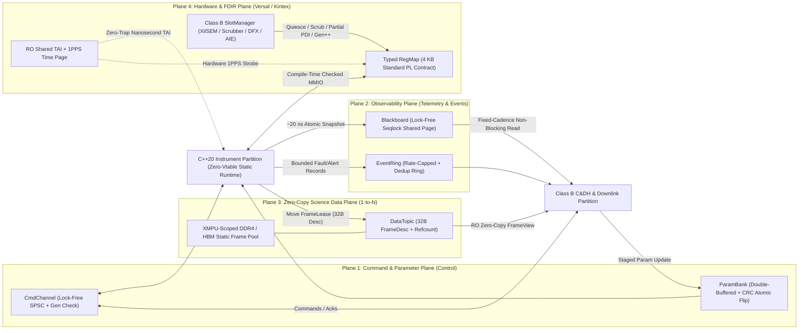

# STRATA-20: Flagship C++20 Bare-Metal Flight Instrument Middleware Architecture

> [!IMPORTANT]
> **Design Target**: A **super-flagship, heap-free, zero-vtable C++20 flight instrument middleware** engineered specifically to sit on top of a **custom bare-metal Type-1 hypervisor** sharing a **Versal** (`XQRVC1902` / `XQRVE2102`) or **Kintex** (`XQRKU060` / KU+) FPGA across **NASA Class B–D** instruments—supporting both concurrent spatial partitioning and dynamic DFX/AIE reconfiguration.
>
> Rather than patching a 2010s C++03/11 single-address-space RTOS framework, **STRATA-20** systematically eliminates every structural weakness of **JPL F' (F Prime)** while fusing the strongest battle-tested architectural ideas from **Oxide Hubris**, **seL4 Microkit**, **Eclipse `iceoryx2`**, **DLR Outpost**, **NASA cFS**, and **Coyote v2** into modern, statically verified **C++20**.

---

## 1. Surgical Breakdown: The 10 Structural Weaknesses of JPL F' — and How STRATA-20 Kills Each One

F' proved that strongly typed interfaces, static allocation, and generated ground dictionaries dramatically beat untyped C macro buses like cFS. Its pain points come from **older C++ idioms, a flat single-address-space RTOS assumption, and a heavy external DSL/inheritance model**.

| # | JPL F' Structural Weakness | Root Cause in F' Architecture | STRATA-20 C++20 Flagship Solution |
| :-: | :--- | :--- | :--- |
| **1** | **Cross-Partition Zero-Copy Breaks at `Svc::GenericHub`** | `Fw::Buffer` wraps a process-local `U8*`; `GenericHub` forbids pointers across address spaces and copies/serializes every payload. | **Move-only `FrameLease<T, Pool>`** carrying a 32-byte `FrameDesc` (`phys_addr`, `pool_slot_idx`, `tai_ns`, `gen`). Zero payload bytes copied across EL2/XMPU boundaries. |
| **2** | **Leak-Prone Manual Buffer Provenance (`Fw::Buffer` + `BufferContextTable`)** | `Fw::Buffer` is a mutable struct + untyped `U32 m_context`; routers (`FprimeRouter`) maintain mutex-guarded pointer lookup tables to return buffers. | **Linear RAII `FrameLease`** (`[[nodiscard]]`, non-copyable). Destructor auto-returns slot on scope exit; hardware **lease timeout + generation counter** reclaims leaked slots if a Class D guest crashes. |
| **3** | **1-to-1 Output Port Lock-In (The `TlmSplit` / `BufferRepeater` Tax)** | An F' output port connects to only **one** input port, forcing hand-written splitter components whenever multiple consumers need telemetry or frames. | **Compile-time 1-to-N `DataTopic<T, MaxSubs>`** with atomic pool refcounting. One PL DMA write fans out zero-copy Read-Only views to Recorder + ML Detector + Downlink simultaneously. |
| **4** | **Heavy External DSL (`FPP`) + Generated `*Ac` Inheritance Boilerplate** | Every component requires `.fpp` files, generated `*ComponentAc` base classes, CMake autocoder glue, and monolithic single-config builds (`default/config`). | **Pure C++20 `concepts` + `consteval` topology wiring**. Plain `struct` components (zero base classes); per-partition compile-time profiles; single `mission.toml` emits only cross-domain ICDs (XTCE, XMPU/NoC TCL, SV SCSR, hypervisor tables). |
| **5** | **Default Virtual Dispatch & Port Indirection** | F' OSAL uses placement-new virtual delegates (`Interface::getDelegate()`) and port-object wrappers unless manually overridden (`FW_DIRECT_PORT_CALLS`). | **100% static dispatch via C++20 `concepts` + templates**. Zero `virtual` functions on any hot path; compiler inlines intra-partition calls to single instructions and cross-partition calls to lock-free ring pushes. |
| **6** | **Thread-Per-Active-Component Bloat & Queue Serialization** | Stateful F' components become `Active` threads with serialized byte queues, wasting stacks, cache lines, and context switches inside bare-metal partitions. | **Zero-thread-explosion `PartitionRuntime`**: static unrolled cyclic `RateGroup`s + bounded lock-free event draining + explicit zero-alloc FSMs. No RTOS required inside guest partitions. |
| **7** | **Trust-Without-Boundaries Flat Address Space** | Encapsulation is by C++ convention inside one flat memory space; a runaway Class D component can corrupt buffers, starve queues, or stall `CmdDispatcher`. | **Hardware-enforced partition isolation** (EL2 Stage-2 MMU, XMPU/SMMU, NoC `EXCLUSIVE_ROUTING_GROUP`) + hypervisor doorbell token buckets + **Hubris-style generation-numbered restarts**. |
| **8** | **Push-Flood Telemetry & Event Storms (`TlmChan` / `ActiveLogger`)** | Components push serialized telemetry packets into central queues, risking queue overflow and priority inversion during anomalies. | **Decoupled Lock-Free Seqlock `Blackboard<HkT>`** (`iceoryx2` pattern) for HK + bounded per-partition **`EventRing`** with hardware/software rate-capping and deduplication. |
| **9** | **Static Compile-Time Topology vs. Dynamic DFX / AIE Silicon** | Component graphs are frozen at compile time; zero native concept of PL/AIE hot-swap, quiescing, scrubbing, or radiation upset recovery. | **First-class `SlotHandle<SlotSpec>`** & uniform FSM (`UNLOADED → LOADING → SBIT → STANDBY → ACTIVE → QUIESCING → FAULTED`) spanning static spatial, dynamic DFX, and AIE slots. |
| **10** | **Ad-Hoc Hardware Registers, DMA & Time Sync** | Raw MMIO pointers, DMA rings, and 1PPS timing live outside FPP in mission-specific glue code; `PrmDb` relies on string/ID runtime lookups. | **Typed `strata::mmio::RegMap`**, hardware-latched **`TaiTimestamp`** via Read-Only Shared Time Page, and atomic double-buffered **`ParamBank<ParamT>`** with CRC-validated staged commit/rollback. |

---

## 2. STRATA-20 System Architecture

STRATA-20 cleanly separates **four orthogonal planes**—so high-rate 20 Gbps sensor imagery, 10 Hz housekeeping, sporadic flight commands, and dynamic FPGA reconfiguration never contend with one another:



---

## 3. Deep Dive into the 7 Flagship C++20 Middleware Pillars

### Pillar 1: Pure C++20 `concepts` + `consteval` Wiring (Zero FPP, Zero Vtables)

Instead of writing `.fpp` files that generate hundreds of lines of `*ComponentAc.hpp` inheritance hierarchies, STRATA-20 uses **C++20 concepts** to define component contracts and **`consteval` topology validation** to bind components with **zero runtime overhead**.

* **No base class inheritance**: An instrument component is just a plain, cache-friendly C++20 `struct`.
* **Zero virtual tables**: All dispatch is resolved statically at compile time via templates and `if constexpr`.
* **Zero runtime registration**: Command IDs, telemetry blackboard offsets, parameter schemas, and rate-group members are resolved into **read-only `constexpr` jump tables** in Flash/ROM—immune to SEU function-pointer corruption in RAM!
* **Per-partition build profiles**: Class B partitions compile with ultra-strict `CLASS_B_PROFILE` (zero dynamic features, strict WCET caps, MC/DC instrumentation); Class D payloads compile independently against the same binary `strata_abi` wire contract.

#### Side-by-Side Comparison: Writing an Instrument Component (F' vs. STRATA-20)

In **F'**, adding a hyperspectral frame processor requires:
1. Defining ports, commands, telemetry, events, and parameters in `.fpp`
2. Running `fpp-to-cpp` to generate `*ComponentAc.hpp/.cpp`
3. Inheriting from `*ComponentBase`, implementing `*_handler()` virtual overrides
4. Manually wiring `BufferManager` + `GenericHub` + `TlmSplit` in topology `.fpp`
5. Writing raw pointer drivers for PL registers and DMA outside FPP

In **STRATA-20**, the entire component is clean, self-documenting, statically checked **C++20**:

```cpp
#include <strata/middleware.hpp>
#include <generated/hyperspec_icd.hpp> // Emitted from mission.toml (C++20 + SV + XTCE)

namespace mission {

struct HyperspecInstrument {
    // 1. Strongly typed hardware slot contract (generated from mission.toml)
    strata::SlotHandle<icd::HyperspecSlot> slot;

    // 2. Zero-copy 1-to-N output topic (Recorder + CloudML + Downlink)
    strata::DataPublisher<icd::HsiCube, icd::HsiPool>& cube_out;

    // 3. Lock-free Seqlock HK Blackboard & Double-Buffered Parameter Bank
    strata::BlackboardWriter<icd::HsiHk>& hk;
    strata::ParamReader<icd::HsiParams>&  params;
    strata::EventWriter<icd::HsiEvent>&   events;

    // Compile-time verified lifecycle hook (called when spatial/DFX slot passes SBIT)
    [[nodiscard]] strata::Status on_slot_ready(strata::GenId gen) noexcept {
        if (!slot.verify_manifest_hash(icd::kManifestHash)) {
            return strata::Status::ManifestMismatch;
        }
        const auto& cfg = params.active();
        slot.reg<icd::RegExposureUs>().write(cfg.exposure_us);
        slot.reg<icd::RegGainMode>().write(cfg.gain_mode);
        slot.command(strata::SlotCmd::StartActive);
        return strata::Status::Ok;
    }

    // Typed command handler (compile-time routed — zero virtual dispatch, zero switch boilerplate)
    [[nodiscard]] strata::CmdResult on_cmd(const icd::CmdSetExposure& cmd) noexcept {
        if (cmd.exposure_us < 100 || cmd.exposure_us > 50'000) {
            return strata::CmdResult::InvalidArg;
        }
        slot.reg<icd::RegExposureUs>().write(cmd.exposure_us);
        return strata::CmdResult::Ok;
    }

    // Deterministic 100 Hz Rate-Group Tick: reap hardware DMA -> 1-to-N zero-copy fan-out
    void step_100hz(strata::TaiTimestamp now) noexcept {
        // Bounded drain: max 4 frames per tick guarantees strict WCET
        for (uint32_t i = 0; i < 4; ++i) {
            auto lease = slot.try_reap_dma_frame(); // Returns std::optional<FrameLease<...>>
            if (!lease) break;

            // Zero payload copies: transfers ONLY the 32-byte descriptor to all N subscribers!
            // If publish() is not called, ~FrameLease() automatically returns the slot to PL DMA.
            if (auto st = cube_out.publish(std::move(*lease)); !st) {
                events.emit(icd::HsiEvent::TopicSaturated, now);
            }
        }
        slot.kick_watchdog();
    }

    // Deterministic 1 Hz Housekeeping Refresh (~20 ns Seqlock write, zero queues)
    void step_1hz(strata::TaiTimestamp now) noexcept {
        hk.publish(icd::HsiHk{
            .tai_ns         = now.ns(),
            .slot_state     = slot.state(),
            .fp_temp_mdeg   = slot.reg<icd::RegFocalPlaneTemp>().read(),
            .frames_dropped = cube_out.dropped_count(),
            .param_bank_ver = params.version(),
        });
    }
};

// Compile-time concept enforcement — build fails immediately with readable diagnostics if violated
static_assert(strata::InstrumentComponent<HyperspecInstrument>);

} // namespace mission
```

Look at what just disappeared compared to F':
* **Zero `.fpp` port boilerplate**
* **Zero generated `*ComponentAc` base classes**
* **Zero virtual functions**
* **Zero `Fw::Buffer` raw pointers or `BufferContextTable` hacks**
* **Zero `TlmSplit` / `BufferRepeater` components**
* **Zero payload `memcpy` across partitions**
* **Zero manual `*(volatile uint32_t*)` register hacks**

---

### Pillar 2: Linear Move-Only `FrameLease<T, Pool>` & Zero-Copy 1-to-N `DataTopic`

This is the heart of STRATA-20's data plane and its cleanest superiority over F', cFS, and OpenAMP.

#### How Ownership & Hardware Isolation Work Together
1. **Static XMPU / SMMU Pool Layout**: Every `DataPool` is a statically carved, 4 KB-aligned contiguous region in DDR4 or HBM split into `K` fixed-size slots (e.g., `64 × 4 MiB`).
   * The producing PL/AIE DMA engine's `SMID` (Versal) or AXI bridge (Kintex) gets **Write-Only / Read-Write** access solely to its assigned pool.
   * All subscriber partitions get **Stage-2 MMU / XMPU Read-Only** mappings to that pool. A buggy Class D ML payload **physically cannot corrupt** a frame being simultaneously read by the Class B Mass Memory Recorder.
2. **Move-Only Linear Type (`FrameLease`)**:
   ```cpp
   template <typename PayloadT, PoolConfig Pool>
   class [[nodiscard]] FrameLease {
   public:
       FrameLease(const FrameLease&) = delete;
       FrameLease& operator=(const FrameLease&) = delete;

       constexpr FrameLease(FrameLease&& other) noexcept
           : desc_(other.desc_), pool_(other.pool_), valid_(other.valid_) {
           other.valid_ = false;
       }

       ~FrameLease() noexcept {
           if (valid_) {
               pool_->release_slot(desc_.pool_slot_idx, desc_.producer_gen);
           }
       }

       [[nodiscard]] std::span<const std::byte> bytes() const noexcept;
       [[nodiscard]] const FrameDesc& desc() const noexcept { return desc_; }

   private:
       friend class DataPublisher<PayloadT, Pool>;
       FrameDesc    desc_{};
       PoolControl* pool_{nullptr};
       bool         valid_{false};
   };
   ```
3. **Zero-Copy 1-to-N Fan-Out with Atomic Refcount + Crash-Safe Lease Reclamation**:
   * Each slot in `PoolControl` has a cache-line-padded `SlotMeta`:
     * `std::atomic<uint16_t> refcount` (initialized to active subscriber count `N` on publish)
     * `uint16_t active_mask` (bitmask of which subscriber partitions currently hold a `ReadOnlyFrameView`)
     * `uint64_t lease_deadline_ns` (hard TAI deadline after which Class B FDIR or the producer may forcibly revoke a stalled Class D subscriber!)
   * On `cube_out.publish(std::move(lease))`:
     * Sets `refcount = N` and `active_mask`, pushes the **32-byte `FrameDesc`** into each subscriber's dedicated lock-free SPSC ring, and rings coalesced doorbells (`hyp_notify`) only for subscribers whose `notify_armed == 1`.
     * **Mixed-criticality guarantee**: Each subscriber ring has an explicit static policy in `mission.toml`:
       * Class B/C Recorder: `Policy::Guaranteed` (sized for worst-case burst; alerts FDIR if high-water mark > 80%).
       * Class D Onboard AI / Quick-Look: `Policy::BestEffortDropOldest` — if Class D stalls, it simply misses frames or loses its lease at `lease_deadline_ns` without ever blocking the PL DMA or Recorder!

---

### Pillar 3: Four Specialized Lock-Free Primitives (Replacing One Generic Bus)

| Primitive | Memory Mechanism | Synchronization | Worst-Case Cost | Fault Containment |
| :--- | :--- | :--- | :--- | :--- |
| **`CmdChannel<Variant>`** | Cache-line-isolated SPSC ring (`128B` hdr + fixed slots) | C++20 `std::atomic_ref` acquire/release + `hyp_notify` | ~80–150 ns (no trap if polling) | Generation check rejects stale peer; hypervisor token-bucket throttles doorbells |
| **`Blackboard<HkT>`** | Double-line Seqlock shared page (`RO` to reader, `RW` to writer) | Atomic `seq` counter (`even` = stable, `odd` = writing) | ~20 ns write; ~40 ns read | Zero queues; Class D cannot flood or block Class B telemetry collector |
| **`EventRing<EvtT, N>`** | Fixed power-of-2 SPSC ring + per-event-ID throttle table | Lock-free SPSC + local cooldown counter | ~60 ns emit | Compile-time severity filter & rate-cap stops anomaly event storms |
| **`ParamBank<ParamT>`** | Double-buffered `struct` (`bank[0]`, `bank[1]`) + `CRC-32C` | Atomic `active_idx` flip at minor-frame boundary | ~5 ns `active()` read | Atomic staged commit & instant rollback if validation/CRC fails |

#### Why `ParamBank<ParamT>` Crushes F' `Svc::PrmDb`
In F', updating instrument parameters involves serializing/deserializing individual `FwPrmIdType` entries through `PrmDb` ports, risking **torn multi-parameter updates** (e.g., changing a sensor's `exposure_us` before its matching `gain_table` takes effect). In STRATA-20, parameters are grouped into a versioned `ParamT` struct:
1. Ground/C&DH writes new parameters into the **inactive shadow bank** (`bank[1 - active]`).
2. `ParamBank` validates range constraints (`consteval`/compile-time bounds) and hardware `CRC-32C`.
3. On the next clean minor-frame boundary, `active_idx.store(next, std::memory_order_release)` flips the entire parameter set **atomically in one instruction**.

---

### Pillar 4: Zero-Thread-Explosion `PartitionRuntime` & Static Scheduling

Inside each hypervisor partition, STRATA-20 eliminates RTOS thread sprawl with a **compile-time-composed `PartitionRuntime`**:

```cpp
// Entire partition execution graph declared statically in C++20 — zero heap, zero RTOS threads!
using HsiPartitionApp = strata::PartitionRuntime<
    strata::Config{
        .partition_id   = icd::PartId::Hyperspec,
        .minor_frame_us = 10'000,   // 10 ms hypervisor minor frame
        .major_frame_us = 1'000'000 // 1 s major frame
    },
    strata::Components<
        mission::HyperspecInstrument,
        mission::ThermalCalibrator
    >,
    strata::Schedule<
        strata::RateGroup<100_Hz, &mission::HyperspecInstrument::step_100hz>,
        strata::RateGroup<10_Hz,  &mission::ThermalCalibrator::step_10hz>,
        strata::RateGroup<1_Hz,   &mission::HyperspecInstrument::step_1hz>
    >,
    strata::CommandRoutes<
        strata::Route<icd::CmdSetExposure, &mission::HyperspecInstrument::on_cmd>,
        strata::Route<icd::CmdSetTempPid,  &mission::ThermalCalibrator::on_cmd>
    >
>;
```

* **Zero indirect calls**: `PartitionRuntime::run()` compiles the `RateGroup` invocations into direct, sequential function calls and generates a flat `switch` on `cmd_id` for `CommandRoutes`.
* **Exact WCET accounting**: Every tick runs inside a bounded hypervisor minor frame, drains at most `K` commands and `M` DMA completions, refreshes `Blackboard`s, kicks the PL hardware watchdog, and calls `hyp_yield()`.
* **Escape Hatch for Complex Class D Payloads**: If a Class D autonomy/CV payload *wants* FreeRTOS/RTEMS threads internally, the STRATA-20 primitives (`CmdChannel`, `Blackboard`, `DataPublisher`, `FrameLease`) are purely lock-free C++20 headers that work identically inside an RTOS task or bare-metal loop.

---

### Pillar 5: Typed Hardware Registers (`RegMap`), Unified `SlotHandle` & DFX/AIE Hot-Swap

STRATA-20 treats **FPGA logic (static spatial, dynamic DFX, and Versal AIE)** as first-class middleware objects rather than external "black box" drivers:

```cpp
// Generated automatically into BOTH C++20 header AND SystemVerilog SCSR package!
namespace icd {
    using RegManifestLo = strata::mmio::Reg<0x004, strata::mmio::RO, uint32_t>;
    using RegSlotState  = strata::mmio::Reg<0x010, strata::mmio::RO, strata::SlotState>;
    using RegSlotCmd    = strata::mmio::Reg<0x014, strata::mmio::WO, strata::SlotCmd>;
    using RegFaultStat  = strata::mmio::Reg<0x018, strata::mmio::RW1C, uint32_t>;
    using RegExposureUs = strata::mmio::Reg<0x1000, strata::mmio::RW, uint32_t>;
}
```

* **Compile-Time Access Enforcement**: Trying to `.write()` an `RO` register or `.read()` a `WO` register is a **compile error**, not a flight bus fault. `RW1C` registers enforce write-1-to-clear semantics explicitly.
* **Uniform Spatial & DFX/AIE Lifecycle**:
  * **Spatial Slot**: Boots directly to `SBIT → STANDBY → ACTIVE`.
  * **Dynamic DFX Slot / Versal AIE Column**: Instrument requests a personality swap via a typed `CmdChannel` message to the **Class B `SlotManager`** (`fdir-slot-mgr`). `SlotManager` verifies authentication digest (RSA-4096 / SHA-384), drives `QUIESCING` (Versal `NoC INI` or Kintex `DFX AXI Shutdown Manager` + `DFX Decoupler`), loads partial PDI / DMA `ICAPE3` bitstream, releases decoupler, increments `slot_gen`, and triggers `on_slot_ready(new_gen)`.
* **Hardware Radiation Recovery Built-In**: When Versal PMC **XilSEM** or Kintex's external rad-hard scrubber flags an uncorrectable CRAM frame inside `Slot #1`, `SlotManager` maps the physical frame coordinate to `Slot #1`, notifies `on_slot_fault(SeuUncorrectable)`, force-decouples and reloads `Slot #1`, and restarts only `Slot #1`'s guest partition—leaving Class B C&DH and Spatial `Slot #0` untouched.

---

### Pillar 6: Single-Source-of-Truth Codegen Without DSL Lock-In

Why did FPP become painful for some teams, while hand-maintained C headers in cFS cause flight/ground ICD mismatches? Because **FPP tries to model *both* C++ class internals and cross-domain ICDs**.

STRATA-20 draws a razor-sharp boundary:
* **`mission.toml` (Tiny Declarative Manifest)** owns *only* the **cross-domain boundary**:
  1. Partition IDs, criticality classes, memory maps, XMPU/SMMU regions, and hypervisor time budgets.
  2. Hardware PL/AIE slot addresses, NoC routing groups, register maps, and authenticated bitstream digests.
  3. Wire message schemas (`Cmd*`, `Hk*`, `Evt*`, `Param*`, `Frame*`) with physical units, min/max engineering limits, and CCSDS APIDs.
* **`strata-gen`** reads `mission.toml` and emits **pure, read-only data/schema artifacts** (zero inheritance, zero hidden runtime logic):
  1. **C++20 `icd/*.hpp`**: `constexpr` constants, `static_assert`-checked `#[repr(C)]`-equivalent POD structs, and `mmio::Reg` definitions.
  2. **Hypervisor Static Tables & Linker Scripts**: `.ld` scripts + `constexpr` EL2 Stage-2 page tables & schedule tables.
  3. **Hardware Artifacts**: SystemVerilog `scsr_pkg.sv` + Vivado XMPU/NoC QoS TCL constraints.
  4. **Ground Dictionaries**: Standard **CCSDS XTCE** (directly ingestible by Yamcs, OpenMCT, COSMOS, or custom GDS) + optional CCSDS SEDS export.
* **C++20 owns all software logic & intra-partition wiring** via `concepts` and `consteval`. You can refactor internal C++20 components freely without regenerating or fighting a DSL!

---

### Pillar 7: Class B C++20 Safety Profile & Native Host/SIL/HIL Verification

To pass **NASA NPR 7150.2D Class B** and align with **MISRA C++:2023** (extended cleanly to C++20 with documented deviations where MISRA C++:2023 stops at C++17), STRATA-20 enforces a strict **Flight C++20 Profile**:

#### Compiler Baseline & Feature Policy
* **Mandatory Flags**: `-std=c++20 -fno-exceptions -fno-rtti -fno-threadsafe-statics -Wall -Wextra -Werror -Wconversion -Wshadow -Wnull-dereference -fstack-usage`
* **Static Stack Bound Proof**: Every partition's worst-case call-graph stack depth is statically checked in CI via `-fstack-usage` + call-graph analysis (zero recursion allowed).

| Category | C++20 Features | Flight Rationale |
| :--- | :--- | :--- |
| **Mandated / Core** | `concepts`, `consteval` / `constexpr`, `std::span`, `std::array`, `std::bit_cast`, `std::atomic_ref`, `[[nodiscard]]`, `[[no_unique_address]]`, `static_assert`, designated initializers, strong `enum class`, move-only RAII types, `strata::Expected<T, Err>` (zero-exception value error) | Eliminates raw pointers, macros, casts, vtables, and runtime config errors while producing optimal, deterministic bare-metal machine code. |
| **Restricted (Reviewed)** | Placement `new` (only inside static pool/ring init at boot), `reinterpret_cast` (isolated exclusively inside `strata::mmio` and `strata::shm` verified core) | Confines low-level hardware mapping to <500 audited lines of Class B core SDK. |
| **Strictly Banned** | `new` / `delete` / `malloc`, exceptions (`try`/`throw`), RTTI (`dynamic_cast`), `virtual` functions on hot paths, **C++20 coroutines (`co_await`)**, `<iostream>`, `<regex>`, `<thread>`, dynamic STL containers (`std::vector`, `std::string`, `std::map`), recursion | Guarantees 100% deterministic WCET, zero heap fragmentation, zero hidden HALO coroutine allocations, and clean MC/DC structural coverage. |

#### First-Class Host SIL + Verilator RTL Co-Simulation
Because every component programs against C++20 `concepts` (`SlotTransport`, `TimeSource`, `RingBackend`):
* **Host Unit & Integration Tests (x86_64/ARM64 Linux)**: Run an entire multi-partition spacecraft (Class B C&DH + FDIR + 3 Instruments) in a single deterministic C++20 test binary at **1,000× real-time** with scripted virtual TAI time, synthetic SEU injection, hung-partition fault injection, and deterministic ring replay!
* **RTL-in-the-Loop (Verilator)**: Swap `SlotHandle`'s MMIO backend to a Verilator AXI4-Lite/DMA driver to run **real flight C++20 instrument code directly against your real SystemVerilog SCSR & DMA RTL** in CI before touching hardware.

---

## 4. Capability Scorecard: STRATA-20 vs. JPL F' vs. cFS vs. Outpost

| Dimension | **STRATA-20 (C++20 Flagship)** | **JPL F' v4 (C++17 + FPP)** | **NASA cFS (C99)** | **DLR Outpost (C++17)** |
| :--- | :--- | :--- | :--- | :--- |
| **Cross-Partition Zero-Copy Data Plane** | **Native (`FrameLease` + 32B `FrameDesc` + XMPU)** | No (`GenericHub` copies payloads) | No (SB/SBN copies) | No (node-level serialization) |
| **1-to-N Zero-Copy Fan-Out** | **Native (`DataTopic` + atomic refcount)** | No (requires `TlmSplit` / `BufferRepeater`) | Copy-based SB pub/sub | Copy-based |
| **Compile-Time Safety & Ergonomics** | **Pure C++20 `concepts` + `consteval` (no DSL bloat)** | Strong via FPP, heavy `*Ac` inheritance | Weak (macros & `void*`) | Good C++, manual wiring |
| **Hot-Path Runtime Overhead** | **Zero vtables, zero heap, zero memcpy** | Virtual OSAL + queue serialization | ~82.5 µs task cycle + SB copy | Low (RTOS tasks) |
| **Per-Partition Mixed-Criticality Builds** | **Yes (independent profiles + ABI hash lock)** | No (single `default/config` per build) | Manual app tables | Manual |
| **Telemetry / Event Storm Immunity** | **Yes (Seqlock `Blackboard` + rate-capped `EventRing`)** | Vulnerable (pushed into central queues) | Vulnerable (SB pipe overflow) | Partial |
| **Atomic Parameter Bank Updates** | **Yes (double-buffered + CRC atomic flip)** | Per-parameter `PrmDb` lookup | Table-based (`cFE TBL`) | Manual |
| **FPGA Spatial + DFX / AIE First-Class Support** | **Yes (`SlotHandle` + SCSR + XilSEM/Scrubber FDIR)** | None | None | None |
| **Host SIL + Verilator RTL Co-Sim** | **Native (concept-swapped backends)** | Good host UT/SIL (no native RTL SCSR) | Medium (OSAL POSIX) | Good host UT |

---

## 5. Recommended Implementation Blueprint & Next Build Steps

If we build **STRATA-20** as a real, production-grade C++20 codebase, here is the exact minimal, auditable modular structure to stand up first:

```text
strata20/
├── cmake/
│   └── strata_safety_flags.cmake    # Enforces C++20 Class B profile + -fstack-usage checks
├── include/strata/
│   ├── core/
│   │   ├── status.hpp               # Status, Expected<T, E>, GenId, TaiTimestamp
│   │   ├── concepts.hpp             # InstrumentComponent, CommandHandler, SlotBackend
│   │   └── hypcall.hpp              # 8-call bare-metal EL2/R5F/MB ABI + host mock backend
│   ├── ipc/
│   │   ├── spsc_ring.hpp            # Cache-line-isolated lock-free SPSC ring (std::atomic_ref)
│   │   ├── blackboard.hpp           # Lock-free Seqlock BlackboardWriter / BlackboardReader
│   │   ├── event_ring.hpp           # Rate-capped, deduplicating bounded EventRing
│   │   └── param_bank.hpp           # Double-buffered CRC-32C atomic ParamBank
│   ├── data/
│   │   ├── frame_desc.hpp           # 32-byte hardware/DMA FrameDesc (static_assert == 32B)
│   │   ├── frame_lease.hpp          # Move-only [[nodiscard]] RAII FrameLease & ReadOnlyView
│   │   └── data_topic.hpp           # 1-to-N zero-copy DataTopic w/ atomic refcount & lease timeout
│   ├── hw/
│   │   ├── reg_map.hpp              # Compile-time RO/WO/RW/RW1C typed MMIO Reg<Offset, Access, T>
│   │   ├── scsr.hpp                 # Standard 4 KB SCSR layout & SlotState FSM
│   │   └── slot_handle.hpp          # Unified spatial + DFX + AIE SlotHandle<SlotSpec>
│   └── runtime/
│       └── partition_runtime.hpp    # Zero-thread-explosion cyclic RateGroups + static CmdRoutes
├── tools/strata-gen/                # Single-source-of-truth mission.toml -> C++20 + SV + TCL + XTCE
└── tests/
    ├── host_sil/                    # Multi-partition SIL tests + fault/SEU/storm injection suite
    └── verilator_hil/               # Flight C++20 Instrument running live against SystemVerilog SCSR
```

### Suggested Phased Build Order
1. **Milestone 1 — Header-Only `strata::core` + `strata::ipc` + `strata::data` (Weeks 1–2)**:
   Implement and unit-test `Expected`, `SpscRing`, `Blackboard`, `EventRing`, `ParamBank`, `FrameLease`, and `DataTopic` (1-to-N zero-copy fan-out + crash/lease-reclaim test) on Linux host with `-fno-exceptions -fno-rtti` and Sanitizers (ASan/TSan/UBSan).
2. **Milestone 2 — `strata::runtime` + `strata::hw` + `strata-gen` MVP (Weeks 3–4)**:
   Build `PartitionRuntime` (`RateGroup` + static `CommandRoutes`), typed `mmio::Reg`, `SlotHandle`, and `strata-gen` generating `icd/*.hpp`, `scsr_pkg.sv`, and CCSDS XTCE from one sample `mission.toml`.
3. **Milestone 3 — Bare-Metal Hypervisor Binding & Fault-Injection Harness (Weeks 5–8)**:
   Bind `hypcall.hpp` to your custom bare-metal hypervisor (ARMv8-A EL2 / Cortex-R5F / MicroBlaze), verify Class D storm & crash containment, and run live zero-copy DMA + DFX slot swaps on hardware.
