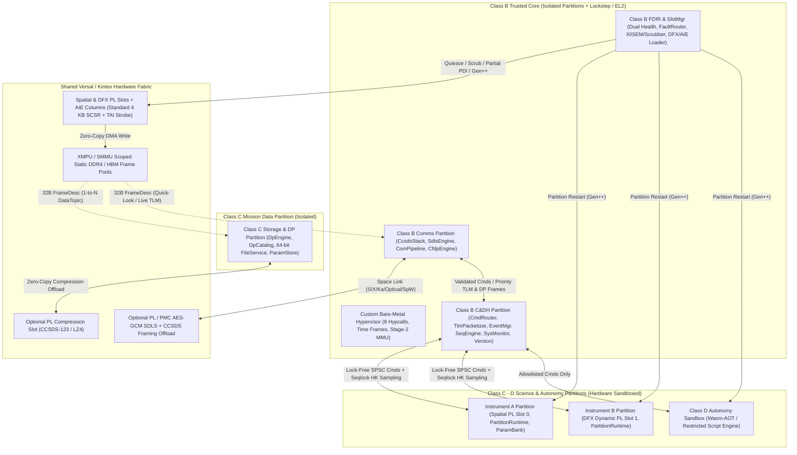

# STRATA-20: Complete JPL F' v4.x Feature Parity & Flagship C++20 Upgrade Specification

> [!IMPORTANT]
> **Purpose**: To be a true **super-flagship** replacement for JPL F' (F Prime v4.x) on a custom bare-metal hypervisor sharing a Versal (`XQRVC1902`/`XQRVE2102`) or Kintex (`XQRKU060`/KU+) FPGA, **STRATA-20** must not only beat F' on zero-copy FPGA data planes and mixed-criticality isolation—it must achieve **100% functional parity across every single F' v4.x capability domain** (`Fw`, `Os`, `Svc`, `Drv`, `ComCcsds`/`SDLS`, `DataProducts`, `CFDP`, `Sequencing`, `WasmSequencer`, `Subtopologies`, `STest`, and `GDS`), while fixing F''s structural and security weaknesses at the root.

---

## 1. Exhaustive 19-Domain F' v4.x → STRATA-20 Feature Parity Matrix

Every capability from the official F' v4.x System Functional catalog is mapped below to its STRATA-20 C++20 equivalent, exact architectural upgrade, and NASA Class B–D partition assignment.

| # | F' v4.x Capability Domain | F' Components / Modules | Key F' Limitation / Failure Mode | STRATA-20 C++20 Flagship Equivalent | Class / Partition |
| :-: | :--- | :--- | :--- | :--- | :---: |
| **1** | **Framework Core & State Machines** | `Fw` types, sync/guarded/async ports, passive/queued/active components, FPP State Machines, serialization | Generated `*Ac` inheritance bloat; virtual port wrappers; queue serialization copies; 1-to-1 output ports | Pure C++20 `concepts`, `consteval` static wiring, zero-alloc `strata::Fsm<States...>`, zero-vtable direct calls, 1-to-N fan-out | All (Header-only) |
| **2** | **OSAL / Platform Layer** | `Os::Task`, `Mutex`, `Queue`, `File`, `RawTime`, `Fw::MemAllocator` | Default link-time virtual dispatch (`Interface::getDelegate()`); assumes RTOS/POSIX threads | 8-call bare-metal `strata::hyp` ABI + `consteval` backend selection (EL2 / R5F / MicroBlaze / Host SIL); zero threads required | Class B Core |
| **3** | **Command Dispatch & Splitting** | `Svc::CmdDispatcher`, `Svc::CmdSplitter` | Runtime registration tables; central bottleneck; flat trust across components | Compile-time `consteval` `CmdRouter` (ROM jump tables) + `PartitionCmdBridge` over generation-checked SPSC rings; per-partition RBAC | Class B C&DH |
| **4** | **Dictionaries & Subtopologies** | FPP models, JSON/XML dicts, `CdhCore`, `ComCcsds`, `DataProducts`, `FileHandling` subtopologies | External FPP DSL lock-in; monolithic *"single config per build"* (`default/config`) | Single `mission.toml` emits C++20 ICDs + SV SCSR + Vivado XMPU TCL + **CCSDS XTCE** + optional F'-GDS JSON; C++20 template `Subtopology` bundles with per-partition profiles | Build-Time (`strata-gen`) |
| **5** | **Command Sequencing** | `Svc::CmdSequencer`, `Svc::SeqDispatcher` | File-system dependent; runs in same address space as critical C&DH | `strata::SeqEngine` (multi-slot concurrent absolute/relative TAI sequences, binary CRC-protected `.sseq` images, dry-run validator, safe-mode abort hook) | Class B/C C&DH |
| **6** | **Advanced Sequencing (Autonomy)** | `Svc::WasmSequencer` (WebAssembly sequences) | Running uploaded Wasm bytecode inside the flat flight process expands the Class B attack/fault surface | **`AutonomySandbox` Partition**: Runs Wasm-AOT / restricted eBPF / micro-Lua inside an **isolated Class C/D hypervisor partition** with strict CPU budget, XMPU wall, and command-allowlist filtering | Class C/D Isolated |
| **7** | **Telemetry (Channel & Packetized)** | `Svc::TlmChan`, `Svc::TlmPacketizer` | Push-flood queue contention; 1-to-1 ports (`TlmSplit` tax); runtime buffer-copy bugs (e.g., `CVE-2026-92159` fixed-slot overwrite) | Lock-free Seqlock `Blackboard<HkT>` (pull-sampled, storm-immune) + `consteval`-verified **`TlmPacketizer`** (`static_assert` exact byte layout—makes slot overwrites impossible) | Class B C&DH |
| **8** | **Event Management & Logging** | `Svc::EventManager` (`ActiveLogger`), `EventSeverityFilter`, `PassiveTextLogger` | Central active queue can drop/starve during anomaly floods; string formatting overhead on flight CPU | Per-partition bounded **`EventRing`** with compile-time severity filter + dedup cooldowns; binary event IDs on wire; optional compile-time UART/SWO `TextSink` | Class B C&DH + Guests |
| **9** | **Rate Groups & Phased Scheduling** | `RateGroupDriver`, `ActiveRateGroup`, `PassiveRateGroup`, `ActivePhaser` | Thread-per-active-rate-group overhead; `Os::RawTimeSource` clock-mismatch pitfalls | Hypervisor ARINC-653-style minor/major frame schedule + zero-thread unrolled **`RateGroup<Hz>`** & compile-time **`PhasedSchedule<Window...>`** locked to hardware TAI | Hypervisor + Guests |
| **10** | **Health Monitoring & Watchdogs** | `Svc::Health`, `Ping`, `WatchDog` | Soft RTOS ping/pong cannot stop a hung CPU loop or runaway DMA without hardware isolation | **Dual-Layer Health**: (1) Hypervisor enforces hard CPU budgets + heartbeat monitoring, (2) Per-slot hardware `SCSR.WDT_RELOAD` forces autonomous PL `STANDBY` if guest hangs | Class B FDIR + HW |
| **11** | **File Management & Transfer** | `FileUplink`, `FileDownlink`, `FileManager`, `Ccsds::CfdpManager` | `FileDownlink` capped at 4 GiB; `CfdpManager` 32-bit offsets; assumes POSIX filesystem | **64-bit `FileService`** + **`CfdpEngine` (Class 1 & 2)** over bare-metal block/NOR/NAND/NVMe flash FS with per-partition directory jail + authenticated DFX PDI/bitstream staging | Class B/C Storage |
| **12** | **Communications Stack** | `ComQueue`, `ComAggregator`, `ComRetry`, `ComSplitter`, `ComStub`, `FrameAccumulator`, `FprimeRouter`, `ComLoggerTee`/`Dp` | Multi-buffer copies along chain; `FprimeRouter` manual `BufferContextTable` pointer tracking | Zero-copy **`ComPipeline`** over `FrameLease`: priority-weighted `ComQueue`, zero-copy gather `ComAggregator` (idle-fill + spanning), `ComRetry`, hardware-DMA `ComTee` recorder | Class B/C Comms |
| **13** | **CCSDS Protocol & SDLS Security** | `ComCcsds`, `ComCcsdsSdls`, `SpacePacket*`, `TmFramer`, `TcDeframer`, `AesGcmEncryptor/Decryptor` | Untrusted wire-length `FW_ASSERT` DoS bugs (e.g., `CVE-2026-92151`); pure-CPU AES-GCM bottlenecks high-rate links | Total-function **`Expected<View, WireErr>`** CCSDS SPP/TC/TM/AOS/USLP parsers (zero asserts on wire input!) + **`SdlsEngine`** with pluggable PL/PMC hardware AES-GCM offload | Class B Comms + PL |
| **14** | **Data Products (Science & Diag)** | `Fw::Dp`, `DpManager`, `DpWriter`, `DpCatalog`, `DpCompressProc`/`DpZLibCompressor` | CPU-allocated `Fw::Buffer` copies; CPU-bound zlib compression chokes high-rate instruments | **Zero-Copy `DpEngine`**: `DpContainer` wraps `FrameLease` directly over DDR4/HBM pools; optional **PL FPGA compression slot** (CCSDS-123 / LZ4 / Zstd); crash-safe priority `DpCatalog` | Class C Storage + PL |
| **15** | **Buffer Management & Cross-Node Hub** | `Fw::Buffer`, `BufferManager`, `BufferRepeater`, `BufferLogger`, `Svc::GenericHub` | `GenericHub` copies across deployments; `Fw::Buffer` leaks on consumer crash; `BufferRepeater` boilerplate | Move-only **`FrameLease<T, Pool>`** + 1-to-N **`DataTopic`** (atomic refcount + lease timeout) + **`InterNodeBridge`** (SpaceWire/1553/Ethernet/PCIe DMA for multi-board systems) | Core SDK + Comms |
| **16** | **Parameter Management** | `Svc::PrmDb` | Per-parameter ID lookup/deserialization; risk of torn multi-parameter updates | Double-buffered, compile-time-typed **`ParamBank<ParamT>`** with `CRC-32C`, range validation, atomic minor-frame commit, rollback, and NV flash persistence | Class B/C + Guests |
| **17** | **Time Services** | `Svc::Time`, `ChronoTime`, `TimeConverter`, `Cycle` | Software time-port call overhead; clock skew across cores and FPGA fabric | **Zero-Trap RO Shared `TaiTimePage`** (updated by hardware 1PPS/TAI shell) + typed `TaiTimestamp`/`SclkTime` **`TimeConverter`** + hardware strobe to every PL `SCSR.TAI` | Static Shell + Core |
| **18** | **System Services** | `SystemResources`, `Version`, `AssertFatalAdapter`, `FatalHandler`, `PolyDb` | `FW_ASSERT` aborts whole flight process; untyped `PolyDb` runtime key-value bag | `SysMonitor` (CPU/RAM/NoC/SEU stats), `BuildManifest` (SW git + live PL `SCSR.MANIFEST_HASH` + active PDI digests), isolated **`FaultRouter`** (Class D assert restarts *only* Class D!), typed `Blackboard` views replacing `PolyDb` | Class B FDIR/Sys |
| **19** | **Testing, Build & Ground Data System** | `fprime-util`, `fppm`, GTest autocoded harnesses, `STest` rule-based testing, `fprime-gds` | Heavy Python/FPP/CMake coupling; no native RTL hardware co-simulation | CMake Presets + C++20 `strata-test` (concept-swapped mocks + **`RuleFuzzer`** matching `STest` + **Verilator RTL co-sim** + deterministic ring replay) + **XTCE (Yamcs/COSMOS/OpenMCT) + F'-GDS JSON bridge** | Host / CI / GDS |

---

## 2. Partition-Level Deployment Architecture (Class B Isolation)

Unlike F', where all 19 services share one process and one address space, STRATA-20 maps every service into **hardware-isolated hypervisor partitions** by NASA criticality class:



---

## 3. Deep Design of Every F'-Parity Subsystem in C++20

### 3.1 Core Framework, Static State Machines & Composable Subtopologies
* **Replacing FPP State Machines (`strata::Fsm`)**:
  F' v4 added state machine modeling inside FPP. STRATA-20 delivers the same formal state-transition discipline **directly in C++20 with zero external codegen** using a `constexpr` transition table (`strata::Fsm<StateEnum, EventVariant, TransitionTable>`):
  * Compile-time checks verify every state/event pair is explicitly handled or explicitly marked `Ignore` / `Fault`.
  * Entry/exit actions, guard predicates, and state-transition telemetry hooks (`Blackboard` auto-update on state change) execute with zero dynamic dispatch and O(1) deterministic latency.
* **Replacing F' `Svc.Subtopologies`**:
  In STRATA-20, reusable bundles like `CdhCore`, `ComCcsds`, `ComCcsdsSdls`, `DataProducts`, and `FileHandling` are **parameterized C++20 template bundles** (`strata::bundle::ComCcsds<ComCfg>`)—so two partitions in the *same* spacecraft build can instantiate the same bundle with completely different buffer counts, queue depths, and safety profiles (eliminating F' v4's monolithic *"one `default/config` per build"* constraint).

---

### 3.2 Command Dispatch, Sequencing & Safe Advanced Sequencing (Wasm)
* **`CmdRouter` & `PartitionCmdBridge`** (replaces `CmdDispatcher` + `CmdSplitter`):
  * `strata-gen` assigns every command a unique `(partition_id, local_opcode)` pair.
  * Class B `CmdRouter` checks ground authentication/SDLS status, verifies the target partition's command allowlist, stamps a monotonic `cmd_seq`, and drops the fixed-size command struct onto the target partition's lock-free `CmdChannel` SPSC ring.
  * Every command handler returns `strata::CmdResult` (`Ok`, `InvalidArg`, `Busy`, `Denied`, `SlotFaulted`)—enforced at compile time by `[[nodiscard]]` (in F', forgetting to call `cmdResponse_out()` silently hangs `CmdSequencer`!).
* **`SeqEngine`** (replaces `CmdSequencer` + `SeqDispatcher`):
  * Supports `M` concurrent sequence runners (`SeqSlot[0..M-1]`) executing compact, CRC-32C-verified binary `.sseq` files with absolute TAI time tags, relative deltas, conditional wait-on-telemetry-predicate checks (reading directly from `Blackboard`s!), and immediate abort on FDIR safe-mode entry.
* **`AutonomySandbox`** (replaces `Svc::WasmSequencer` safely):
  * F' v4's `WasmSequencer` is an exciting capability for onboard autonomy—but executing uploaded WebAssembly inside a flat Class B flight process is an assurance nightmare.
  * STRATA-20 runs uploaded autonomy modules (Wasm-AOT compiled via `wasm2c`/Cranelift or bounded bytecode) inside a **dedicated Class C/D hypervisor partition**:
    * **Hardware memory ceiling**: XMPU/Stage-2 MMU strictly traps any out-of-bounds access.
    * **Hardware CPU ceiling**: Hypervisor minor-frame budget preempts any infinite loop without needing software fuel-metering bugs.
    * **Read-only observability + gated actuation**: The sandbox reads instrument/bus `Blackboard`s Read-Only and submits commands solely through an allowlisted `CmdChannel` to Class B `CmdRouter` (which rejects forbidden safety-critical opcodes like pyros, thruster fire, or DFX flash unlock).

---

### 3.3 Telemetry (`Blackboard` + `TlmPacketizer`) & Events (`EventRing`)
* **Eliminating `CVE-2026-92159` by Construction**:
  In F' prior to v4.3.0, `Svc::TlmPacketizer::TlmRecv_handler` copied runtime serialized byte buffers (`val.getSize()`) into fixed packet slots without verifying bounds, corrupting adjacent telemetry fields.
  In STRATA-20, telemetry packet groups are **compile-time C++20 struct projections** over strongly typed `Blackboard` snapshots:

```cpp
// Compile-time verified CCSDS Telemetry Packet definition (zero runtime size mismatch possible)
template <uint16_t Apid, typename... Fields>
struct TlmPacketSchema {
    static constexpr uint16_t kApid = Apid;
    static constexpr size_t   kPayloadBytes = (sizeof(Fields) + ...);
    static_assert(kPayloadBytes <= strata::ccsds::kMaxSpacePacketPayload,
                  "Telemetry packet exceeds CCSDS Space Packet MTU!");
};

// Packetizer samples Seqlock Blackboards at fixed cadence (e.g., 1 Hz / 0.2 Hz)
// Zero incoming queues, zero dynamic byte-length copies, zero chance of adjacent-slot overwrite.
template <typename Schema, typename... BlackboardReaders>
class TlmPacketizer {
public:
    [[nodiscard]] strata::Expected<size_t, strata::Status>
    build_packet(std::span<std::byte> out_buf, strata::TaiTimestamp now) noexcept;
};
```

* **Event Management (`EventRing` + `SeverityFilter` + `TextSink`)**:
  * Preserves all F' event severities (`FATAL`, `WARNING_HI`, `WARNING_LO`, `ACTIVITY_HI`, `ACTIVITY_LO`, `COMMAND`, `DIAGNOSTIC`), per-severity runtime enable/disable masks, and per-event-ID throttle limits.
  * **Key upgrade**: Each partition owns a bounded local `EventRing` with **automatic burst deduplication** (collapsing repeated identical faults into `{event_id, first_tai, last_tai, repeat_count}`), preventing a noisy Class D instrument from flooding the Class B downlink or masking a Class B critical alert.

---

### 3.4 Data Products 2.0 (`DpEngine` + `DpCatalog` + Hardware PL Compression)

F''s Data Products (`Fw::Dp`, `DpManager`, `DpWriter`, `DpCatalog`, `DpZLibCompressor`) are one of its best modern features for science payloads—letting instruments stream structured records into prioritized containers persisted to non-volatile storage for later priority-ordered downlink.

**STRATA-20 keeps the exact operational model while eliminating its CPU-copy and compression bottlenecks**:
1. **Zero-Copy `DpContainer` over `FrameLease`**:
   Instead of `DpManager` allocating a CPU `Fw::Buffer` and copying science bytes into it, a `DpContainer<ContainerId>` wraps a **DDR4/HBM `FrameLease`** directly—meaning PL/AIE DMA writes raw science records straight into the container payload region, and the instrument partition only stamps the 64-byte `DpHeader` (`container_id`, `priority`, `tai_start`, `tai_end`, `record_count`, `crc32c`).
2. **Optional Hardware Compression Stage (`PL_COMP`)**:
   Instead of burning ARM A72/R5F cycles on `DpZLibCompressor`, `DpWriter` can optionally pass the 32-byte `FrameDesc` to a dedicated **PL FPGA Compression Slot** (e.g., CCSDS-123.0-B-2 lossless/near-lossless hyperspectral compressor, LZ4, or Zstd) which reads the DDR4 slot via NoC DMA and emits a compressed `FrameLease` directly to the NV storage DMA engine—**zero CPU payload touches from sensor to solid-state recorder!**
3. **Crash-Safe Priority `DpCatalog`**:
   Maintains a CRC-protected metadata index on NV storage (NOR/NAND/NVMe) supporting priority-sorted downlink (`SEND_CATALOG`, `DOWNLINK_BY_PRIORITY`, `DELETE_BY_ID`, `DELETE_OLDEST_LOW_PRIO`, `RESUME_PARTIAL`), and feeds directly into `CfdpEngine` or `ComPipeline`.

---

### 3.5 File Management, Sandboxed Transfers & 64-Bit CCSDS CFDP
* **Fixes F' 4 GiB Ceiling**: Uses 64-bit file sizes and offsets (`uint64_t`) throughout `FileService` and `CfdpEngine` (supporting multi-GB synthetic aperture radar / hyperspectral datasets and large Versal PDI images).
* **Dual-Protocol Support**:
  * **CCSDS CFDP (`CfdpEngine`)**: Full Class 1 (unacknowledged) and Class 2 (acknowledged NAK/retransmit, suspend/resume, checkpointing) for deep-space/intermittent links.
  * **Lightweight Fast File Protocol (`FastFileTx/Rx`)**: Minimal framing for benchtop FlatSat / high-SNR links (matching F' `FileUplink`/`FileDownlink` convenience).
* **Strict Partition Sandboxing & Authenticated Bitstream Staging**:
  * Every partition is jailed to its own logical volume/quota (`MissionVol`, `InstAVol`, `DfxStagingVol`).
  * Files uplinked to `DfxStagingVol` (partial PDIs, bitstreams, new parameter banks, or autonomy modules) require **SHA-384 + RSA-4096 / ECDSA-P384 verification** by Class B `SlotManager` before they are ever marked executable or loadable.

---

### 3.6 Communications Stack, CCSDS & SDLS Security
* **Total-Function Wire Parsers (Eliminating `CVE-2026-92151` Forever)**:
  F' prior to v4.2.0 crashed its own flight software process (`FW_ASSERT`) when `SpacePacketDeframer` received a malformed telecommand frame ≤ 6 bytes after TC header stripping.
  STRATA-20 enforces a **Zero-Assert-On-External-Input** rule across the entire `Comms` partition: every framer/deframer is a pure, fuzz-tested total function returning `strata::Expected<ParsedFrame, WireErr>` using bounds-checked `std::span<const std::byte>`:

```cpp
[[nodiscard]] constexpr strata::Expected<SpacePacketView, WireErr>
parse_space_packet(std::span<const std::byte> raw) noexcept {
    if (raw.size() < kPrimaryHeaderBytes) {
        return strata::Unexpected(WireErr::TruncatedHeader);
    }
    const uint16_t data_len = read_be16(raw.subspan<4, 2>()) + 1U;
    if (raw.size() < kPrimaryHeaderBytes + data_len) {
        return strata::Unexpected(WireErr::LengthMismatch);
    }
    return SpacePacketView{
        .apid    = static_cast<uint16_t>(read_be16(raw.subspan<0, 2>()) & 0x07FFU),
        .seq     = static_cast<uint16_t>(read_be16(raw.subspan<2, 2>()) & 0x3FFFU),
        .payload = raw.subspan(kPrimaryHeaderBytes, data_len),
    };
}
```

* **Full CCSDS Stack Parity + Hardware Offload**:
  * **Uplink**: `FrameAccumulator` → `TcDeframer` / `UslpDeframer` → `SdlsDecryptor` (AES-GCM-256 auth + anti-replay window) → `SpacePacketDeframer` → `CmdRouter` / `CfdpEngine`.
  * **Downlink**: Priority-weighted `ComQueue` (real-time critical HK > events > command acks > CFDP > bulk Data Products) → `SpacePacketFramer` → zero-copy scatter-gather `ComAggregator` (idle-packet fill + packet spanning) → `SdlsEncryptor` → `TmFramer` / `AosFramer` / `UslpFramer` → `ComTee` (optional zero-copy flight recorder tap) → Link DMA.
  * **Hardware Crypto/Framing Hook**: On Versal, `SdlsEngine` can bind to PMC AES-GCM hardware or a static PL crypto/LDPC/RS framing engine via the exact same `CryptoBackend` C++20 concept.

---

### 3.7 Health Monitoring, Watchdogs & System Services
* **Dual-Layer Health (`HealthMonitor`)**:
  Replaces F''s `Svc::Health` ping table with two hardware-enforced tiers:
  1. **Hypervisor & Heartbeat Layer**: Every partition updates a monotonic `heartbeat_counter` in its `Blackboard` each major frame; Class B FDIR checks liveness without sending intrusive ping messages. If a partition overruns its minor-frame CPU slice, the hypervisor immediately preempts it and logs a `BudgetOverrun` fault record.
  2. **Hardware PL Watchdog Layer**: Every PL slot implements `SCSR.WDT_RELOAD`; if a guest partition stops kicking its slot, the FPGA logic autonomously quiesces DMA and enters safe `STANDBY` within microseconds.
* **Isolated `FaultRouter` (Replacing `AssertFatalAdapter` + `FatalHandler`)**:
  In F', `FW_ASSERT` inside any component routes through `AssertFatalAdapter` → `FatalHandler` and reboots the entire flight computer.
  In STRATA-20:
  * An assertion or memory fault inside a **Class C/D partition** triggers `hyp_fault_report()` (or an EL2 abort trap), which notifies Class B `FaultRouter`. `FaultRouter` captures a compact crash dump (`PC`, `LR`, `ESR`, `FAR`, `part_gen`), emits a `FATAL` event, quiesces that partition's PL slot, and **restarts only that partition** (incrementing `part_gen`).
  * Only an unrecoverable fault inside the **Class B TCB** escalates to spacecraft-level safe-mode / cold reboot via the external rad-hard watchdog.
* **Hardware-Aware `Version` & `SysResources`**:
  * `BuildManifest` reports firmware git SHA, compiler version, `MANIFEST_HASH`, **and live hardware identity** read from every PL slot (`SCSR.MAGIC_VER`, `SCSR.MANIFEST_HASH`, active DFX personality ID, Versal DNA / XilSEM status).
  * `SysMonitor` publishes CPU headroom per partition, hypervisor frame jitter max/min, DDR pool high-water marks, NoC QoS stalls, and XilSEM/scrubber corrected/uncorrectable SEU counts directly into a Class B `Blackboard`.
* **Replacing `Svc::PolyDb`**:
  Instead of an untyped runtime key-value bag (`Fw::PolyType`), cross-component shared state (e.g., GNC attitude quaternion, ephemeris, spacecraft mode, thermal state) is published as **strongly typed, versioned `Blackboard<NavState>` / `Blackboard<ThermalState>` pages**—zero runtime type mismatches, zero locks, and hardware Read-Only enforcement for science consumers.

---

### 3.8 Developer Experience, Testing (`STest` Parity) & Ground Data System (GDS)

A huge reason teams adopt F' is its **out-of-the-box testability and GDS**. STRATA-20 treats testing and ground integration as first-class citizens:

| F' Developer Tooling | STRATA-20 Equivalent | Why It's Better |
| :--- | :--- | :--- |
| **Autocoded GTest Component Harnesses** | **Concept-Swapped `strata::testing::Harness<Component>`** | Zero autocoding step required—instantiate any C++20 component directly with `MockSlot`, `MockClock`, `MockRing`, and `MockPool` in standard GoogleTest / Catch2. |
| **`STest` Rule-Based Random Testing** | **`strata::testing::RuleEngine` (Deterministic Seeded Fuzz + Property Testing)** | Define preconditions/actions/invariants in C++20; runs millions of seeded random command, DMA, DFX-swap, and SEU fault sequences with 100% deterministic reproducer seeds. |
| **No Native RTL Co-Simulation** | **Verilator `VerilatorSlotBackend`** | Drop-in replacement for `MockSlot` that compiles your real SystemVerilog `SCSR` + DMA RTL and executes your real flight C++20 instrument against it in CI! |
| **No Flight-Replay Recording** | **Deterministic Ring & Blackboard Shadow Capture** | Optional compile-time tap records exact sequences of incoming descriptors, commands, and TAI timestamps so any FlatSat or on-orbit anomaly replays bit-for-bit on a laptop. |
| **`fprime-gds` Ground Data System** | **Standard CCSDS XTCE + Yamcs / OpenMCT / COSMOS + F'-GDS JSON Bridge** | Emits industry-standard **CCSDS XTCE** natively (plug-and-play with **Yamcs**, **Ball COSMOS**, and **NASA OpenMCT**), PLUS an optional F'-compatible JSON dictionary exporter if your ops team already uses `fprime-gds`! |

---

## 4. Complete Class B vs. C/D Footprint & Verification Budget

A core promise of STRATA-20 is delivering **100% of F' v4.x's mission capabilities while shrinking the NASA Class B Trusted Computing Base (TCB)** so formal verification and MC/DC testing remain affordable:

| Subsystem Group | Target Assurance Class | Est. C++20 LOC | Static RAM Footprint (Base) | Key Hardware Isolation Barrier |
| :--- | :---: | :---: | :---: | :--- |
| Custom Bare-Metal Hypervisor + 8-Hypcall ABI | **Class B** | ~2,500 – 4,000 | ~64 KB (incl. Stage-2 tables) | EL2 / R5F MPU / Lockstep |
| `strata::core` + `ipc` + `data` + `runtime` SDK | **Class B** | ~1,800 – 2,500 | Header-only (0 global heap) | `consteval` + `-fstack-usage` |
| Class B C&DH (`CmdRouter`, `TlmPacketizer`, `EventMgr`, `SeqEngine`, `SysMonitor`, `Version`) | **Class B** | ~3,500 – 5,000 | ~48 KB | Dedicated Partition + RO Blackboards |
| Class B Comms (`CcsdsStack`, `SdlsEngine`, `ComPipeline`) | **Class B** | ~3,000 – 4,500 | ~64 KB + TX/RX rings | Total-function parsers + XMPU |
| Class B FDIR & `SlotManager` (Health, `FaultRouter`, XilSEM/Scrubber, DFX/AIE Loader) | **Class B** | ~2,500 – 3,500 | ~32 KB | PMC PLM / External Rad-Hard Supervisor |
| Class C Storage (`DpEngine`, `DpCatalog`, `CfdpEngine`, 64-bit `FileService`) | **Class C** | ~4,000 – 6,000 | ~128 KB + DDR pools | Dedicated Partition + XMPU RO Views |
| Class C/D Science Instruments & `AutonomySandbox` (Wasm/Script) | **Class C / D** | Mission-specific | Per-partition static allocation | Full EL2 + XMPU + NoC `EXCLUSIVE_ROUTING_GROUP` + SCSR WDT |
| **Total Class B Core Software TCB** | **Class B** | **~13 – 19.5 KSLOC** | **~208 KB Static** | **Hardware-enforced fault containment** |

> [!TIP]
> **Why This Numbers Table Matters at PDR/CDR**:
> Instead of certifying 80,000–150,000+ lines of monolithic flight software + RTOS + autocoded FPP glue + third-party science drivers at **NASA Class B**, STRATA-20 delivers **every single F' v4.x capability** while confining your Class B verification scope to **~13–19.5 KSLOC of zero-heap, zero-vtable, zero-exception C++20**.
