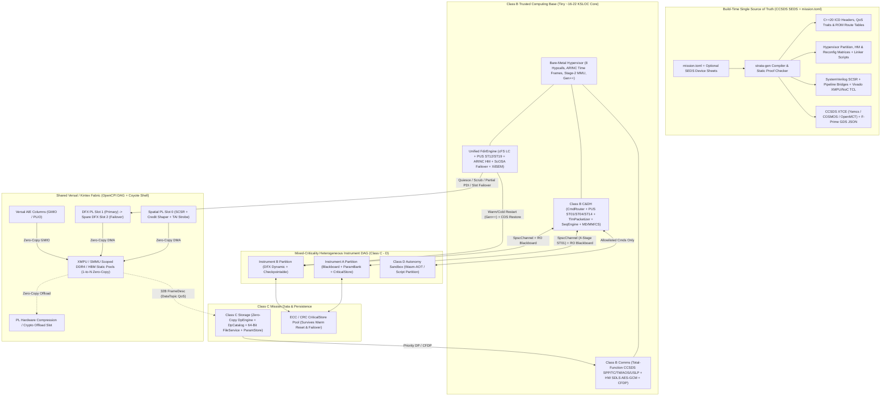

# STRATA-20 Unified Super-Flagship Blueprint: Synthesizing the Best of All Spaceflight, Avionics & FPGA Middlewares in C++20

> [!IMPORTANT]
> **The Design Philosophy — Unification Without Bloat**:
> Building a "super-flagship" middleware does **not** mean bolting 11 frameworks together into a 300 KSLOC monster. Every major spaceflight, avionics, and bare-metal system solved 1–2 hard problems brilliantly while carrying legacy baggage everywhere else.
>
> **STRATA-20** extracts the **single strongest, flight-proven superpower from 11 ecosystems** and collapses overlapping concepts into just **6 orthogonal, zero-heap, zero-vtable C++20 primitives** + **5 isolated mission services**—delivering a superset of **JPL F'**, **NASA cFS**, **ESA PUS-C**, **ARINC 653**, **DLR ScOSA**, **DDS**, and **OpenCPI** inside a **~16–22 KSLOC NASA Class B Trusted Computing Base (TCB)**.

---

## 1. The Grand Unification: How 11 Middlewares Collapse into 6 Orthogonal Primitives

Notice how seemingly different abstractions across the aerospace industry are actually the **same underlying pattern** implemented with incompatible tradeoffs. STRATA-20 unifies them cleanly:

| Unified STRATA-20 C++20 Primitive | Legacy Abstractions It Replaces & Unifies | Net Architectural Win |
| :--- | :--- | :--- |
| **1. `Blackboard<T, QoS>`** *(Seqlock Shared Page)* | ARINC 653 **Sampling Port** + `iceoryx2` **Blackboard** + DDS **`TransientLocal` / `Deadline`** + F' **`TlmChan` & `PolyDb`** + PUS **`ST[03]`/`ST[04]`** | One ~20 ns lock-free primitive handles HK telemetry, shared GNC/ephemeris state, instant post-restart catch-up, and onboard min/max/mean statistics—with zero queues and zero storm risk. |
| **2. `SpscChannel<T, QoS>`** *(Lock-Free Ring + Doorbell)* | ARINC 653 **Queuing Port** + F' **Async Ports** + cFS **Software Bus** + OpenAMP **RPMsg vring** + Hubris **Generation Checks** | One cache-line-aligned zero-copy control transport with compile-time QoS (`Deadline`, `DropOldest`/`Guaranteed`), hypervisor doorbell rate-limiting, and stale-generation rejection. |
| **3. `DataTopic<T, Pool, QoS>` + `FrameLease`** *(32B Descriptor + XMPU Pool)* | F' **`Fw::Buffer` / `GenericHub` / `BufferRepeater` / `DpManager`** + `iceoryx2` **Zero-Copy Pub/Sub** + OpenCPI **HDL/RCC Streams** + Coyote v2 **vFPGA DMA Rings** | One true zero-copy 1-to-N data plane uniting CPU partitions, static spatial PL slots, dynamic DFX slots, AIE columns, PL compressors, and solid-state recorders. |
| **4. `ParamBank<T>`** *(Double-Buffered CRC Table)* | cFS **`cFE TBL`** + F' **`PrmDb`** + PUS **`ST[20]`** | Hot-uploadable binary configuration tables (gain LUTs, FDIR limits, telemetry maps) validated via CRC-32C and flipped atomically on a minor-frame boundary—zero torn updates. |
| **5. `CriticalStore<T>`** *(Persistent CRC State Block)* | cFS **Critical Data Store (`CDS`)** + DLR ScOSA **Task Checkpointing** | ECC/CRC-protected RAM/OCM/NVRAM block per partition that survives warm resets, SEU partition restarts, and cross-slot failover in <2 ms. |
| **6. `SlotHandle<Spec>` + `RegMap`** *(Unified HW/DFX/AIE Contract)* | OpenCPI **HDL Workers** + Coyote v2 **vFPGA Shell** + AMD **XRT / `dfx-mgr`** + CCSDS **SEDS Register Sheets** | First-class compile-time-safe MMIO + unified lifecycle (`UNLOADED → LOADING → SBIT → STANDBY → ACTIVE → QUIESCING → FAULTED`) for spatial PL, DFX PL, and Versal AIE columns. |

---

## 2. DNA Provenance Matrix: What We Steal vs. What We Leave Behind

| # | Source Middleware / Standard | Signature Superpower Extracted into STRATA-20 | Legacy Baggage Explicitly Rejected |
| :-: | :--- | :--- | :--- |
| **1** | **JPL F' (F Prime v4.x)** | Strongly typed interfaces, Data Products (`DpCatalog`), CCSDS + SDLS framing, CFDP, Sequencing, `ActivePhaser`, `STest` rule-based testing, flight/ground dictionary lock-step | External FPP DSL & `*Ac` inheritance, `GenericHub` copy wall, `Fw::Buffer` leaks, 1-to-1 `TlmSplit` tax, default vtables, thread-per-active-component, monolithic single-config builds |
| **2** | **NASA cFS (Class A)** | **Critical Data Store (`CDS`)**, **Limit Checker (`LC`)** watchpoints/actionpoints, hot-swappable binary **Tables (`TBL`)**, **Memory Dwell (`MD`)**, **Memory Manager (`MM`)**, background **SW Checksum (`CS`)** | Flat single-address-space C89/C99 bus, copy-centric `CFE_SB` latency blow-up, weak macro typing, >100 KB static base overhead |
| **3** | **ESA ECSS PUS-C (`70-41C`) & CORDET-C2 / FSFW** | **4-Stage Command Verification (`ST[01]`)** (*Accept → Start → Progress → Complete*), **On-Board Parameter Statistics (`ST[04]`)**, **On-Board Monitoring (`ST[12]`) + Event-Action Autonomy (`ST[19]`)**, **Forwarding Control (`ST[14]`)** | Heavy XML/manual PUS packet boilerplate, rigid ESA-only wire lock-in (STRATA-20 supports native CCSDS SPP, PUS-C framing, or F'-GDS bridge selectable per mission) |
| **4** | **ARINC 653 (IMA Avionics)** | Strict **Time & Space Partitioning**, **Sampling vs. Queuing Port** semantics, multi-level **Health Monitoring (HM) Recovery Tables**, explicit Partition Modes (`COLD → WARM → NORMAL → IDLE`) | Heavyweight commercial RTOS licensing, legacy C APEX API verbosity, lack of FPGA/NoC/DFX primitives |
| **5** | **DDS / Space ROS / Zenoh** | **Declarative QoS Contracts**: `Deadline` (miss detection), `Liveliness` (staleness), `History::KeepLast<N>`, `Reliability::Guaranteed \| BestEffortDropOldest`, `Durability::TransientLocal` | Dynamic RTPS discovery storms, heap allocations, heavy C++ serialization, Linux/POSIX assumptions |
| **6** | **Oxide Hubris** | **Generation Counters** on every partition & slot (kills stale-handle races), **Crash-Revocable Memory Leases**, **Supervisor Outside the Kernel**, zero runtime task creation | 32-bit MCU-only focus (STRATA-20 scales across A72 EL2, Lockstep R5F, MicroBlaze, PL, and AIE) |
| **7** | **seL4 Microkit** | Ultra-minimalist **3-object static model** (Partitions, Memory Regions, Channels) and tiny auditable **8-hypcall** ABI | Manual C boilerplate without higher-level flight services (STRATA-20 adds full flight middleware above the tiny ABI) |
| **8** | **Eclipse `iceoryx2`** | **Decentralized Brokerless** lock-free shared memory, Seqlock **Blackboard**, 1-to-N zero-copy loan/publish pools | POSIX OS shared-memory filesystem setup (replaced by static physical/XMPU maps in `mission.toml`) |
| **9** | **DLR ScOSA & Outpost** | **Hybrid Rad-Hard Supervisor (RCN) + High-Perf Reconfigurable Node (HPN)** failover: pre-verified **Offline Reconfig Matrices** + **Checkpoint Migration** across redundant cores/DFX slots | SpaceWire-only inter-node message copying (upgraded to NoC/DDR zero-copy on-chip + SpaceWire/SpaceFibre/Optical off-chip) |
| **10** | **OpenCPI & Coyote v2** | **Unified CPU ↔ PL ↔ AIE Worker Pipeline DAG** (OpenCPI) + **Standard vFPGA Shell (`SCSR`) & Hardware Credit-Based Fair Sharing** (Coyote v2) | OpenCPI's heavy Linux/XML runtime; Coyote's PCIe cloud-host assumptions |
| **11** | **CCSDS SOIS / SEDS & XTCE** | Build-time **Electronic Data Sheets**: engineering units, nonlinear calibration curves, bit-exact register/packet layouts shared across RTL, C++20, and Ground | Heavy runtime SOIS subnetwork abstraction layers |

---

## 3. Unified STRATA-20 Super-Flagship System Architecture



---

## 4. Deep Dive: The 7 Superpowers Added Beyond F' Parity

### 4.1 `CriticalStore<T>` — Sub-2 ms Recovery Across Warm Resets & Failover *(cFS `CDS` + DLR ScOSA)*

F' has no native warm-reset persistent RAM store; when a component or deployment restarts after an SEU, volatile state is lost unless manually written to slow flash files. STRATA-20 adopts cFS's **Critical Data Store (`CDS`)** and pairs it with DLR ScOSA's **state checkpointing**:

* Each partition is granted a statically sized, ECC-backed OCM/SRAM or battery/FRAM-backed **`CriticalStore<StateT>`** region mapped outside its normal `.bss` (so a partition restart zeroes `.bss`/stack while preserving `CriticalStore`).
* Every checkpoint uses **ping-pong double buffering + `CRC-32C` + `MANIFEST_HASH`** (`slot[0]` and `slot[1]` alternating), guaranteeing crash-atomic checkpoints even if an SEU hits mid-write.
* **Warm Restart Flow (< 2 ms)**:
  1. Class D Instrument suffers an SEU trap or stack overflow.
  2. Hypervisor scrubs its stack/BSS, increments `part_gen`, and restarts it in `PartitionMode::WarmStart`.
  3. On boot, `cds.restore()` validates CRC-32C + schema version and immediately resumes with its active calibration epoch, scan-line counter, thermal PID integrator, and sequence state intact!
* **Hardware Failover Flow (DLR ScOSA pattern)**: If PL `Slot 1` suffers a permanent hard fault, Class B `FdirEngine` loads Instrument B's partial PDI into spare `DFX Slot 2`, remaps `CriticalStore<InstBState>` to the standby partition/slot, and resumes mission science with zero manual ground intervention.

---

### 4.2 Unified Autonomous `FdirEngine` *(cFS `LC` + PUS `ST[12]`/`ST[19]` + ARINC 653 HM + ScOSA + XilSEM)*

Instead of scattering fault detection across ad-hoc component `if`-statements, STRATA-20 implements one table-driven, **uploadable (via `ParamBank`) Class B FDIR Engine**:

1. **Watchpoints (`ST[12]` / cFS `LC` WP)**: Evaluates deterministic threshold, delta, stale-timestamp (`Deadline`), and expected-value checks directly against any partition's Seqlock `Blackboard` (e.g., `HsiHk.fp_temp_mdeg > 295'000` or `Slot1.seu_uncorr_cnt > 0`) with configurable **persistence/debounce counts** (`N` consecutive ticks).
2. **Actionpoints (`ST[19]` / cFS `LC` AP)**: Evaluates bounded Reverse-Polish / boolean combinations of Watchpoints (`WP_OVERTEMP && WP_OVERCURRENT`) and triggers an explicit **Recovery Action** without requiring ground contact.
3. **ARINC 653 Multi-Level Recovery Escalation Ladder**:
   * *Level 0 (Local)*: Emit `WARNING_HI` event, log telemetry snapshot, throttle instrument cadence.
   * *Level 1 (Partition Warm Restart)*: `hyp_part_ctl(part_id, WARM_RESTART)` + `CriticalStore` restore.
   * *Level 2 (PL/AIE Surgical Scrub)*: `SCSR.QUIESCE` → NoC INI / DFX Decoupler → authenticated partial PDI / AIE column reload → `SBIT`.
   * *Level 3 (ScOSA Redundant Failover)*: Consult pre-verified **Offline Reconfiguration Matrix** (`mission.toml`) → disable damaged `Slot 1` permanently, load Instrument B personality onto spare `Slot 2` (or shed lower-priority Class D payload to preserve Class B/C).
   * *Level 4 (System Safe Mode)*: Triggered *only* by Class B TCB or spacecraft bus faults → quiesce all Class C/D slots, power-gate non-essential PL regions, enter minimal beacon mode.

---

### 4.3 Operational Maturity from ESA PUS-C *(ST[01] 4-Stage Ack, ST[04] On-Board Stats, ST[14] Forwarding)*

* **4-Stage Command Verification (`ST[01]`)**:
  F' only emits a single final `CmdResponse` (`OK`/`EXECUTION_ERROR`). For multi-second FPGA instrument operations (e.g., *cool focal plane → load DFX calibration bitstream → run 10 s dark-frame SBIT → switch to science mode*), ground operators are blind until timeout.
  STRATA-20's `CmdHandle` natively emits optional 4-stage verification packets:
  1. `Accepted` (Class B `CmdRouter` passed SDLS + schema + RBAC)
  2. `Started` (Target instrument partition began execution)
  3. `Progress(step, pct)` (Optional bounded progress milestones)
  4. `Completed(CmdResult)` (Final status + optional return code)
* **Zero-Copy On-Board Parameter Statistics (`ST[04]`)**:
  A lightweight Class B `StatsCollector` samples selected `Blackboard` fields at high rate (e.g., 100 Hz power/thermal/jitter) using Welford's online algorithm (zero buffers, O(1) RAM) and downlinks compact `{min, max, mean, variance, sample_count}` packets every 60 seconds—catching transient micro-glitches while cutting telemetry bandwidth by >50×.
* **Dynamic Telemetry Forwarding Control (`ST[14]`)**:
  Ground or `SeqEngine` can independently switch any APID / Event severity / DP priority between `LIVE_RF`, `STORE_ONLY`, `LIVE_AND_STORE`, or `MUTED` depending on contact window and link margin.

---

### 4.4 Compile-Time Static DDS QoS Contracts *(Zero Discovery, Zero Heap)*

DDS's *declarative Quality-of-Service* semantics are genuinely superior to raw queues—its only flaw is its bloated dynamic RTPS runtime. STRATA-20 compiles DDS QoS contracts directly into **zero-overhead C++20 template policies**:

```cpp
// Every Blackboard, SpscChannel, and DataTopic carries an explicit compile-time QoS contract!
using NavStateQoS = strata::QoS<
    strata::Durability::TransientLocal,        // Restarted guests immediately read last valid GNC state
    strata::Deadline<20_ms>,                   // Flags StaleData if GNC hasn't refreshed within 20 ms
    strata::Liveliness::Automatic<100_ms>      // Escalates to FdirEngine if producer heartbeat stops
>;

using ScienceTopicQoS = strata::QoS<
    strata::Reliability::BestEffortDropOldest, // Class D subscriber never back-pressures PL DMA
    strata::History::KeepLast<8>,              // Static ring depth = 8 descriptors
    strata::LeaseTimeout<50_ms>                // Reclaims DDR4 slot if Class D hangs > 50 ms
>;

// Reader automatically checks hardware TAI freshness on every ~40 ns lock-free Seqlock read:
auto nav = nav_bb.read(now);
if (!nav) {
    // Handles QoS::DeadlineMissed or QoS::NoDataYet explicitly — impossible to consume stale attitude!
}
```

---

### 4.5 On-Orbit Flight Introspection & Software Scrubbing *(cFS `MD`, `MM`, `CS`)*

When an anomaly happens 1 million km from Earth, engineers need surgical diagnostic visibility without reflashing the entire spacecraft:
* **`MemDwell` (cFS `MD`)**: Table-driven diagnostic sampler that reads up to `N` authorized memory addresses or PL `SCSR`/instrument registers per cycle into a diagnostic telemetry packet—strictly bounded by a compile-time **XMPU Read-Allowlist** so operators cannot trigger bus aborts on unmapped/write-only addresses.
* **`MemPatch` (cFS `MM`)**: Authenticated, CRC-verified surgical peek/poke/load for authorized RAM tables or debug registers (requires SDLS auth + explicit Class B arm/execute two-step command).
* **`SwChecksum` (cFS `CS`)**: Low-priority background scrubber running in hypervisor slack time that continuously verifies `CRC-32C` / `SHA-256` across immutable `.text`, `.rodata`, hypervisor tables, and ROM `CmdRouter` jump tables—complementing Versal **PMC XilSEM** / Kintex **external CRAM scrubbing** to detect bit-flips in software instruction caches/SRAM/DDR!

---

### 4.6 Unified Heterogeneous CPU ↔ PL ↔ AIE Pipeline DAG *(OpenCPI + Coyote v2, Zero Linux)*

OpenCPI's killer vision was letting mission teams compose an instrument pipeline across **CPU + FPGA + DSP** uniformly—without hand-wiring every DMA and adapter. STRATA-20 achieves that exact capability **purely at build time** via `mission.toml` + `strata-gen`:

```toml
# mission.toml excerpt: Heterogeneous Hyperspectral Pipeline (PL -> AIE -> PL -> Class C Storage)
[pipelines.hyperspec_science]
stages = [
  { id = "fe_capture",   kind = "PL_SPATIAL", slot = 0, out_pool = "hsi_raw_pool" },
  { id = "aie_denoise",  kind = "VERSAL_AIE", cols = [4, 5], in_pool = "hsi_raw_pool", out_pool = "hsi_clean_pool" },
  { id = "pl_ccsds123",  kind = "PL_DFX",     slot = 1, in_pool = "hsi_clean_pool", out_pool = "hsi_comp_pool" },
  { id = "dp_recorder",  kind = "SW_PART",    part = "storage_c", in_topic = "hsi_comp_topic" },
  { id = "cloud_ml",     kind = "SW_PART",    part = "autonomy_d", in_topic = "hsi_clean_topic", qos = "BEST_EFFORT_DROP" },
]
```

From that 6-line DAG, `strata-gen` automatically generates:
1. **Hardware connectivity**: NoC routing groups (`CRITICAL_EXCL` vs. `SCIENCE_BEST_EFFORT`), Coyote-style hardware credit budgets, XMPU/SMMU `SMID` read/write masks per pool, and SystemVerilog `SCSR` + DMA ring base addresses.
2. **Software connectivity**: Zero-copy `DataTopic` 1-to-N descriptor rings so `dp_recorder` (Class C, guaranteed) and `cloud_ml` (Class D, best-effort drop) both consume zero-copy Read-Only `FrameLease` views without copying a single pixel on the ARM cores!
3. **Host SIL Digital Twin**: Generates a single-process C++20 software pipeline where `fe_capture`, `aie_denoise`, and `pl_ccsds123` can each be swapped independently between C++ behavioral models, Verilator RTL simulations, or real silicon!

---

### 4.7 Concrete C++20 Showcase: Unified Primitives Working Together

```cpp
// Example: Instrument using CriticalStore (cFS CDS), 4-Stage PUS ST[01] Ack,
// Static DDS QoS Blackboard, and Unified SlotHandle (Spatial / DFX / AIE)
struct SarInstrument {
    strata::SlotHandle<icd::SarDfxSlot>                  slot;
    strata::BlackboardReader<icd::NavState, NavStateQoS> nav_bb;
    strata::BlackboardWriter<icd::SarHk>                 hk_bb;
    strata::CriticalStore<icd::SarCheckpoint>&           cds;
    strata::DataPublisher<icd::SarFrame, icd::SarPool>&  frame_out;

    void on_boot(strata::PartitionMode mode, strata::TaiTimestamp now) noexcept {
        if (mode == strata::PartitionMode::WarmStart) {
            if (auto saved = cds.restore(); saved) {
                state_ = *saved; // < 2 ms recovery after SEU restart or slot failover!
                return;
            }
        }
        state_ = icd::SarCheckpoint{};
    }

    // 4-Stage PUS ST[01] Progress Command for Long-Running DFX Mode Swap
    [[nodiscard]] strata::CmdResult on_cmd(const icd::CmdSwitchSarMode& cmd,
                                           strata::CmdProgress& progress) noexcept {
        progress.report_started();
        if (auto nav = nav_bb.read(strata::now()); !nav) {
            return strata::CmdResult::PreconditionFailed; // DDS Deadline QoS prevented stale-nav imaging!
        }
        progress.report_step(1, 50); // 50%: Requesting Class B SlotManager DFX personality swap
        // ... asynchronous state machine completes swap and calls progress.report_completed(Ok)
        state_.active_mode = cmd.target_mode;
        cds.checkpoint(state_);      // Atomic ping-pong CRC-32C save
        return strata::CmdResult::InProgress;
    }

private:
    icd::SarCheckpoint state_{};
};
```

---

## 5. Ultimate Ecosystem Scorecard

| Capability | **STRATA-20 (Unified Flagship)** | **JPL F' v4** | **NASA cFS** | **ESA PUS / TASTE** | **ARINC 653 IMA** | **DLR ScOSA** | **OpenCPI** | **Space ROS / DDS** |
| :--- | :---: | :---: | :---: | :---: | :---: | :---: | :---: | :---: |
| **Bare-Metal Custom Hypervisor Native** | **Full** | Partial | No | Partial | OS-bound | Partial | No | No |
| **100% F' v4 Mission Services (DP, CFDP, SDLS, Seq, GDS)** | **Full** | **Full** | Partial | Partial | No | Partial | No | Partial |
| **Zero-Copy 1-to-N Cross-Partition FPGA/AIE Data Plane** | **Full** | No | No | No | No | No | Partial | Linux only |
| **Concurrent Spatial + Dynamic DFX / AIE Failover** | **Full** | No | No | No | No | Node-level | Partial | No |
| **cFS-Class Ops (`CDS`, `TBL`, `LC`, `MD`, `MM`, `CS`)** | **Full** | Partial | **Full** | Partial | No | Checkpoints | No | No |
| **PUS-C Ops (`ST[01]` 4-Stage, `ST[04]` Stats, `ST[12/19]` FDIR)** | **Full** | Partial | Partial | **Full** | No | Partial | No | No |
| **Compile-Time DDS QoS (`Deadline`, `Liveliness`, `TransientLocal`)** | **Full** | No | No | No | Sampling only | No | No | **Full** (heavy) |
| **Mixed-Criticality Isolation (Class B + C/D, Gen# Restart)** | **Full** | No | Weak | Partial | **Full** | **Full** | No | Weak |
| **C++20 Zero-Vtable / Zero-Heap / Zero-DSL Ergonomics** | **Full** | No (FPP) | No (C99) | No (AADL) | No (C) | C++17 | No (XML) | No (Heap) |
| **Host SIL + `STest` Rule Fuzzing + Verilator RTL Co-Sim** | **Full** | SIL + `STest` | SIL | Partial | Vendor sim | HIL | Sim | Gazebo |

---

## 6. Class B TCB Budget Check (Keeping the Super-Flagship Lean)

Because all 11 middlewares were unified into **6 orthogonal primitives**, adding cFS (`CDS`, `LC`, `MD`/`MM`/`CS`), PUS-C (`ST[01]`/`ST[04]`/`ST[12]`/`ST[14]`/`ST[19]`), ARINC 653 HM, DDS static QoS, DLR ScOSA failover, and OpenCPI/Coyote heterogeneous DAGs adds **only ~3 KSLOC** to the Class B TCB:

| Partition / Layer | Assurance Class | Est. C++20 LOC | Base Static RAM |
| :--- | :---: | :---: | :---: |
| Custom Bare-Metal Hypervisor (8 hypcalls, ARINC frames, Stage-2 MMU, Gen#) | **Class B** | ~2,500 – 4,000 | ~64 KB |
| `strata` Header-Only 6-Primitive SDK (`Blackboard`, `SpscChannel`, `DataTopic`/`FrameLease`, `ParamBank`, `CriticalStore`, `SlotHandle`/`RegMap`, `Fsm`, `QoS`) | **Class B** | ~2,500 – 3,500 | Header-only (0 heap) |
| Class B C&DH (`CmdRouter` + `ST[01]`, `TlmPacketizer` + `ST[04]`/`ST[14]`, `EventMgr`, `SeqEngine`, `MD`/`MM`/`CS`, `SysMonitor`/`Version`) | **Class B** | ~4,500 – 6,000 | ~64 KB |
| Class B Comms (Total-Function CCSDS SPP/TC/TM/AOS/USLP, `SdlsEngine`, `ComPipeline`) | **Class B** | ~3,000 – 4,500 | ~64 KB |
| Class B Unified `FdirEngine` & `SlotManager` (`LC`/`ST[12]`/`ST[19]`, ARINC HM, ScOSA Failover, XilSEM/Scrubber, DFX/AIE Loader) | **Class B** | ~3,500 – 4,500 | ~48 KB |
| **Total Class B Trusted Computing Base** | **Class B** | **~16 – 22.5 KSLOC** | **~240 KB Static** |
| Class C Storage (`DpEngine`, `DpCatalog`, 64-Bit `CfdpEngine` + `FileService`) | **Class C** | ~4,000 – 6,000 | ~128 KB + DDR pools |
| Class C/D Science Instruments & `AutonomySandbox` (Wasm-AOT) | **Class C / D** | Mission-specific | Hardware isolated |
